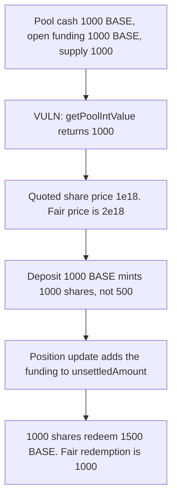

# ELFI: pool value ignores open funding

> **Vulnerability classes:** vuln/logic/fee-calculation · vuln/logic/price-calculation · vuln/defi/sandwich-attack

> **Reproduction:** local synthetic. `getPoolIntValue` is the audited sum. No fork and no warp.

<!-- non-defihacklabs -->
<!-- source-auditvault: https://github.com/Auditware/AuditVault/blob/main/findings/34765-h-3-pool-value-does-not-consider-the-open-funding-fees-sherl.md -->
<!-- date: 2024-05 -->

## Key info

| | |
|---|---|
| **Protocol** | ELFI |
| **Finding** | Sherlock H-3, AuditVault 34765 |
| **Vulnerable code** | `LpPoolQueryProcess.getPoolIntValue` |
| **Harm** | Quoted share price is 1e18. Fair price is 2e18. A 1000 BASE deposit withdraws 1500 BASE. The fair withdrawal is 1000 BASE. |
| **Chain** | local synthetic |

## TL;DR

The pool holds 1000 BASE and is already owed 1000 BASE of open funding. `getPoolIntValue` sums `amount + unsettledAmount + unPnl` and leaves the open funding out, so the share price is 1e18 instead of 2e18. A deposit of 1000 BASE mints 1000 shares instead of 500. When the position update writes the funding into `unsettledAmount`, those shares redeem 1500 BASE. The fair redemption is 1000 BASE. The depositor's profit is 500 BASE, taken from the existing LPs. The control adds `openFundingFee` to the sum. The same deposit mints 500 shares and withdraws 1000 BASE.

## The vulnerable code

```solidity
if (pool.baseTokenBalance.amount > 0 || pool.baseTokenBalance.unsettledAmount > 0) {
    int256 unPnl = getMarketUnPnl(pool.symbol, oracles, true, pool.baseToken, true);
    int256 baseTokenPrice = OracleProcess.getIntOraclePrices(oracles, pool.baseToken, true);
    // @> VULN: openFundingFee is not in the sum, so the share price is 1e18 instead of 2e18
    value = tokenToUsdInt((amount + unsettledAmount + unPnl), 18, baseTokenPrice);
}
```

The report's expression is `(amount + unsettledAmount + unPnl)` converted to USD. Funding is only copied into `unsettledAmount` when a position is updated. Until then the share price is low, and after the update it jumps with no change in supply.

## Root cause

Open funding is a pool receivable that `getPoolIntValue` does not count. Mint and redeem both divide by that value. A depositor who arrives before the position update is given too many shares for the true value, then redeems them after the update at the spiked value.

## Preconditions

One pool, base price 1, no unsettled amount, no unrealised PnL. Cash is 1000 BASE. Open funding owed to the pool is 1000 BASE. Stake-token supply is 1000 shares, all held by an existing LP. The depositor has 1000 BASE. The position update that realizes the funding happens after the deposit and before the withdrawal. `run()` does not warp.

## Attack walkthrough

1. `sharePrice` calls `getPoolIntValue`. The sum is 1000. Quoted price is 1e18. Fair price is `(1000 + 1000) / 1000 = 2e18`.
2. Deposit 1000 BASE. Shares minted = `1000 * 1000 / 1000 = 1000`. Fair mint = `1000 * 1000 / 2000 = 500`.
3. The position update sets `unsettledAmount` to 1000 and delivers those tokens to the pool. Cash plus unsettled is now 3000. Supply is 2000.
4. Withdraw 1000 shares. Assets out = `1000 * 3000 / 2000 = 1500`.
5. Fair withdrawal of the 500 shares on a supply of 1500 is `500 * 3000 / 1500 = 1000`.

The control's `getPoolIntValue` adds `openFundingFee`. Price is 2e18, the deposit mints 500 shares, and the withdrawal returns 1000 BASE.

## Diagrams



## Impact

The depositor puts in 1000 BASE and takes out 1500 BASE. The extra 500 BASE is the existing LP's share of funding that was not in the price. The quoted share price was 1e18 and the fair price was 2e18. The same gap works in the other direction for a redeemer who exits before a funding payment the pool owes: the quoted value is too high and they take too much cash. This case is the receivable side, and the withdrawal is too high.

## Remediation

Add the net open funding fee, across open positions, to `getPoolIntValue` before shares are minted or redeemed. Do not wait for a position update to copy it into `unsettledAmount`.

## How to reproduce

```bash
cd 34765-h-3-pool-value-does-not-consider-the-open-funding-fees-sherl_exp
forge test -vv
```

The forge log shows `quoted price: 1000000000000000000`, `fair price: 2000000000000000000`, `withdrawn: 1500000000000000000000`, `fair withdraw: 1000000000000000000000`. The control withdraws `1000000000000000000000`.

## Sources

- AuditVault finding: https://github.com/Auditware/AuditVault/blob/main/findings/34765-h-3-pool-value-does-not-consider-the-open-funding-fees-sherl.md
- Sherlock judging: https://github.com/sherlock-audit/2024-05-elfi-protocol-judging/issues/33
- Reviewed tree: https://github.com/sherlock-audit/2024-05-elfi-protocol/blob/8a1a01804a7de7f73a04d794bf6b8104528681ad/elfi-perp-contracts/contracts/process/LpPoolQueryProcess.sol
