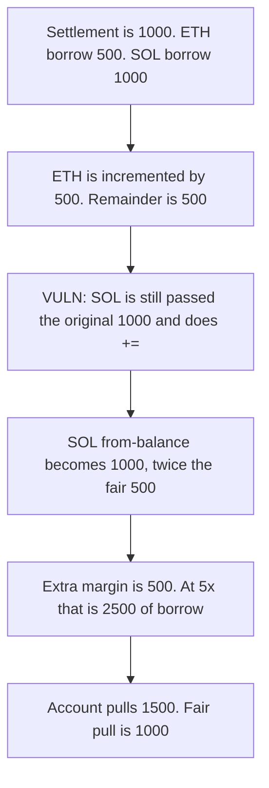

# ELFI: from-balance is incremented instead of set to the remainder

> **Vulnerability classes:** vuln/logic/state-update · vuln/logic/incorrect-state-transition · vuln/logic/missing-check

> **Reproduction:** local synthetic. The audited `+=` and the call that still passes `amount` are in the playground. No fork and no warp.

<!-- non-defihacklabs -->
<!-- source-auditvault: https://github.com/Auditware/AuditVault/blob/main/findings/34766-h-4-updateallpositionfrombalancemargin-function-mistakenly-i.md -->
<!-- date: 2024-05 -->

## Key info

| | |
|---|---|
| **Protocol** | ELFI |
| **Finding** | Sherlock H-4, AuditVault 34766 |
| **Vulnerable code** | `PositionMarginProcess.updateAllPositionFromBalanceMargin` |
| **Harm** | SOL from-balance becomes 1000, twice the fair 500. 500 extra margin is pulled. At 5x that is 2500 of borrowing power. |
| **Chain** | local synthetic |

## TL;DR

A cross-margin close settles 1000 USDC of margin back onto the account's other positions. ETH needs 500. SOL needs 1000. The loop subtracts what each position consumed from `reduceAmount`, but it still calls `updatePositionFromBalanceMargin` with the original `amount`, and that function does `+=`. ETH is incremented by 500. SOL is incremented by the original 1000, so its from-balance is 1000 instead of the 500 that was left. The account pulls 1500. The settlement was 1000. The extra 500 comes out of other liquidity. The control passes the remaining budget and sets the from-balance. SOL is 500 and the pull is 1000.

## The vulnerable code

```solidity
int256 changeAmount = int256(
    updatePositionFromBalanceMargin(
        keys[i],
        originPositionKey.length > 0 && originPositionKey == position.key,
        amount
    )
);
reduceAmount = amount > 0 ? reduceAmount - changeAmount : reduceAmount + changeAmount;

// @> VULN: from-balance is incremented by the original amount. SOL becomes 1000, twice the 500 it should be set to
position.initialMarginInUsdFromBalance +=
    changeAmount * position.initialMarginInUsd / position.initialMargin;
```

The report's fix is to pass `reduceAmount` into `updatePositionFromBalanceMargin` instead of `amount`. The control also sets the from-balance from that remaining budget instead of adding the original amount on top.

## Root cause

`reduceAmount` is only used to decide when to stop the loop. It is not the input to the per-position credit. Each position therefore sizes its `+=` off the full settlement, capped only by its own borrow. Once the first position takes a slice, every later position is still incremented as if the whole settlement were still available.

## Preconditions

Two remaining cross positions share the margin token. ETH: initial margin 500, from-balance 0, borrow 500. SOL: initial margin 1000, from-balance 0, borrow 1000. The closed position's settlement is 1000 and its key is not one of these two. The margin contract holds 1500 USDC: the 1000 settlement plus 500 of other liquidity, which is what the extra credit pulls. `run()` does not warp.

## Attack walkthrough

1. `updateAllPositionFromBalanceMargin(1000)` starts with `reduceAmount = 1000`.
2. ETH is called with `amount = 1000`. Borrow caps the change at 500. `from-balance += 500`. `reduceAmount` becomes 500.
3. SOL is called with `amount = 1000` again, not 500. Borrow is 1000, so the change is 1000. `from-balance += 1000`.
4. SOL's size is 1000. The fair size is the leftover 500. 1000 is 2x 500. Extra margin is 500. At 5x leverage that is 2500 of borrowing power.
5. The account pulls ETH 500 + SOL 1000 = 1500. The fair pull is 1000.

The control passes `reduceAmount`. ETH is set to 500, then the budget is 500, and SOL is set to 500. The pull is 1000 and 500 stays in the contract.

## Diagrams



## Impact

SOL's balance-backed margin is 1000 instead of 500. The account withdraws 1500 USDC against a 1000 settlement. The other 500 is liquidity that was not part of this close. The same 500, treated as initial margin at 5x, supports 2500 of extra position notional. The control sets SOL to 500 and pays only the 1000 settlement.

## Remediation

Pass `reduceAmount` into `updatePositionFromBalanceMargin`, and write the position's from-balance from that remaining budget. Do not increment it by a change computed from the original settlement.

## How to reproduce

```bash
cd 34766-h-4-updateallpositionfrombalancemargin-function-mistakenly-i_exp
forge test -vv
```

The forge log shows `SOL size: 1000000000000000000000`, `fair SOL: 500000000000000000000`, `extra margin: 500000000000000000000`, `withdrawn: 1500000000000000000000`. The control pays `1000000000000000000000` and sets SOL to `500000000000000000000`.

## Sources

- AuditVault finding: https://github.com/Auditware/AuditVault/blob/main/findings/34766-h-4-updateallpositionfrombalancemargin-function-mistakenly-i.md
- Sherlock judging: https://github.com/sherlock-audit/2024-05-elfi-protocol-judging/issues/35
- Reviewed tree: https://github.com/sherlock-audit/2024-05-elfi-protocol/blob/8a1a01804a7de7f73a04d794bf6b8104528681ad/elfi-perp-contracts/contracts/process/PositionMarginProcess.sol
