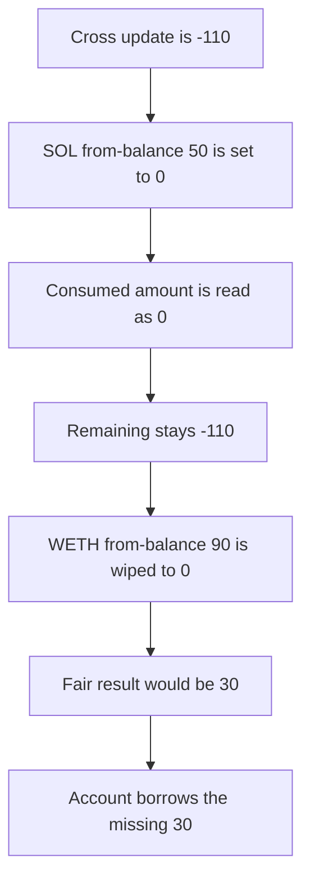

# ELFi: a -110 margin update leaves WETH at 0 instead of 30

> **Vulnerability classes:** vuln/logic/incorrect-order-of-operations · vuln/logic/liquidation-logic

<!-- non-defihacklabs -->
<!-- source-auditvault: https://github.com/Auditware/AuditVault/blob/main/findings/34767-h-5-updatepositionfrombalancemargin-function-returns-0-if-am.md -->
<!-- date: 2024-05 -->

## Key info

| | |
|---|---|
| **Protocol** | ELFi |
| **Finding** | Sherlock 2024-05-elfi-protocol H-5, AuditVault 34767 |
| **Vulnerable code** | `PositionMarginProcess.updatePositionFromBalanceMargin` |
| **Harm** | WETH from-balance ends at 0 instead of 30. The account borrows that 30. The control leaves 30 and borrows 0 |
| **Chain** | local synthetic |

## TL;DR

When the cross-margin change is negative and larger than a position's from-balance, the code sets `initialMarginInUsdFromBalance` to 0 and then computes the consumed token amount from that storage. The amount is 0. SOL's 50 is not subtracted from the -110, so WETH receives the whole -110 and its 90 is wiped. Fair ordering consumes 50 from SOL first, leaves -60, and WETH keeps 30. The missing 30 is borrowed.

## The vulnerable code

```solidity
if (position.initialMarginInUsdFromBalance <= addBorrowMarginInUsd) {
    position.initialMarginInUsdFromBalance = 0;
    // @> VULN: change amount is read after the storage was set to 0
    lastChange = position.initialMarginInUsdFromBalance * position.initialMargin / position.initialMarginInUsd;
}
```

SOL: margin 100, from-balance USD 50. The update is -110. `addBorrow` is 110. 50 <= 110, so from-balance becomes 0 and `lastChange` is 0. Remaining stays -110.

WETH: margin 100, from-balance USD 90. `addBorrow` is still 110. 90 <= 110, so WETH is also set to 0. It should have been decreased by 60 and left at 30.

The control computes `consumed` before the store:

```solidity
uint256 consumed = position.initialMarginInUsdFromBalance * position.initialMargin / position.initialMarginInUsd;
position.initialMarginInUsdFromBalance = 0;
```

SOL consumes 50. Remaining is -60. WETH's from-balance becomes 30. `borrowShortfall` transfers nothing.

## Root cause

The amount consumed from this position is derived from the same storage slot the previous line just cleared.

## Preconditions

Two cross positions. SOL from-balance USD is 50. WETH from-balance USD is 90. Both notionals are 100. The settled change is -110. No price update and no time change. This is not the `updateAllPositionFromBalanceMargin` bug.

## Attack walkthrough

1. The book is funded with 30, the amount fair accounting would retain. See [output.txt](output.txt).
2. `update(-110)` runs the buggy branch on SOL. `lastChange` is 0.
3. WETH is wiped. `wethLeft` is 0.
4. `borrowShortfall` sends 30 to the account.
5. The control's `updateFair(-110)` leaves WETH at 30 and borrows 0.

## Diagrams



## Impact

WETH's from-balance is 0 rather than 30. The account's margin is 30 too low, and it borrows that 30. The control keeps the 30 inside the book.

## Remediation

Read `initialMarginInUsdFromBalance * initialMargin / initialMarginInUsd` into the consumed amount before assigning 0.

## How to reproduce

```bash
cd 34767-h-5-updatepositionfrombalancemargin-function-returns-0-if-am_exp
forge test -vv
```

## Sources

- AuditVault finding: https://github.com/Auditware/AuditVault/blob/main/findings/34767-h-5-updatepositionfrombalancemargin-function-returns-0-if-am.md
- Sherlock issue: https://github.com/sherlock-audit/2024-05-elfi-protocol-judging/issues/36
- Function: https://github.com/sherlock-audit/2024-05-elfi-protocol/blob/8a1a01804a7de7f73a04d794bf6b8104528681ad/elfi-perp-contracts/contracts/process/PositionMarginProcess.sol#L274-L338
- Repo: sherlock-audit/2024-05-elfi-protocol@8a1a01804a7de7f73a04d794bf6b8104528681ad
- Synthetic: [test/34767-h-5-updatepositionfrombalancemargin-function-returns-0-if-am.sol](test/34767-h-5-updatepositionfrombalancemargin-function-returns-0-if-am.sol)
