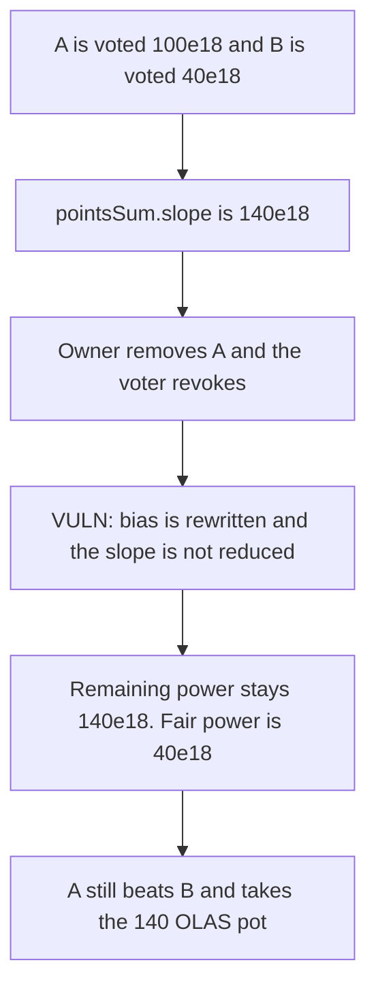

# Olas: removing a nominee does not reduce pointsSum.slope

> **Vulnerability classes:** vuln/logic/state-update · vuln/logic/reward-calculation · vuln/logic/missing-check

> **Reproduction:** local synthetic. `removeNominee` rewrites bias and leaves the slope. One block, no warp.

<!-- non-defihacklabs -->
<!-- source-auditvault: https://github.com/Auditware/AuditVault/blob/main/findings/34920-h-01-pointssumslope-not-updated-after-nominee-removal-and-vo.md -->
<!-- date: 2024-05 -->

## Key info

| | |
|---|---|
| **Protocol** | Olas |
| **Finding** | Code4rena H-01, AuditVault 34920 |
| **Vulnerable code** | `VoteWeighting.removeNominee` / `revokeRemovedNomineeVotingPower` |
| **Harm** | Remaining voting power stays 140e18. Fair power is 40e18. The removed nominee takes the 140 OLAS reward. |
| **Chain** | local synthetic |

## TL;DR

A vote of 100e18 slope for nominee A and 40e18 for nominee B makes `pointsSum.slope` 140e18. The owner removes A. `removeNominee` zeroes A's bias and rewrites `pointsSum.bias`. It does not subtract A's slope. `revokeRemovedNomineeVotingPower` clears the voter's own record and also does not subtract the slope. Remaining power is still 140e18. A's slope is still 100e18, which beats B's 40e18, so A wins the 140 OLAS pot. The fair power is 40e18 and B should win. The control subtracts the slope in `removeNominee`. Power drops to 40e18 and B is paid the 140 OLAS.

## The vulnerable code

```solidity
uint256 oldWeight = pointsWeight[nominee].bias;
uint256 oldSum = pointsSum.bias;
pointsWeight[nominee].bias = 0;
uint256 newSum = oldSum - oldWeight;
pointsSum.bias = newSum;
// @> VULN: bias was rewritten and this slope is not subtracted from pointsSum.slope
lastPower = pointsWeight[nominee].slope;

function revokeRemovedNomineeVotingPower(bytes32 nominee) external {
    require(removed[nominee], "not removed");
    votedSlope[msg.sender][nominee] = 0;
}
```

The report's vote path does `pointsSum.slope += newSlope.slope`. Neither removal nor revoke has the matching subtraction. The checkpoint used here is the single current point. The audited contract stores that point at `pointsSum[nextTime]`; the field that is left stale is the same `slope`.

## Root cause

Bias and slope are both parts of the voting-power point, and only bias is updated when a nominee is removed. Later reads of `pointsSum.slope`, including the decay inside `_getSum` once a week passes, still include the removed nominee. On this single block the slope is used directly as the remaining power and as the ranking for the reward, so the error is visible without rolling the clock.

## Preconditions

The caller of `removeNominee` is the owner. Nominee A has been voted 100e18 slope. Nominee B has been voted 40e18. The reward contract holds 140 OLAS. A is removed and the voter revokes. No week boundary is crossed. `run()` does not warp.

## Attack walkthrough

1. Vote A 100e18 and B 40e18. `pointsSum.slope` is 140e18.
2. `removeNominee(A)` sets A's bias to 0 and sets `pointsSum.bias` to the sum minus A's bias. A's slope and `pointsSum.slope` stay.
3. Revoke sets the voter's `votedSlope` for A to 0. The checkpoint slope is still 140e18. Fair power is B's 40e18.
4. Payout ranks by slope. 100e18 > 40e18, so A wins. The 140 OLAS pot is transferred to A's payee. B is paid 0.

The control subtracts A's slope inside `removeNominee` and zeroes A's slope. `pointsSum.slope` is 40e18. B wins and receives the 140 OLAS. A is paid 0.

## Diagrams



## Impact

The removed nominee still carries 100e18 of slope. Total voting power stays 140e18 instead of dropping to the honest 40e18. The reward pot of 140 OLAS is paid to the removed nominee. The honest nominee, who should have been the only remaining vote, receives nothing. The control drops the power to 40e18 and pays the honest nominee the 140 OLAS.

## Remediation

When a nominee is removed, subtract that nominee's slope from `pointsSum.slope` and set the nominee's slope to 0. Do not leave the subtraction for a later revoke. `revokeRemovedNomineeVotingPower` must not be able to change a slope that removal already cleared, and it must not be the only place the slope is reduced.

## How to reproduce

```bash
cd 34920-h-01-pointssumslope-not-updated-after-nominee-removal-and-vo_exp
forge test -vv
```

The forge log shows `remaining power: 140000000000000000000`, `fair power: 40000000000000000000`, `reward to removed: 140000000000000000000`. The control log shows `control power: 40000000000000000000` and `control paid: 140000000000000000000`.

## Sources

- AuditVault finding: https://github.com/Auditware/AuditVault/blob/main/findings/34920-h-01-pointssumslope-not-updated-after-nominee-removal-and-vo.md
- Code4rena report: https://code4rena.com/reports/2024-05-olas
- Reviewed tree: https://github.com/code-423n4/2024-05-olas/blob/main/governance/contracts/VoteWeighting.sol
- Mitigation: https://github.com/valory-xyz/autonolas-governance/pull/146
