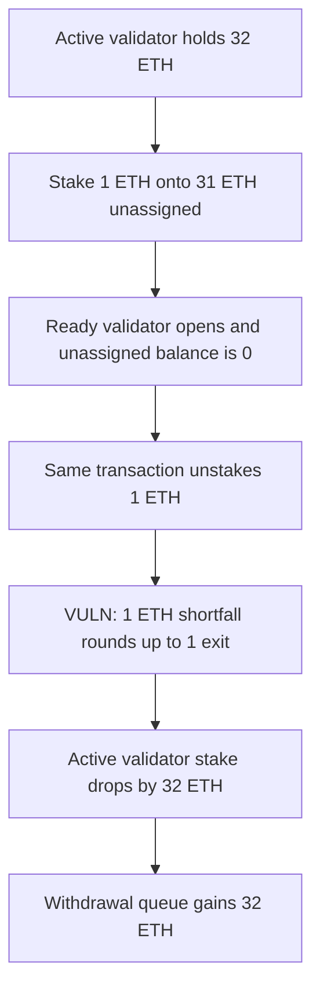

# Casimir: staking and unstaking in one transaction forces a validator exit

> **Vulnerability classes:** vuln/dos/griefing

<!-- non-defihacklabs -->
<!-- source-auditvault: https://github.com/Auditware/AuditVault/blob/main/findings/35001-a-malicious-staker-can-force-validator-withdrawals-by-instan.md -->
<!-- date: 2024-07 -->

## Key info

| | |
|---|---|
| **Protocol** | Casimir |
| **Finding** | Cyfrin Casimir v2.0, AuditVault 35001 |
| **Vulnerable code** | `CasimirManager.requestUnstake` / `exitsForShortfall` |
| **Harm** | A 1 ETH same-transaction unstake drops an active validator's stake by 32 ETH and the withdrawal queue gains 32 ETH |
| **Chain** | local synthetic |

## TL;DR

`requestUnstake` has no lock between a deposit and an unstake. It covers the unstake queue from withdrawable balance, already-requested exits, and the delayed effective balance. A 1 ETH shortfall is not a multiple of the 32 ETH validator capacity, so the remainder rounds the exit count up from 0 to 1. `exitValidators` then takes 32 ETH off an active validator and sends it to the withdrawal queue. The 1 ETH deposit has already been moved into a ready validator, which is not the balance that gets exited.

The control records the deposit block and reverts `requestUnstake` while `block.number` is still that block. The active stake stays 32 ETH and the queue stays empty.

## The vulnerable code

The shortfall is the audited expression. Capacity is 32 ETH.

```solidity
uint256 expectedWithdrawableBalance =
    getWithdrawableBalance() + requestedExits * VALIDATOR_CAPACITY + delayedEffectiveBalance;
if (unstakeQueueAmount > expectedWithdrawableBalance) {
    uint256 requiredAmount = unstakeQueueAmount - expectedWithdrawableBalance;
    requiredExits = requiredAmount / VALIDATOR_CAPACITY;
    // @> VULN: no unstake lock, so a same-transaction 1 ETH unstake rounds the remainder up to a full validator exit
    if (requiredAmount % VALIDATOR_CAPACITY > 0) {
        requiredExits++;
    }
}
```

Withdrawable balance is the unassigned balance plus the withdrawn balance. After `distributeStakes` the unassigned balance is 0, so the expected withdrawable balance is 0. `requiredAmount` is 1 ETH. `1 / 32` is 0 and `1 % 32 > 0`, so `requiredExits` becomes 1.

The control is the same math behind a same-block lock:

```solidity
require(block.number > depositBlock[msg.sender], "unstake locked");
```

## Root cause

A deposit and an unstake in one transaction are treated as a liquidity shortfall against active validators. The exit count uses integer division by `VALIDATOR_CAPACITY` and then rounds any remainder up, so any positive shortfall below 32 ETH exits a whole validator. Ready stake that the deposit just created is not spent first.

## Preconditions

One active validator holds 32 ETH. Unassigned balance is 31 ETH, withdrawn balance is 0, delayed effective balance is 0, and requested exits are 0. Deposit fees are 0. The attacker needs 1 ETH. No role is required. The whole sequence is one transaction, so no time change is required.

## Attack walkthrough

1. Seed the active validator with 32 ETH. The withdrawal queue is empty.
2. Seed 31 ETH of unassigned balance, then stake 1 ETH. `distributeStakes` assigns 32 ETH to `readyValidatorStake` and leaves the active validator at 32 ETH.
3. `requestUnstake(1 ETH)` in that same transaction. Expected withdrawable balance is 0, so the shortfall is 1 ETH.
4. The remainder check rounds `requiredExits` from 0 to 1.
5. `exitValidators` subtracts 32 ETH from `activeValidatorStake` and transfers 32 ETH to the withdrawal queue.

`stakeBefore` is 32 ETH, `stakeAfter` is 0, and the queue balance is 32 ETH. The unstake queue amount is 1 ETH. The ready validator still holds 32 ETH.

The control stakes the same 1 ETH and calls `requestUnstake` in the same block. The call reverts with `unstake locked`. Active stake stays 32 ETH, requested exits stay 0, and the queue balance stays 0.

## Diagrams



## Impact

Genuine stakers lose the validator that was earning rewards. The protocol queues a 32 ETH beacon withdrawal to satisfy a 1 ETH unstake. Repeating the sequence increments `requestedExits` again. The attacker pays gas and, when fees are non-zero, the deposit fee. The measured harm in this run is the 32 ETH moved from the active validator to the withdrawal queue.

## Remediation

Reject `requestUnstake` until a later block than the user's deposit. Cover shortfalls from ready validators before exiting an active one, so a 1 ETH unstake does not round up to a 32 ETH exit.

## How to reproduce

```bash
cd 35001-a-malicious-staker-can-force-validator-withdrawals-by-instan_exp
forge test -vv
```

## Sources

- AuditVault finding: https://github.com/Auditware/AuditVault/blob/main/findings/35001-a-malicious-staker-can-force-validator-withdrawals-by-instan.md
- Cyfrin report: https://github.com/solodit/solodit_content/blob/main/reports/Cyfrin/2024-07-10-cyfrin-casimir-v2.0.md
- Quoted vulnerable function: `CasimirManager.requestUnstake`, as printed in that report. Casimir recorded the fix in commit `4a5cd145c247d9274c3f21f9e9c1b5557a230a01`.
