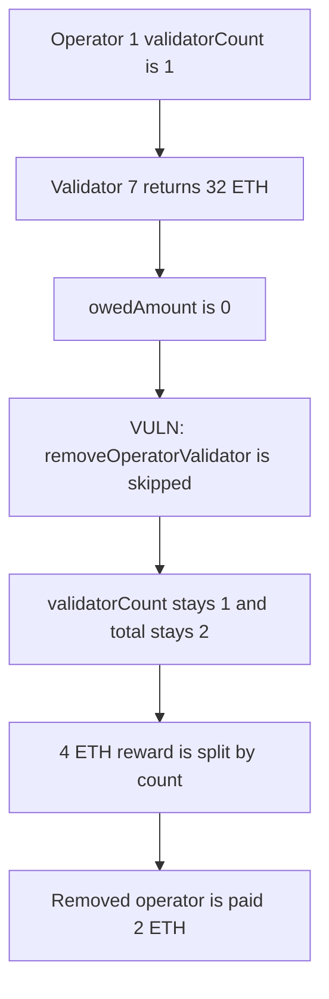

# Casimir: a full validator return leaves the operator registered and still paid

> **Vulnerability classes:** vuln/logic/incorrect-state-transition · vuln/logic/reward-calculation

<!-- non-defihacklabs -->
<!-- source-auditvault: https://github.com/Auditware/AuditVault/blob/main/findings/35002-operator-is-not-removed-in-registry-when-validator-has-oweda.md -->
<!-- date: 2024-07 -->

## Key info

| | |
|---|---|
| **Protocol** | Casimir |
| **Finding** | Cyfrin Casimir v2.0, AuditVault 35002 |
| **Vulnerable code** | `CasimirManager.withdrawValidator` owedAmount gate |
| **Harm** | After a 32 ETH return, validatorCount stays 1 and a 4 ETH reward pays the removed operator 2 ETH |
| **Chain** | local synthetic |

## TL;DR

`withdrawValidator` calls `registry.removeOperatorValidator` only inside `if (owedAmount > 0)`. `owedAmount` is `32 ETH - finalEffectiveBalance`. When the validator returns the full 32 ETH, owed is 0, the call is skipped, and `validatorCount` stays 1. The next reward distribution still weights that operator. A 4 ETH reward split across the two counted operators pays the removed operator 2 ETH.

The control runs the removal even when `recoverAmount` is 0. The count becomes 0, the removed operator is paid 0, and the remaining operator receives the whole 4 ETH.

## The vulnerable code

The gate is the audited condition. The loop is the registry update that also clears `validatorCount`.

```solidity
uint256 owedAmount = VALIDATOR_CAPACITY - finalEffectiveBalance;
// @> VULN: removeOperatorValidator is skipped when owedAmount == 0, so the operator stays registered
if (owedAmount > 0) {
    uint256 availableCollateral = registry.collateralUnit() * 4;
    owedAmount = owedAmount > availableCollateral ? availableCollateral : owedAmount;
    uint256 recoverAmount = owedAmount / 4;
    for (uint256 i; i < operatorLength[validatorId]; i++) {
        registry.removeOperatorValidator(operatorIds[validatorId][i], validatorId, recoverAmount);
    }
}
```

`VALIDATOR_CAPACITY` is 32 ETH. A final balance of 32 ETH makes `owedAmount` 0, so the loop never runs.

The control always removes, and passes `recoverAmount` 0 when nothing is owed:

```solidity
uint256 recoverAmount;
if (owedAmount > 0) {
    recoverAmount = owedAmount / 4;
}
for (uint256 i; i < operatorLength[validatorId]; i++) {
    registry.removeOperatorValidator(operatorIds[validatorId][i], validatorId, recoverAmount);
}
```

## Root cause

`removeOperatorValidator` is not only a collateral-recovery call. It is the update that decreases `operator.validatorCount`. Gating it on a positive shortfall leaves a fully withdrawn operator in the registry. Reward distribution reads that count.

## Preconditions

Two operators are registered, each with `validatorCount` 1. Validator 7 lists operator 1. The validator's final effective balance is exactly 32 ETH, so nothing is owed. A later 4 ETH reward is distributed in proportion to `validatorCount`. No privileged role is required beyond the withdrawal path the report describes. One transaction is enough. No time change is required.

## Attack walkthrough

1. Register operator 1 at `0x2222…2222` and operator 2 at `0x3333…3333`. Each count is 1. `totalValidatorCount` is 2.
2. Point validator 7 at operator 1.
3. `withdrawValidator(7, 32 ETH)`. `owedAmount` is 0. The removal call is skipped.
4. `validatorCount(1)` is still 1. `countedAfterExit` is 1. `totalValidatorCount` is still 2.
5. `distribute(4 ETH)` pays `4 * 1 / 2` to each counted operator.

The removed operator's balance is 2 ETH. The remaining operator also receives 2 ETH, instead of the full 4 ETH.

The control uses the same 32 ETH return, then distributes the same 4 ETH. `validatorCount(1)` is 0, `totalValidatorCount` is 1, `paidRemoved` is 0, the old operator's balance stays 0, and the remaining operator receives 4 ETH.

## Diagrams



## Impact

The removed operator is still a member of the registry. Collateral that `validatorCount` is supposed to release stays accounted against them, and the next reward or slash weight still includes them. In this run the concrete payment is 2 ETH of a 4 ETH reward sent to the operator whose validator has already exited. The other operator is paid 2 ETH instead of 4 ETH.

## Remediation

Call `removeOperatorValidator` for every operator on the validator whether or not `owedAmount` is positive. Pass `recoverAmount` 0 when the returned balance covers the 32 ETH. The count then drops before the next distribution.

## How to reproduce

```bash
cd 35002-operator-is-not-removed-in-registry-when-validator-has-oweda_exp
forge test -vv
```

## Sources

- AuditVault finding: https://github.com/Auditware/AuditVault/blob/main/findings/35002-operator-is-not-removed-in-registry-when-validator-has-oweda.md
- Cyfrin report: https://github.com/solodit/solodit_content/blob/main/reports/Cyfrin/2024-07-10-cyfrin-casimir-v2.0.md
- Quoted vulnerable function: `CasimirManager.withdrawValidator`, as printed in that report. Casimir recorded the fix in commit `d7b35fce9925bfa2133fd4e16ae11e483ab4daa4`.
