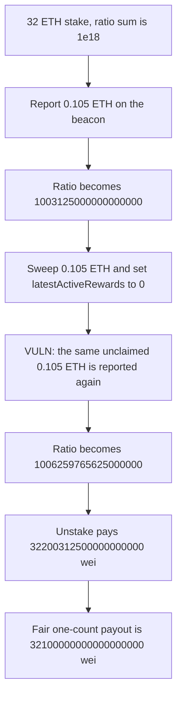

# Casimir: an unclaimed delayed balance is counted twice in rewardStakeRatioSum

> **Vulnerability classes:** vuln/logic/reward-calculation

<!-- non-defihacklabs -->
<!-- source-auditvault: https://github.com/Auditware/AuditVault/blob/main/findings/35003-accounting-for-rewardstakeratiosum-is-incorrect-when-a-delay.md -->
<!-- date: 2024-07 -->

## Key info

| | |
|---|---|
| **Protocol** | Casimir |
| **Finding** | Cyfrin Casimir v2.0, AuditVault 35003 |
| **Vulnerable code** | `CasimirManager.finalizeReport` rewardStakeRatioSum update |
| **Harm** | A 32 ETH stake unstakes `32200312500000000000` wei instead of the fair `32100000000000000000` |
| **Chain** | local synthetic |

## TL;DR

The report accounting assumes a swept reward is claimed before the next report. It is not. The first report sees 32.105 ETH on the beacon and adds a 0.1 ETH gain to `rewardStakeRatioSum`. The reward is then swept into the EigenPod. The second report subtracts that sweep from the balance tracker and sets `latestActiveRewards` to `rewards - swept`, which is 0, while the 0.105 ETH is still sitting unclaimed. The third report, with no new reward, sees the same 0.105 ETH and increases the ratio again.

A 32 ETH deposit then unstakes `32200312500000000000` wei (32.2003125 ETH). The fair payout, counting the 0.1 ETH gain once, is `32100000000000000000` wei (32.1 ETH). The extra is `100312500000000000` wei.

The control stores `latestActiveRewards = rewards` until the swept balance is claimed. The third report's change is 0. The payout is 32.1 ETH.

## The vulnerable code

Fee is 1/21 of the gross reward, so 0.105 ETH becomes a 0.1 ETH gain. `PRINCIPAL` is 32 ETH.

```solidity
uint256 rewards = reportSweptBalance + reportActiveBalance - PRINCIPAL;
if (rewards > latestActiveRewards) {
    uint256 gainAfterFee = (rewards - latestActiveRewards) * 20 / 21;
    uint256 bump = rewardStakeRatioSum * gainAfterFee / latestActiveBalanceAfterFee;
    // @> VULN: an unclaimed delayed balance is added into rewardStakeRatioSum again
    rewardStakeRatioSum = rewardStakeRatioSum + bump;
}
latestActiveRewards = rewards - reportSweptBalance;
```

The last assignment is what lets the next report treat the unclaimed sweep as new. The control keeps the unclaimed reward in `latestActiveRewards`:

```solidity
latestActiveRewards = rewards;
```

## Root cause

`rewardStakeRatioSum` is increased whenever `rewards` exceeds `latestActiveRewards`. Zeroing `latestActiveRewards` while `reportSweptBalance` still holds the reward makes the same balance pass that test on the next report. The balance tracker itself nets back to 32 ETH. Only the ratio, which prices user shares, keeps the second gain.

## Preconditions

One validator's 32 ETH is the stake base. A 0.105 ETH beacon reward is reported, then swept, and is not claimed before the following report. The user's shares are the full 32 ETH. No time change is required. The three reports are three calls in one transaction. The pool holds 33 ETH so the inflated transfer can settle. The extra wei comes out of that reserve.

## Attack walkthrough

1. Open the stake. Balance after fees is 32 ETH. The ratio sum is `1e18`.
2. Report active balance 32.105 ETH and swept balance 0. Gain after the 1/21 fee is 0.1 ETH. The ratio becomes `1003125000000000000`. `latestActiveRewards` becomes 0.105 ETH. The balance tracker becomes 32.1 ETH.
3. Report active balance 32 ETH and swept balance 0.105 ETH. Change is 0, so the ratio stays. The sweep subtracts 0.1 ETH from the balance tracker, back to 32 ETH. `latestActiveRewards` becomes 0.
4. Report the same 32 ETH and 0.105 ETH again. Change is 0.105 ETH. The ratio becomes `1006259765625000000`. The balance tracker ends at 32 ETH again.
5. `previewUnstake(32 ETH)` is `32200312500000000000` wei. `fairPayout` is `32100000000000000000` wei. `unstake` transfers the larger amount.

The control runs the same three reports and previews `32100000000000000000` wei. Its `latestActiveRewards` is still 0.105 ETH, so the third report does not bump the ratio.

## Diagrams



## Impact

The user's stake is priced above the reward the protocol actually earned. Unstaking 32 ETH pays `32200312500000000000` wei instead of `32100000000000000000` wei. The difference, `100312500000000000` wei, is taken from other stake in the pool. Repeating the report while the sweep stays unclaimed increases the ratio again.

## Remediation

Do not clear `latestActiveRewards` by subtracting a swept balance that is still unclaimed. Leave `latestActiveRewards` equal to `rewards` until that balance is claimed, so a later report with the same sweep has a change of 0. Count the delayed balance in `rewardStakeRatioSum` once.

## How to reproduce

```bash
cd 35003-accounting-for-rewardstakeratiosum-is-incorrect-when-a-delay_exp
forge test -vv
```

## Sources

- AuditVault finding: https://github.com/Auditware/AuditVault/blob/main/findings/35003-accounting-for-rewardstakeratiosum-is-incorrect-when-a-delay.md
- Cyfrin report: https://github.com/solodit/solodit_content/blob/main/reports/Cyfrin/2024-07-10-cyfrin-casimir-v2.0.md
- The report's three-report walkthrough of `rewardStakeRatioSum`, `latestActiveBalanceAfterFee`, and `latestActiveRewards`. Casimir recorded the fix in commit `eb31b4349e69eb401615e0eca253e9ab8cc0999d`.
