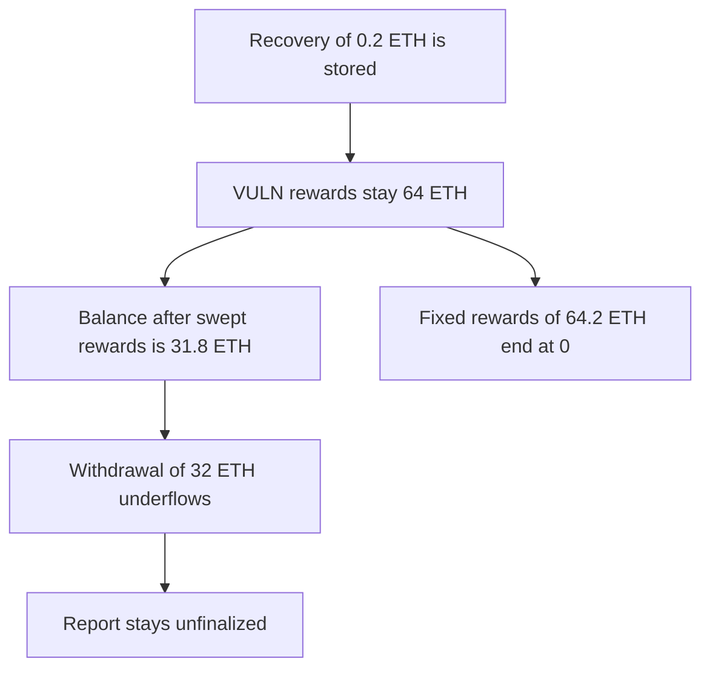

# Casimir: a 0.2 ETH slash recovery is omitted and finalizeReport underflows

> **Vulnerability classes:** `vuln/arithmetic/underflow`

<!-- non-defihacklabs -->
<!-- source-auditvault: https://github.com/Auditware/AuditVault/blob/main/findings/35004-incorrect-accounting-of-reportrecoveredeffectivebalance-can.md -->
<!-- date: 2024-07 -->

## Key info

| Field | Value |
|---|---|
| **Loss** | Report period 2 cannot finalize. The 0.2 ETH operator recovery is missing, and the withdrawal step underflows |
| **Vulnerable contract** | `CasimirManager.finalizeReport` |
| **Attacker EOA** | `0x1111111111111111111111111111111111111111` |
| **Attack contract** | `Exploit` |
| **Attack tx** | `Exploit.run()` |
| **Chain / block / date** | Ethereum model · block 0 · 2024-07 |
| **Compiler** | solc 0.8.27, cancun, via IR |
| **Bug class** | Recovered effective balance left out of rewards |

## TL;DR

Cyfrin's period-2 proof uses a 0.2 ETH slash that operators cover. `finalizeReport` builds rewards as 64 ETH and never adds `reportRecoveredEffectiveBalance`. After the swept-reward adjustment the balance is 31.8 ETH. Subtracting the 32 ETH withdrawal underflows. The report stays unfinalized. Adding the 0.2 ETH makes the same steps end at 0.

## The vulnerable code

```solidity
uint256 recovered = reportRecoveredEffectiveBalance;
int256 rewards = int256(64 ether); // @> VULN: reportRecoveredEffectiveBalance is omitted from rewards
bal -= 32 ether; // 31.8 ether - 32 ether underflows
```

The numbers are the report's period-2 column: start 32.1, rewards 64, change 63.9, swept 64.2, withdrawal 32. The fixed column uses rewards 64.2 and change 64.1 and ends at 0.

## Root cause

The slash reduces `latestActiveBalanceAfterFee`, and the operator collateral that covers it is tracked separately. Rewards never add that recovery back, so the later withdrawal does not fit.

## Preconditions

- Period 1 ended at `latestActiveBalanceAfterFee` 32.1 ETH and `latestActiveRewards` 0.1 ETH.
- Period 2 has `reportRecoveredEffectiveBalance` 0.2 ETH, swept rewards 64.2 ETH, and a 32 ETH withdrawal.
- Rewards without the recovery are 64 ETH.

## Attack walkthrough

1. Load the period-2 recovery.
2. Set rewards to 64 ETH.
3. Apply change and swept rewards. The balance is 31.8 ETH.
4. Subtract 32 ETH. The call reverts.
5. `finalized` is false. The fixed function on the same inputs returns 0 and sets `finalized`.

## Diagrams



## Impact

The pool cannot finalize the report. New validators cannot be activated and the next reporting period cannot start. The 0.2 ETH that operators posted to cover the slash is not credited to stakers in the buggy accounting. The control finalizes and leaves a 0 balance.

## Remediation

Add `reportRecoveredEffectiveBalance` to rewards before the change is applied. Casimir did this in commit eb31b4349e69eb401615e0eca253e9ab8cc0999d.

## How to reproduce

```bash
cd 35004-incorrect-accounting-of-reportrecoveredeffectivebalance-can_exp
forge test -vv
```

Captured output is `output.txt`.

## Sources

- AuditVault finding: https://github.com/Auditware/AuditVault/blob/main/findings/35004-incorrect-accounting-of-reportrecoveredeffectivebalance-can.md
- Cyfrin Casimir report: https://github.com/solodit/solodit_content/blob/main/reports/Cyfrin/2024-07-10-cyfrin-casimir-v2.0.md
- Fix: https://github.com/casimirlabs/casimir-contracts/commit/eb31b4349e69eb401615e0eca253e9ab8cc0999d
- Taxonomy: genome underflow, reward-calculation, known-pattern, permanent, fee-accounting, integer-bounds, reward-accounting. Tags severity/high, sector/staking, sector/infra, vuln/arithmetic/underflow, platform/cyfrin.

