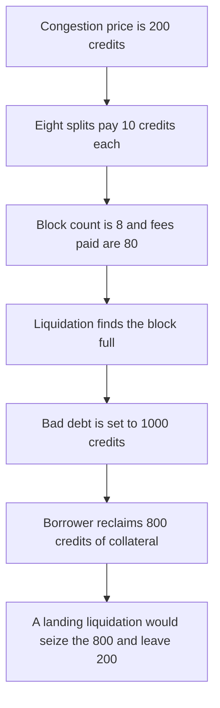

# Aleo — a fixed 10-credit split fee fills the block ahead of liquidation

> **Vulnerability classes:** vuln/logic/fee-calculation · vuln/dos/griefing

> **Reproduction:** a self-contained Foundry PoC that compiles and runs offline
> with only `forge-std` — no fork and no RPC. Trace: [output.txt](output.txt).
> PoC: [test/35023-h-2-split-transactions-fixed-fees-undercharge-block-stuff-do_exp.sol](test/35023-h-2-split-transactions-fixed-fees-undercharge-block-stuff-do_exp.sol).

<!-- non-defihacklabs -->
<!-- source-auditvault: https://github.com/Auditware/AuditVault/blob/main/findings/35023-h-2-split-transactions-fixed-fees-undercharge-block-stuff-do.md -->
<!-- date: 2024-05 -->

---

## Key info

| | |
|---|---|
| **Impact** | **HIGH** — eight splits pay **80 credits** instead of the **1,600** congestion price, the liquidation does not land, **800 credits** of collateral is kept, and **1,000 credits** of debt is unpaid |
| **Protocol** | Aleo `credits.aleo` `split` and `Block::verify_transactions` |
| **Vulnerable code** | A single-transition split charges a hardcoded 10 credits and does not use the dynamic fee |
| **Bug class** | Fixed fee bypasses congestion pricing and fills `MAX_TRANSACTIONS` |
| **Finding** | Sherlock — Aleo, May 2024 · id 35023, H-2 |
| **Report** | [sherlock-audit/2024-05-aleo-judging #35](https://github.com/sherlock-audit/2024-05-aleo-judging/issues/35) |
| **Source** | [AuditVault finding](https://github.com/Auditware/AuditVault/blob/main/findings/35023-h-2-split-transactions-fixed-fees-undercharge-block-stuff-do.md) |
| **Status** | The fee lives inside `split` instead of the consensus fee. Reproduced here as a local synthetic. |
| **Compiler** | solc 0.8.27, cancun, via IR |

---

## TL;DR

A split that is the whole transaction pays **10 credits**. It does not rise when other transactions are paying the congestion price. The block rejects anything past `Transactions::MAX_TRANSACTIONS`.

This reduction uses a cap of **8** so one trace can fill it. Eight splits cost **80 credits**. Eight executes at the congestion price of **200 credits** would cost **1,600**. The liquidation of a position with **800 credits** of collateral and **1,000 credits** of debt finds the block full and does not land. The borrower reclaims the **800**. Bad debt is the full **1,000**, not the **200** shortfall a successful seize would leave.

`run()` does not warp. Credits use 6 decimals, so 10 credits is `10_000_000` units.

## The vulnerable code

```solidity
function submitSplit(address payer) external returns (uint256 fee) {
    require(txCount < MAX_TRANSACTIONS, "full");
    // @> VULN: split's fee is hardcoded to 10 credits and ignores CONGESTION_FEE
    fee = SPLIT_FEE;
    require(credits.transferFrom(payer, address(this), fee), "fee");
    txCount += 1;
}
```

The audited constant is the 10 credit fee inside `credits.aleo` `split`. The audited cap is `transactions.len() > Transactions::MAX_TRANSACTIONS` in `snarkVM/ledger/block/src/verify.rs`. The synthetic cap is 8 so the fill is one call deep. The fee amount is the audited 10 credits.

## Root cause

Dynamic fees are charged on execute transactions. `split` hardcodes 10 credits at the program layer and does not take a fee commitment, so congestion does not raise its price. A full block of those transactions crowds out a liquidation that does pay the congestion price.

## Preconditions

- Congestion fee for an execute is **200 credits**. The split fee is **10 credits**.
- The block accepts **8** transactions.
- The open position has **800 credits** of collateral and **1,000 credits** of debt.
- No timestamp change happens inside `run()`.

## Attack walkthrough

1. Submit **8** splits. Fees paid: **80 credits**. The congestion price for those slots is **1,600 credits**.
2. `liquidate` calls `submitLiquidation`. `txCount` is already 8, so it returns false.
3. Bad debt is set to **1,000 credits**. Nothing is seized.
4. `reclaim` transfers the **800 credits** of collateral to the borrower, because the position was not marked liquidated.

Control: no splits. The liquidation pays **200 credits**, seizes **800**, and leaves bad debt of **200**. `reclaim` reverts.

## Diagrams



## Impact

The borrower keeps **800 credits** of collateral that a landing liquidation would have seized, and the protocol is left with **1,000 credits** of unpaid debt instead of a **200 credit** shortfall. The block space cost **80 credits** instead of **1,600**.

## Remediation

Remove the hardcoded fee from `split` and require the same fee commitment other transactions use, so the price rises with congestion and validators are not filled with underpriced splits.

## Sources

- [AuditVault finding 35023](https://github.com/Auditware/AuditVault/blob/main/findings/35023-h-2-split-transactions-fixed-fees-undercharge-block-stuff-do.md)
- [Sherlock judging issue 35](https://github.com/sherlock-audit/2024-05-aleo-judging/issues/35)
- [credits.aleo split](https://github.com/sherlock-audit/2024-05-aleo/blob/main/snarkVM/synthesizer/program/src/resources/credits.aleo#L947-L972)
- [Block::verify_transactions](https://github.com/sherlock-audit/2024-05-aleo/blob/main/snarkVM/ledger/block/src/verify.rs#L422-L428)

### Taxonomy

- `severity/high`
- `vuln/logic/fee-calculation`
- `vuln/dos/griefing`
