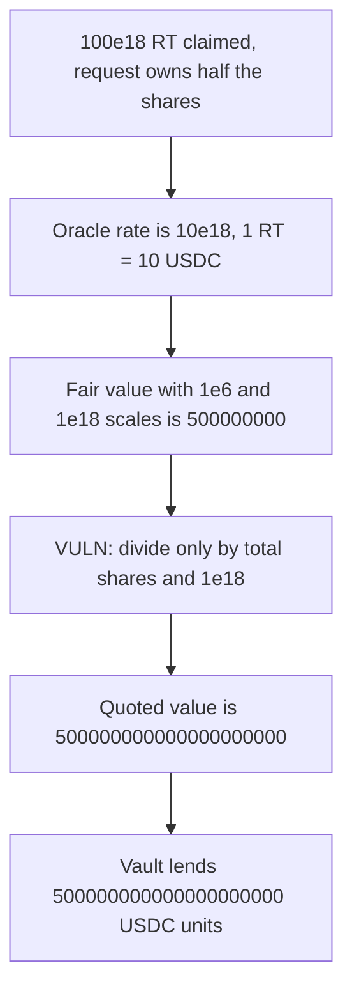

# Notional: a split vault-share withdraw is valued in the wrong decimals

> **Vulnerability classes:** vuln/logic/price-calculation · vuln/arithmetic/decimal-mismatch

<!-- non-defihacklabs -->
<!-- source-auditvault: https://github.com/Auditware/AuditVault/blob/main/findings/35118-h-5-incorrect-valuation-of-vault-share-sherlock-notional-lev.md -->
<!-- date: 2024-06 -->

## Key info

| | |
|---|---|
| **Protocol** | Notional Leveraged Vaults |
| **Finding** | Sherlock 2024-06 H-5, AuditVault 35118 |
| **Vulnerable code** | `WithdrawRequestBase._getValueOfSplitFinalizedWithdrawRequest` |
| **Harm** | The vault lends `500000000000000000000` USDC units instead of the fair `500000000` |
| **Chain** | local synthetic |

## TL;DR

A finalized split withdraw is valued in the borrow token. The redemption token has 18 decimals and the borrow token has 6. `getOraclePrice` returns a correct 18-decimal rate of `10e18`, so 1 RT is 10 USDC. The share formula multiplies `totalWithdraw * rate * vaultShares` and divides only by `totalVaultShares * 1e18`. It never multiplies by the 6-decimal borrow precision or divides by the 18-decimal redemption precision.

With the report's numbers the request owns half of 100 RT. That is 500 USDC, which is `500000000` raw units. The function returns `500000000000000000000`. The vault lends that amount.

This is not the PT-rate divisor bug. The rate here is already scaled to 18 decimals. The missing factors are `BORROW_PRECISION` (`1e6`) and `REDEMPTION_PRECISION` (`1e18`).

## The vulnerable code

`EXCHANGE_RATE_PRECISION` is `1e18`. `rate` is `10e18`.

```solidity
(int256 rate, /* */) = trading.getOraclePrice(redeemToken, borrowToken);
// @> VULN: redemption decimals are not converted into borrow decimals, so the share value is 1e12 too large
return (s.totalWithdraw * rate.toUint() * w.vaultShares) /
    (s.totalVaultShares * EXCHANGE_RATE_PRECISION);
```

Inputs from the report: `totalWithdraw = 100e18`, `vaultShares = 5e8`, `totalVaultShares = 10e8`.

```text
(100e18 * 10e18 * 5e8) / (10e8 * 1e18) = 500000000000000000000
```

The control, which is the report's fix:

```solidity
return (s.totalWithdraw * rate.toUint() * w.vaultShares * BORROW_PRECISION) /
    (s.totalVaultShares * EXCHANGE_RATE_PRECISION * REDEMPTION_PRECISION);
```

```text
(100e18 * 10e18 * 5e8 * 1e6) / (10e8 * 1e18 * 1e18) = 500000000
```

`500000000` raw 6-decimal units is 500 USDC.

## Root cause

`totalWithdraw` is in the redemption token's native precision. The exchange rate is an 18-decimal "BT per RT" price. Dividing only by `EXCHANGE_RATE_PRECISION` leaves the result in redemption precision, 12 orders above the borrow token's 6 decimals. `500e18 / 500e6 = 1e12`.

## Preconditions

The borrow token and the redemption token are different, so the exchange-rate branch runs. Borrow decimals are 6 and redemption decimals are 18. The oracle rate is the correct `10e18`. The split holds `100e18` of RT and `10e8` vault shares. This request owns `5e8` shares. The vault holds enough USDC to pay the inflated quote. No role and no time change are required.

## Attack walkthrough

1. The attacker holds a finalized split withdraw: 100 RT claimed, 5e8 of 10e8 shares.
2. `getOraclePrice` returns `10e18`. One RT is 10 USDC.
3. The fair formula, multiplying by `1e6` and dividing by `1e18`, returns `500000000`.
4. `quote` uses the audited return and gets `500000000000000000000`.
5. `borrow` transfers that amount of USDC to the attacker.

`buggy / fair` is `1e12`. The attacker receives `500000000000000000000` USDC units. The control contract, given the same rate and the same split, returns `500000000`.

## Diagrams



## Impact

Collateral marked at the inflated share value can borrow `500000000000000000000` USDC units against a position worth `500000000` units. The excess leaves the vault. Every account whose withdraw request is priced with this formula is over-collateralized by about `1e12` when the redemption token has 18 decimals and the borrow token has 6.

## Remediation

Scale the product by the borrow token's precision and divide by the redemption token's precision:

```solidity
(s.totalWithdraw * rate.toUint() * w.vaultShares * BORROW_PRECISION) /
    (s.totalVaultShares * EXCHANGE_RATE_PRECISION * REDEMPTION_PRECISION);
```

For this pair that is multiply by `1e6` and divide by `1e18`.

## How to reproduce

```bash
cd 35118-h-5-incorrect-valuation-of-vault-share-sherlock-notional-lev_exp
forge test -vv
```

## Sources

- AuditVault finding: https://github.com/Auditware/AuditVault/blob/main/findings/35118-h-5-incorrect-valuation-of-vault-share-sherlock-notional-lev.md
- Sherlock contest: https://github.com/sherlock-audit/2024-06-leveraged-vaults-judging/issues/60
- Audited function: `WithdrawRequestBase._getValueOfSplitFinalizedWithdrawRequest` in `leveraged-vaults-private/contracts/vaults/common/WithdrawRequestBase.sol`, as quoted in that issue. The rate comes from `TradingModule.getOraclePrice`, which in this case already returns a correct 18-decimal rate.
