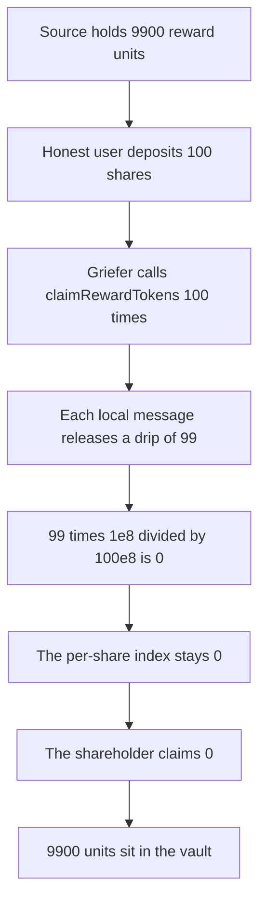

# Notional vault rewards — a grief pays the shareholder nothing

> **Vulnerability classes:** vuln/logic/reward-calculation · vuln/arithmetic/precision-loss

<!-- non-defihacklabs -->
<!-- source-auditvault: https://github.com/Auditware/AuditVault/blob/main/findings/35119-h-6-loss-of-rewards-due-to-continuous-griefing-attacks-on-l2.md -->
<!-- date: 2024-06 -->

## Key info

| | |
|---|---|
| **Protocol** | Notional Leveraged Vaults |
| **Finding** | Sherlock 2024-06 H-6, AuditVault 35119 |
| **Vulnerable code** | `VaultRewarderLib._accumulateSecondaryRewardViaClaim` |
| **Harm** | Honest shareholder receives 0 of 9900 reward units. The control pays them 9900. |
| **Chain** | local synthetic |

**AuditVault taxonomy:** lang/solidity · sector/staking · platform/sherlock · severity/high · genome: griefing · reward-accounting · dos-resistance

## TL;DR

`claimRewardTokens` is permissionless. On an L2 the report's point is that calling it every block is cheap, so each call only observes a small reward balance. That balance is multiplied by 1e8 and divided by `totalVaultShares`. Below the share count, the division is zero, and the tokens that arrived are not credited to anyone. Here each call is a local stand-in for one L2 reward message: the source releases 99 units. The vault has 100 shares. One hundred messages deliver 9900 units. The index stays 0. The shareholder's claim returns 0. A rewarder that keeps the division remainder credits the same 9900 and the shareholder receives all of it.

## The vulnerable code

The balance difference and the division are the two lines the report cites. `PRECISION` is Notional's `INTERNAL_TOKEN_PRECISION` of 1e8.

```solidity
uint256 tokensClaimed = balanceAfter - balancesBefore;
accumulated += (tokensClaimed * PRECISION) / totalVaultSharesBefore; // @> VULN: drip rounds to zero
```

`release()` on the reward source is the L2 message. It transfers a fixed drip. Nothing in the attack waits for another chain or another block.

The control adds the undistributed remainder back in before the next division:

```solidity
uint256 scaled = tokensClaimed * PRECISION + remainder;
uint256 delta = scaled / totalShares;
remainder = scaled % totalShares;
accumulated += delta;
```

## Root cause

The per-share index is an integer. `99 * 1e8 / 100e8` is 0. The function still accepts the tokens into the vault, then stores an index that did not move. Repeating the call does not repair it, because each drip is judged on its own. The shareholder's claim multiplies their shares by that index and also gets 0.

## Preconditions

One shareholder deposits 100 shares. Internal supply is `100 * 1e8`. The reward source is funded with 9900 units and releases 99 per call. The griefer calls `claimRewardTokens` 100 times in the same transaction. No timestamp warp. The second chain is not required: the message is the local `release` call, and the bug is the division.

## Attack walkthrough

1. Mint 9900 reward units to the source. Deposit 100 shares for the honest user.
2. Call `claimRewardTokens` 100 times. Each call asks the source to `release` 99 units.
3. `tokensClaimed` is 99. The index update divides `99 * 1e8` by `100e8` and adds 0.
4. After the loop the vault holds 9900 and `accumulated` is 0.
5. `claim` for the shareholder computes `shares * 0 / 1e8` and returns 0. Their token balance stays 0.

The control runs the same 100 releases through the remainder update. The index ends at 99. The shareholder's claim transfers 9900 and the vault balance ends at 0.

## Diagrams



## Impact

The shareholder receives 0 of the 9900 reward units their shares should have taken. The tokens are in the vault and the index that would pay them out was never increased. The griefer does not take the tokens. The loss is that the honest claim pays nothing. The remainder-tracking control, given the same drips, pays the shareholder the full 9900.

## Remediation

Do not drop the division remainder. Carry `tokensClaimed * PRECISION % totalShares` into the next call, which is what the control does, so a sequence of sub-threshold drips still sums to the right index. The report's other mitigation is to make `claimRewardTokens` permissioned so a keeper claims a balance large enough not to round away. Either change stops this user from being paid 0.

## How to reproduce

```bash
cd 35119-h-6-loss-of-rewards-due-to-continuous-griefing-attacks-on-l2_exp
forge test -vv
```

## Sources

- AuditVault finding: https://github.com/Auditware/AuditVault/blob/main/findings/35119-h-6-loss-of-rewards-due-to-continuous-griefing-attacks-on-l2.md
- Sherlock issue: https://github.com/sherlock-audit/2024-06-leveraged-vaults-judging/issues/61
- Vulnerable library: https://github.com/sherlock-audit/2024-06-leveraged-vaults/blob/main/leveraged-vaults-private/contracts/vaults/common/VaultRewarderLib.sol
- Contest: https://github.com/sherlock-audit/2024-06-leveraged-vaults-judging
