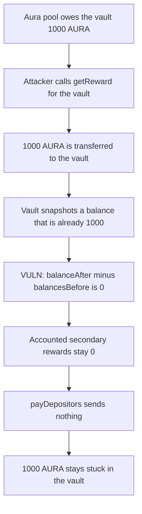

# Notional vaults — a public getReward leaves 1,000 AURA stuck

> **Vulnerability classes:** vuln/logic/reward-calculation · vuln/dos/frozen-funds

<!-- non-defihacklabs -->
<!-- source-auditvault: https://github.com/Auditware/AuditVault/blob/main/findings/35120-h-7-users-can-deny-the-vault-from-claiming-reward-tokens-she.md -->
<!-- date: 2024-06 -->

## Key info

| | |
|---|---|
| **Protocol** | Notional Leveraged Vaults |
| **Finding** | Sherlock 2024-06 H-7, AuditVault 35120 |
| **Vulnerable code** | `VaultRewarderLib._claimVaultRewards` |
| **Harm** | 1,000 AURA stuck in the vault; the depositor is paid 0 |
| **Chain** | local synthetic |

## TL;DR

`_claimVaultRewards` credits only the reward-token balance gained during `_executeClaim`. Aura's `getReward` is callable by anyone and pays the vault, not the caller. An attacker calls it first. The vault's own claim then sees a before/after difference of 0. The 1,000 AURA sits in the vault and `payDepositors` sends nothing.

## The vulnerable code

```solidity
for (uint256 i; i < state.length; i++) {
    uint256 balanceAfter = IERC20(state[i].rewardToken).balanceOf(address(this));
    _accumulateSecondaryRewardViaClaim(
        i,
        state[i],
        // @> VULN: front-running getReward makes this difference 0, so tokens already in the vault are never credited
        balanceAfter - balancesBefore[i],
        totalVaultSharesBefore
    );
}
```

Aura pays the named account, whoever the caller is:

```solidity
function getReward(address _account, bool _claimExtras) public returns (bool) {
    uint256 reward = earned(_account);
    if (reward > 0) {
        rewards[_account] = 0;
        rewardToken.transfer(_account, reward);
    }
    return true;
}
```

The warden's fix credits the vault's entire reward-token balance instead of the difference. The same front-run then still accounts for the 1,000 AURA, and the depositor is paid.

## Root cause

The claim assumes the only way tokens arrive is inside `_executeClaim`. `getReward(vault)` is not restricted to the vault. A call from anyone moves the pending reward onto the vault before the snapshot. `balanceAfter - balancesBefore` is then 0, and that 0 is what gets stored as the secondary reward.

## Preconditions

The vault has a positive unpaid balance on an Aura reward pool. The pool's `getReward` pays `_account` and does not check `msg.sender`. The vault measures a claim by the balance delta around that call.

## Attack walkthrough

1. Aura still owes the vault 1,000 AURA. `earned(vault)` returns that amount.
2. The attacker calls `getReward(vault)`. The pool transfers 1,000 AURA to the vault and zeroes the earned balance.
3. The vault already holds the 1,000 AURA. Its own `claimVaultRewards` has not run.
4. The claim snapshots that balance, calls `getReward` again, and adds nothing.
5. `balanceAfter - balancesBefore` is 0. Accounted rewards stay 0.
6. `payDepositors` reads 0 and transfers nothing. The depositor's balance stays 0. The 1,000 AURA remains in the vault.

The control uses the entire post-claim balance. After the same front-run it credits 1,000 AURA and pays that amount to the depositor. The vault's balance ends at 0.

## Diagrams



## Impact

Depositors lose the 1,000 AURA that the pool had already assigned to the vault. The tokens are not stolen by the attacker. They sit in the vault with accounted rewards at 0, so the payout pays 0. Repeating the front-run on every claim keeps later rewards out of the accounting as well.

## Remediation

Credit `balanceAfter`, the vault's full reward-token balance, instead of `balanceAfter - balancesBefore`. Tokens delivered by a public `getReward` are then included in the claim.

## How to reproduce

```bash
cd 35120-h-7-users-can-deny-the-vault-from-claiming-reward-tokens-she_exp
forge test -vv
```

## Sources

- AuditVault finding: https://github.com/Auditware/AuditVault/blob/main/findings/35120-h-7-users-can-deny-the-vault-from-claiming-reward-tokens-she.md
- Sherlock contest: https://github.com/sherlock-audit/2024-06-leveraged-vaults-judging
- Sherlock issue: https://github.com/sherlock-audit/2024-06-leveraged-vaults-judging/issues/63
- Vulnerable line: https://github.com/sherlock-audit/2024-06-leveraged-vaults/blob/main/leveraged-vaults-private/contracts/vaults/common/VaultRewarderLib.sol#L174
- Claim call: https://github.com/sherlock-audit/2024-06-leveraged-vaults/blob/main/leveraged-vaults-private/contracts/vaults/common/VaultRewarderLib.sol#L181
