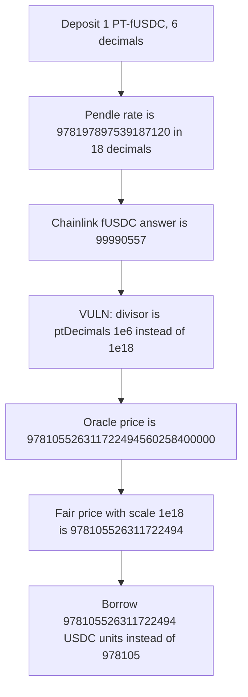

# Notional PendlePTOracle — a 6-decimal PT is priced with an 18-decimal rate

> **Vulnerability classes:** vuln/arithmetic/decimal-mismatch · vuln/logic/price-calculation

<!-- non-defihacklabs -->
<!-- source-auditvault: https://github.com/Auditware/AuditVault/blob/main/findings/35122-h-9-wrong-decimal-precision-resulted-in-the-price-being-infl.md -->
<!-- date: 2024-06 -->

## Key info

| | |
|---|---|
| **Protocol** | Notional Leveraged Vaults (Pendle PT) |
| **Finding** | Sherlock 2024-06 H-9, AuditVault 35122 |
| **Vulnerable code** | `PendlePTOracle` decimal conversion and `_calculateBaseToQuote` |
| **Harm** | 1 PT-fUSDC borrows `978105526311722494` USDC units instead of `978105` |
| **Chain** | local synthetic (audited Ethereum oracle) |

## TL;DR

`PendlePTOracle` stores `ptDecimals = 10**pt.decimals()` and then computes

`answer = (ptRate * baseToUSD * rateDecimals) / (baseToUSDDecimals * ptDecimals)`.

Pendle's `getPtToAssetRate` is always 18 decimals (`rateDecimals = 10**18`). PT-fUSDC has 6 decimals, so the divisor is `1e6` instead of `1e18`. With the report's feeds the oracle returns `978105526311722494560258400000` instead of `978105526311722494`. A vault that trusts that 18-decimal USD answer lends about `1e12` times too much USDC against one PT.

## The vulnerable code

The constructor writes the scales with the audited conversion. `_ptDecimals` is 6 for PT-fUSDC, so `ptDecimals` becomes `1e6`. `rateDecimals` stays `10**18`.

```solidity
baseToUSDDecimals = int256(10**_baseDecimals);
ptDecimals = int256(10**_ptDecimals);
```

The price uses those scales. `ptRate` here is `978197897539187120` and `baseToUSD` is `99990557`.

```solidity
int256 ptRate = expiry <= block.timestamp ? ptDecimals : _getPTRate();
// @> VULN: ptRate is 18 decimals; dividing by ptDecimals (10**pt decimals) inflates the price.
answer = (ptRate * baseToUSD * rateDecimals) / (baseToUSDDecimals * ptDecimals);
```

Fair form, which the control uses. The divisor is `10**18`, the Pendle rate scale, not `10**ptDecimals`:

```solidity
int256 rateScale = int256(10**18);
answer = (ptRate * baseToUSD * rateScale) / (baseToUSDDecimals * rateScale);
```

That is the same as dividing by `rateDecimals` and cancels the extra `* rateDecimals`. The later Notional oracle dropped both factors and returns `(ptRate * baseToUSD) / baseToUSDDecimals`.

## Root cause

The formula treats Pendle's PT rate as if it were denominated in the PT token's decimals. `getPtToAssetRate` is a fixed 18-decimal rate: `978197897539187120 / 1e18` is about 0.978 asset per PT. Dividing by `10**6` instead of `10**18` multiplies the quoted USD price by `1e12`.

Integer evaluation of the report's inputs:

- buggy answer = `978105526311722494560258400000` (the report's `9.781055263e29`)
- fair answer = `978105526311722494` (about 0.978 USD in 18 decimals)
- `buggy / fair = 1e12` in integer division

The oracle's own `decimals` is 18, so a lender reads the buggy answer as roughly `9.78e11` dollars per PT.

## Preconditions

The PT token's decimals are not 18. The report uses PT-fUSDC 26DEC2024, which has 6 decimals, with `useSyOracleRate` false so the oracle calls `getPtToAssetRate`. The same shape applies to any PT whose decimals are not 18. No special role is required. One PT posted as collateral is enough.

## Attack walkthrough

1. The attacker deposits 1 PT-fUSDC (`1e6` raw units) in a leveraged vault that prices collateral with `PendlePTOracle`.
2. The oracle loads Chainlink fUSDC/USD `99990557` (8 decimals) and Pendle's 18-decimal rate `978197897539187120`.
3. The answer line divides by `ptDecimals` (`1e6`). The returned price is `978105526311722494560258400000`.
4. The vault converts that 18-decimal USD value into 6-decimal USDC and transfers `978105526311722494` units. The fair borrow is `978105` (0.978105 USDC).

The control oracle, given the same feeds and `int256(10**18)` as the rate scale, returns `978105526311722494`. `quoteBorrow` of that price for 1 PT is `978105`.

## Diagrams



## Impact

The account's PT collateral is overvalued by about twelve orders of magnitude, so the borrower can draw `978105526311722494` USDC units against one PT whose fair value supports `978105`. That is unbacked borrowing from the vault. The same inflated answer would mark every position that uses this oracle.

## Remediation

Divide the PT rate by Pendle's rate decimals (`10**18`), not by `10**ptDecimals`. Equivalently, drop both the `* rateDecimals` and the `/ ptDecimals` factors and return `(ptRate * baseToUSD) / baseToUSDDecimals`.

## How to reproduce

```bash
cd 35122-h-9-wrong-decimal-precision-resulted-in-the-price-being-infl_exp
forge test -vv
```

## Sources

- AuditVault finding: https://github.com/Auditware/AuditVault/blob/main/findings/35122-h-9-wrong-decimal-precision-resulted-in-the-price-being-infl.md
- Sherlock contest issue: https://github.com/sherlock-audit/2024-06-leveraged-vaults-judging/issues/66
- Audited oracle at contest import `091206da03be1072f69c25fe4b2f5244653815fc` (private tree `9d0df3326f085e4f732e03fea65e0dee4b7dbf04`): https://github.com/sherlock-audit/2024-06-leveraged-vaults/blob/091206da03be1072f69c25fe4b2f5244653815fc/leveraged-vaults-private/contracts/oracles/PendlePTOracle.sol
