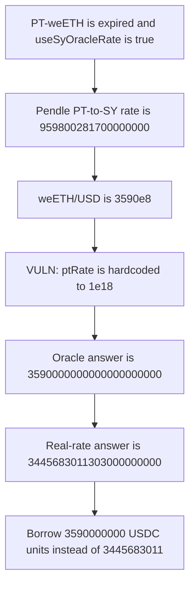

# Notional: post-expiry PT rate is hardcoded to 1.0

> **Vulnerability classes:** vuln/logic/price-calculation · vuln/logic/incorrect-state-transition

<!-- non-defihacklabs -->
<!-- source-auditvault: https://github.com/Auditware/AuditVault/blob/main/findings/35123-h-10-incorrect-assumption-that-pt-rate-is-10-post-expiry-she.md -->
<!-- date: 2024-06 -->

## Key info

| | |
|---|---|
| **Protocol** | Notional Leveraged Vaults (Pendle PT) |
| **Finding** | Sherlock 2024-06 H-10, AuditVault 35123 |
| **Vulnerable code** | `PendlePTOracle` post-expiry `ptRate` |
| **Harm** | 1 PT-weETH borrows `3590000000` USDC units instead of `3445683011` |
| **Chain** | local synthetic |

## TL;DR

After expiry, `PendlePTOracle` sets `ptRate` to `ptDecimals`, which is 1.0 in the PT token's decimals. The comment says 1 PT is worth 1 SY. For PT-weETH 27 Jun 2024 that is wrong. `useSyOracleRate` is true, and Pendle's `getPtToSyRate` after maturity is `0.9598002817`, because 1 PT redeems 1 eETH rather than 1 weETH.

weETH/USD in the report is 3590. The hardcoded rate prices 1 PT at `3590000000000000000000` (3590 USD in 18 decimals). The real rate prices it at `3445683011303000000000`. A vault that lends 6-decimal USDC against that answer lends `3590000000` units instead of `3445683011`. The extra is `144316989` units.

PT-weETH has 18 decimals, so `ptDecimals` equals `rateDecimals`. This is not the bug that divides an 18-decimal rate by `10**6`.

The market expiry is 0, so this block is already past maturity. The post-expiry branch is taken with no timestamp change.

## The vulnerable code

`useSyOracleRate` is true. `ptDecimals` and `rateDecimals` are both `1e18`. `baseToUSD` is `3590e8`.

```solidity
// Past expiration, hardcode the PT oracle price to 1. It is no longer tradable and
// is worth 1 unit of the underlying SY at expiration.
// @> VULN: post-expiry rate is ptDecimals (1.0), not Pendle's 0.9598002817 PT-to-SY rate
int256 ptRate = expiry <= block.timestamp ? ptDecimals : _getPTRate();

answer = (ptRate * baseToUSD * rateDecimals) / (baseToUSDDecimals * ptDecimals);
```

`_getPTRate` would have returned `getPtToSyRate`, which is `959800281700000000`. The ternary never calls it once `expiry <= block.timestamp`.

The control uses that rate in the same formula:

```solidity
int256 ptRate = int256(pendleOracle.getPtToSyRate(pendleMarket, 1800));
answer = (ptRate * baseToUSD * rateDecimals) / (baseToUSDDecimals * ptDecimals);
```

Integer results:

- buggy answer = `3590000000000000000000`
- fair answer = `959800281700000000 * 3590` = `3445683011303000000000`
- buggy USDC borrow of 1 PT = `3590000000`
- fair USDC borrow of 1 PT = `3445683011`

## Root cause

The oracle treats a matured PT as redeemable 1:1 for the SY's yield-bearing token. Pendle redeems PT 1:1 for the accounting asset. For weETH the accounting asset is eETH, and weETH is worth more than eETH, so the PT-to-SY rate at expiry is about 0.9598 rather than 1. Hardcoding 1.0 marks the PT at the full weETH price.

## Preconditions

`useSyOracleRate` is true, as in the PT-weETH 27 Jun 2024 deployment. The PT has 18 decimals. The market is expired, which this synthetic models with `expiry == 0` so the current block is already past it. Chainlink weETH/USD is `3590e8`. Pendle's PT-to-SY rate is `959800281700000000`. One PT posted as collateral is enough. No role is required.

## Attack walkthrough

1. Read `getPtToSyRate`. It is `959800281700000000`.
2. Deposit 1 PT-weETH (`1e18`) in a vault that prices collateral with `PendlePTOracle`.
3. `latestAnswer` sees `expiry <= block.timestamp` and sets `ptRate` to `1e18`.
4. The answer is `3590000000000000000000`. The same formula with the real rate is `3445683011303000000000`.
5. `borrowMax` converts that 18-decimal USD value into 6-decimal USDC and transfers `3590000000` units.

The control oracle, given the same feed and `getPtToSyRate`, returns `3445683011303000000000`. `quoteBorrow` of that price for 1 PT is `3445683011`. The difference is `144316989` USDC units.

## Diagrams



## Impact

PT collateral is marked at the weETH price instead of the eETH-sized redemption value. One PT borrows `3590000000` USDC units. The same PT at the real rate supports `3445683011`. The `144316989` unit difference is unbacked borrowing from the vault. Every expired PT-weETH position priced by this oracle is overstated by the same ratio, `1 / 0.9598002817`.

## Remediation

After expiry, keep using Pendle's PT-to-SY rate (or an explicit PT-to-accounting-asset rate). Do not substitute `ptDecimals`. For this market that rate is `959800281700000000`, not `1e18`.

## How to reproduce

```bash
cd 35123-h-10-incorrect-assumption-that-pt-rate-is-10-post-expiry-she_exp
forge test -vv
```

## Sources

- AuditVault finding: https://github.com/Auditware/AuditVault/blob/main/findings/35123-h-10-incorrect-assumption-that-pt-rate-is-10-post-expiry-she.md
- Sherlock contest issue: https://github.com/sherlock-audit/2024-06-leveraged-vaults-judging/issues/69
- Audited oracle: `PendlePTOracle._calculateBaseToQuote` in the 2024-06 leveraged-vaults contest, the `expiry <= block.timestamp ? ptDecimals : _getPTRate()` line quoted in that issue. The measured Pendle rate is `0.9598002817` and the weETH price used here is the report's 3590 USD.
