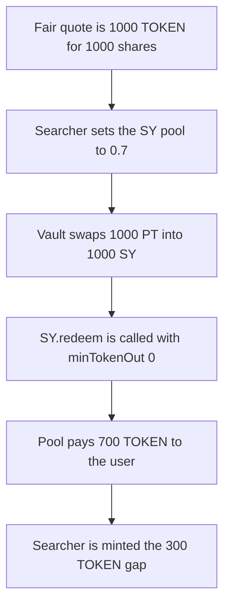

# Notional — Pendle PT redemption accepts any SY output

> **Vulnerability classes:** vuln/defi/slippage · vuln/logic/missing-check

> **Reproduction:** cheatcode-free local synthetic. `_redeemPT` calls `SY.redeem` with `minTokenOut` hardcoded to 0. Full trace: [output.txt](output.txt). PoC: [test/35124-h-11-lack-of-slippage-control-on-redeempt-function-sherlock_exp.sol](test/35124-h-11-lack-of-slippage-control-on-redeempt-function-sherlock_exp.sol).

<!-- non-defihacklabs -->
<!-- source-auditvault: https://github.com/Auditware/AuditVault/blob/main/findings/35124-h-11-lack-of-slippage-control-on-redeempt-function-sherlock.md -->
<!-- date: 2024-06 -->

**AuditVault taxonomy:** `lang/solidity` · `sector/dex` · `sector/lending` · `sector/staking` · `sector/token` · `platform/sherlock` · `has/github` · `severity/high` · `impact/mev/sandwich` · `trigger/sandwich-attack` · genome: `wrong-condition` · `sandwich` · `defi/sandwich-attack` · `fot-slippage` · `frontrun-exposure` · `timestamp-dependence`

## Key info

| | |
|---|---|
| **Protocol** | Notional Leveraged Vaults, Pendle PT |
| **Finding** | Sherlock 2024-06 leveraged vaults H-11, AuditVault 35124 |
| **Vulnerable code** | `PendlePrincipalToken._redeemPT` |
| **Harm** | User receives 700 TOKEN against a stated minimum of 1,000. The searcher keeps the 300 TOKEN difference |
| **Chain** | local synthetic |

## TL;DR

`_redeemPT` redeems principal tokens and then calls `SY.redeem` with `minTokenOut` set to 0. For this SY, one share is not one underlying token: the redemption reads a pool price. In the same transaction the searcher sets that price from 1 TOKEN per share to 0.7. The vault still accepts the fill. The user who asked for 1,000 TOKEN receives 700. The searcher is paid the 300 TOKEN gap. A control that forwards the caller's minimum reverts on that same price, and pays the full 1,000 when the pool is left at 1:1.

## The vulnerable code

Audited `PendlePrincipalToken._redeemPT`. The call below is the line the report marks. `TOKEN_OUT_SY` equals `BORROW_TOKEN` in this path, so `_executeInstantRedemption` also skips the later trade limit and returns `netTokenOut` as-is.

```solidity
// @> VULN: minTokenOut is hardcoded to 0, so a worse SY pool price is accepted
netTokenOut = SY.redeem(address(this), netSyOut, TOKEN_OUT_SY, 0, true);
// FIX: pass the caller's minimum and revert when the SY pool pays less.
```

The SY mock pays `netSyOut * tokenPerSy / 1e18` and reverts when that is below `minTokenOut`. At `tokenPerSy = 1e18`, 1,000 shares pay 1,000 TOKEN. At `0.7e18` they pay 700, and the 300 gap versus the 1:1 amount is minted to the account that set the price.

## Root cause

The slippage argument is a constant 0, not the minimum the caller passed into instant redemption. The PT to SY hop in this reduction is 1:1, so the whole loss is inside `SY.redeem`. That matches the report: some SY contracts withdraw from an external pool, and one SY share is not one yield token.

## Preconditions

The vault holds 1,000 PT, worth 1,000 TOKEN at the untouched pool price. The user passes `minPurchaseAmount` of 1,000 TOKEN. `TOKEN_OUT_SY` equals `BORROW_TOKEN`, so instant redemption does not run a second swap that would apply that minimum. The searcher can set the SY pool price before the redeem in the same transaction.

## Attack walkthrough

1. `quote(1000 TOKEN shares)` at `tokenPerSy = 1e18` returns 1,000 TOKEN. That is the user's minimum.
2. The searcher calls `setTokenPerSy(0.7e18)` before redeem. Same `run()`, no warp.
3. Instant redemption swaps 1,000 PT for 1,000 SY at the market. The market price does not move.
4. `SY.redeem` is called with `minTokenOut` 0. The pool pays 700 TOKEN to the vault and mints 300 TOKEN to the searcher.
5. The user's 1,000 minimum is written to `ignoredMin` and never compared. The vault transfers 700 TOKEN to the user.
6. User balance is 700. Searcher balance is 300. 700 is less than 1,000.

The guarded control passes `minPurchaseAmount` into `SY.redeem`. On the 0.7 price the call reverts with `Slippage: INSUFFICIENT_TOKEN_OUT` and nobody is paid. On the fair price the user receives 1,000 TOKEN and the searcher receives 0.

## Diagrams



## Impact

The user loses 300 TOKEN on a 1,000 TOKEN redemption. The searcher receives that 300. The stated minimum of 1,000 is not enforced. At the original 1:1 price the same redemption pays 1,000 and the searcher gets nothing, so the loss is the disabled minimum plus the price move, not a constant fee.

## Remediation

Pass the caller's minimum through `_redeemPT` into `SY.redeem` as `minTokenOut`. Keep the existing trade `limit` for the case where `TOKEN_OUT_SY` is not `BORROW_TOKEN`.

## How to reproduce

```bash
cd 35124-h-11-lack-of-slippage-control-on-redeempt-function-sherlock_exp
forge test -vv
```

## Sources

- AuditVault finding: https://github.com/Auditware/AuditVault/blob/main/findings/35124-h-11-lack-of-slippage-control-on-redeempt-function-sherlock.md
- Sherlock report: https://github.com/sherlock-audit/2024-06-leveraged-vaults-judging
- Finding issue: https://github.com/sherlock-audit/2024-06-leveraged-vaults-judging/issues/70
- Audited function: https://github.com/sherlock-audit/2024-06-leveraged-vaults/blob/main/leveraged-vaults-private/contracts/vaults/staking/protocols/PendlePrincipalToken.sol
