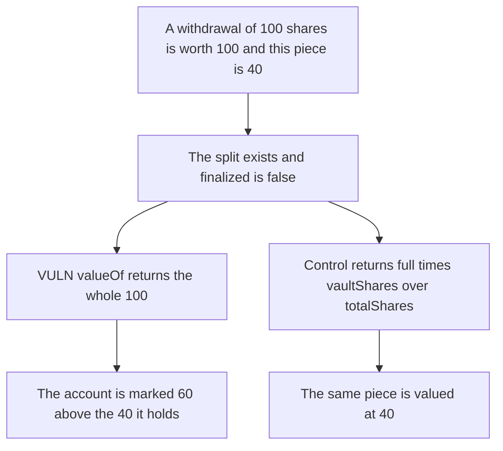

# Notional values an unfinalized withdrawal split at the whole withdrawal

> **Vulnerability classes:** vuln/logic/withdraw-valuation · vuln/defi/collateral-overvalue

<!-- non-defihacklabs -->
<!-- source-auditvault: https://github.com/Auditware/AuditVault/blob/main/findings/35125-h-12-the-withdrawvalue-calculation-in-calculatevalueofwithd.md -->
<!-- date: 2024-06 -->

## Key info

| Field | Value |
|---|---|
| **Loss** | A 40-share piece of a 100-share withdrawal is valued at 100, which is 60 too high |
| **Vulnerable contract** | `Vault.valueOf` |
| **Attacker EOA** | `0x1111111111111111111111111111111111111111` |
| **Attack contract** | `Exploit` at `0x15452ec016c4dc8c549e7fe6ff4b26324ea8b7a4` |
| **Attack tx** | `Exploit.run()` |
| **Chain / block / date** | Ethereum model · block 0 · 2024-06 |
| **Compiler** | solc 0.8.27, cancun, via IR |
| **Bug class** | An unfinalized split falls through to the full withdrawal value |



## TL;DR

`_calculateValueOfWithdrawRequest` is supposed to scale a split by `vaultShares / totalShares` once the split is finalized. The quoted branch returns the full withdrawal value when `finalized` is still false.

The withdrawal is worth 100. This piece is 40 shares of 100. `valueOf` stores 100. The control returns `100 * 40 / 100`, which is 40. The overstatement is 60.

## The vulnerable code

```solidity
if (w.hasSplit) {
    SplitWithdrawRequest memory s = splits[w.requestId];
    if (s.finalized) {
        return fullValue[w.requestId] * w.vaultShares / s.totalShares;
    }
}
borrowTokenValue = _getValueOfWithdrawRequest(w); // @> VULN: the unfinalized 40-share piece is valued as the whole 100
```

## Impact

Collateral and borrow checks that read this value treat a 40-share piece as the entire 100. The account is overvalued by 60.

## How to reproduce

```bash
cd 35125-h-12-the-withdrawvalue-calculation-in-calculatevalueofwithd_exp
forge test -vv
```

`test_exploit_unfinalized_split_is_valued_at_100` asserts the stored value is 100. `test_control_scales_the_piece_to_40` asserts the scaled value is 40.

## Sources

- AuditVault finding: https://github.com/Auditware/AuditVault/blob/main/findings/35125-h-12-the-withdrawvalue-calculation-in-calculatevalueofwithd.md
- Sherlock contest: leveraged-vaults, 2024-06
