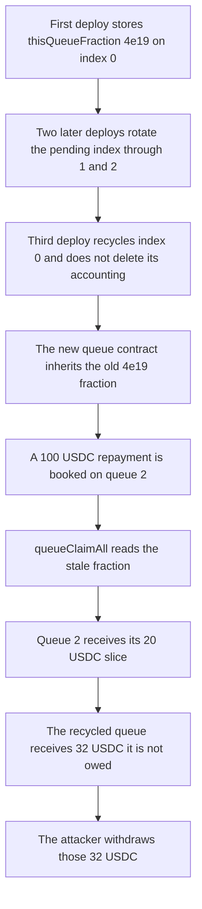

# Gondi Pool — recycled withdrawal queue keeps stale accounting

> **Vulnerability classes:** vuln/logic/state-update · vuln/logic/missing-check

<!-- non-defihacklabs -->
<!-- source-auditvault: https://github.com/Auditware/AuditVault/blob/main/findings/35209-h-07-deploywithdrawalqueue-need-to-clear-queueaccountinglas.md -->
<!-- date: 2024-04 -->

## Key info

| | |
|---|---|
| **Protocol** | Gondi |
| **Finding** | Code4rena 2024-04 H-07, AuditVault 35209 |
| **Vulnerable code** | `Pool.deployWithdrawalQueue` / `_updatePendingWithdrawalWithQueue` |
| **Harm** | 32 USDC paid to a recycled queue that is not owed them; the active queue still receives its 20 USDC slice |
| **Chain** | local synthetic |

## TL;DR

`deployWithdrawalQueue` rotates a circular array of withdrawal queues. It deletes `_queueOutstandingValues[lastQueueIndex]` and `_outstandingValues`, then reuses `lastQueueIndex` as the new pending queue. It does not delete `_queueAccounting[lastQueueIndex]`. The next `queueClaimAll` still loads that struct. A 100 USDC repayment booked on the active queue pays 20 USDC to the cohort that is owed it and 32 USDC to the fresh queue that inherited the previous cohort's `thisQueueFraction` of `4e19`. The attacker, who holds the only receipt on that fresh queue, withdraws the 32 USDC.

## The vulnerable code

`deployWithdrawalQueue` clears two slots and leaves the accounting slot in place:

```solidity
/// @dev We move outstaning values from the pool to the queue that was just deployed.
_queueOutstandingValues[pendingQueueIndex] = _outstandingValues;
/// @dev We clear values of the new pending queue.
delete _queueOutstandingValues[lastQueueIndex];
delete _outstandingValues;
// FIX: delete _queueAccounting[lastQueueIndex];

_updateLoanLastIds();

_pendingQueueIndex = lastQueueIndex;
```

`queueClaimAll` then distributes `getTotalReceived` with the stale fraction:

```solidity
// @> VULN: stale _queueAccounting[lastQueueIndex] is still loaded after deploy skips the delete
QueueAccounting memory queueAccounting = _queueAccounting[secondIdx];
if (queueAccounting.thisQueueFraction == 0) {
    unchecked {
        ++i;
    }
    continue;
}
```

A zero `thisQueueFraction` is what a new pending queue should have. The missing `delete` keeps the old value, so the loop does not `continue` and assigns `totalReceived * thisQueueFraction / PRINCIPAL_PRECISION` to the recycled index.

## Root cause

Queue indexes are `(pending + 1) % (maxQueues + 1)`. The slot that is about to become the pending queue is an old cohort's slot. Deploy replaces the queue contract at that index and clears outstanding-value caches, but `QueueAccounting.thisQueueFraction` and `netPoolFraction` stay. `_updatePendingWithdrawalWithQueue` treats any non-zero `thisQueueFraction` as a live claimant and subtracts that share from the repayment before the remainder is left with the pool.

## Preconditions

Three queue slots (`getMaxTotalWithdrawalQueues = 2`). Two deploys fill indexes 0 and 1. The third deploy wraps `lastQueueIndex` to 0, where `thisQueueFraction` is still `4e19` from the first cohort (40 shares out of 100). A later repayment is credited to `getTotalReceived[2]`. No timestamp warp is required: `getMinTimeBetweenWithdrawalQueues` is 0 in this reduction, which makes the audited `TooSoon` check pass inside one transaction. The loan-id walk inside `_loanTermination` is omitted; `noteRepayment` writes the same `getTotalReceived[idx] += received` the walk would write for queue 2.

## Attack walkthrough

1. Deposit 100 USDC. Total supply and assets are 100.
2. Withdraw 40 shares into pending index 0 and call `deployWithdrawalQueue`. The deploy stores `_queueAccounting[0].thisQueueFraction = 4e19` and moves the pending index to 1. Total supply becomes 60.
3. Deposit 40 USDC (supply and assets return to 100). Withdraw 25 shares into index 1 and deploy. Pending index becomes 2. Index 0's fraction is not cleared.
4. Deposit 25 USDC (supply and assets return to 100). Withdraw 20 shares into index 2 and deploy. `lastQueueIndex` is 0. A new queue contract is deployed at index 0. Outstanding values at 0 are deleted. `_queueAccounting[0]` is still `4e19`. Pending index is now 0. Total supply is 80.
5. Deposit 8 USDC and withdraw those 8 shares into the new queue. That receipt is the only position on the recycled contract.
6. Credit 100 USDC to `getTotalReceived[2]` and call `queueClaimAll`. The walk starts at queue 2: `100 * 2e19 / 1e20 = 20` USDC for queue 2. The next index is 0, whose stale fraction is `4e19`, so `(100 - 20) * 4e19 / 1e20 = 32` USDC is assigned to index 0. The loop then stops on the oldest index.
7. The attacker withdraws. Eight shares own the whole recycled queue, so the receipt pays 32 USDC.

The control is the same sequence on a pool that inserts `delete _queueAccounting[lastQueueIndex]` next to the other deletes. After the wrap, index 0's fraction is 0, the walk skips it, queue 2 still receives 20 USDC, and the attacker's withdrawal returns 0.

## Diagrams



## Impact

The fresh queue is paid 32 USDC of a repayment that belongs to an older cohort and to LPs who stayed in the pool. The attacker did not hold the old 40% position; that cohort was already separated at the first deploy. The active queue is not underpaid in this trace: it still receives its own 20 USDC slice. The 32 USDC is the part that should have stayed in the pool. The same stale fraction is what the report describes as overpayment, underpayment, or a stuck claim, depending on which slot is recycled and whether `totalReceived` can cover the extra subtraction.

## Remediation

Delete the accounting slot in the same place the outstanding-value caches are cleared:

```solidity
delete _queueOutstandingValues[lastQueueIndex];
delete _queueAccounting[lastQueueIndex];
delete _outstandingValues;
```

That is the change Gondi shipped for H-07. The control above runs it. The recycled fraction is 0, the new queue is paid nothing, and queue 2 still receives 20 USDC.

## How to reproduce

```bash
cd 35209-h-07-deploywithdrawalqueue-need-to-clear-queueaccountinglas_exp
forge test -vv
```

## Sources

- AuditVault finding: https://github.com/Auditware/AuditVault/blob/main/findings/35209-h-07-deploywithdrawalqueue-need-to-clear-queueaccountinglas.md
- Code4rena report: https://code4rena.com/reports/2024-04-gondi
- Vulnerable pool: https://github.com/code-423n4/2024-04-gondi/blob/5037caceb7acf77925e1548c4b15fae744f3f5b2/src/lib/pools/Pool.sol
- Mitigation review: https://github.com/code-423n4/2024-05-gondi-mitigation-findings/issues/47
- Original issue: https://github.com/code-423n4/2024-04-gondi-findings/issues/48
