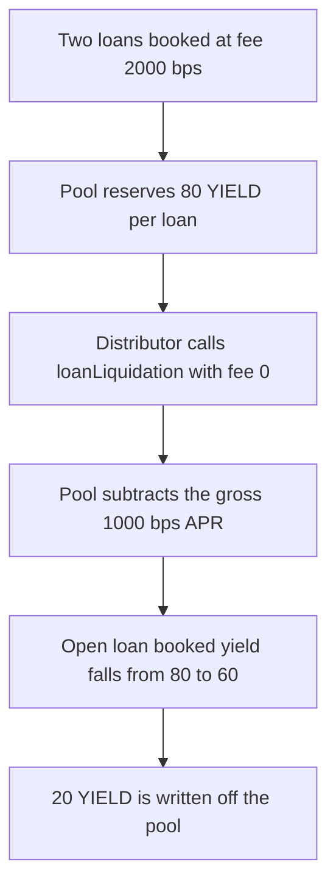

# Gondi — liquidation drops the protocol fee and shorts the pool

> **Vulnerability classes:** vuln/logic/fee-calculation

> **Reproduction:** cheatcode-free local synthetic. `LiquidationDistributor` calls `Pool.loanLiquidation` with the protocol fee hardcoded to 0. Full trace: [output.txt](output.txt). PoC: [test/35213-h-11-incorrect-protocol-fee-implementation-results-in-outsta_exp.sol](test/35213-h-11-incorrect-protocol-fee-implementation-results-in-outsta_exp.sol).

<!-- non-defihacklabs -->
<!-- source-auditvault: https://github.com/Auditware/AuditVault/blob/main/findings/35213-h-11-incorrect-protocol-fee-implementation-results-in-outsta.md -->
<!-- date: 2024-04 -->

**AuditVault taxonomy:** `lang/solidity` · `sector/lending` · `platform/code4rena` · `has/github` · `severity/high` · `vuln/logic/fee-calculation` · `novelty/variant` · `misassumption/math-is-safe` · `fix/fix-arithmetic` · genome: `fee-calculation` · `variant` · `fee-theft` · `fee-accounting` · `liquidation-underwater`

## Key info

| | |
|---|---|
| **Protocol** | Gondi Pool / LiquidationDistributor |
| **Finding** | Code4rena 2024-04 Gondi H-11, AuditVault 35213 |
| **Vulnerable code** | `LiquidationDistributor._handleLoanManagerCall` |
| **Harm** | After one of two loans is liquidated, the pool's booked yield on the loan that remains is 60 YIELD instead of 80. 20 YIELD is written off |
| **Chain** | local synthetic |

## TL;DR

A loan is originated with a 2,000 bps protocol fee. `Pool.validateOffer` adds `netApr * principal` to `sumApr`, and `netApr` is 800 when the quoted APR is 1,000 bps. On liquidation, `LiquidationDistributor` calls `loanLiquidation` with the fee argument set to 0, so the pool subtracts the gross APR. Two identical 1,000 TOKEN loans book 160 YIELD. Closing one of them at fee 0 removes 100 YIELD of APR from the books and leaves 60 for the loan that is still open. That loan was reserved at 80. The 20 YIELD gap is transferred out of the pool. Passing the real 2,000 bps fee leaves the pool at 80 and writes off nothing.

## The vulnerable code

Audited `LiquidationDistributor._handleLoanManagerCall`. The `0` is the argument the report marks. `Pool._updateOutstandingValuesOnTermination` then does `sumApr -= _apr * principal`, and `_apr` is `_netApr(apr, protocolFee)`.

```solidity
// @> VULN: protocol fee is hardcoded to 0. Origination added the post-fee APR.
pool.loanLiquidation(loanId, principalAmount, aprBps, accruedInterest, 0, sent, startTime);
// FIX: pass the loan's protocol fee instead of 0.
```

`_netApr` is `apr * (10_000 - fee) / 10_000`. Fee 2,000 gives 800. Fee 0 gives 1,000. Each loan's reserved yield is `principal * netApr / 10_000`: 80 YIELD at the origination fee, 100 YIELD if the gross APR is removed.

## Root cause

Origination and liquidation do not use the same fee. The value added to `sumApr` is the post-fee APR. The value subtracted on this path is the pre-fee APR, because the distributor never forwards `protocolFee`. With another loan still open, `sumApr` does not underflow. It lands 200,000 units below the remaining loan (`600_000` instead of `800_000`), which is 20 YIELD of annual booked yield.

## Preconditions

Two pool loans, each principal 1,000 TOKEN, APR 1,000 bps, protocol fee 2,000 bps. Both are opened in this block, so accrued interest is zero and the only difference is the APR removed from `sumApr`. The tranche lender is the pool, so the distributor takes the loan-manager branch. One loan is liquidated. The other stays open.

## Attack walkthrough

1. `validateOffer` twice. Each call adds `800 * 1_000 TOKEN` to `sumApr` and mints 80 YIELD to the pool. The pool holds 160 YIELD. `sumApr` is 1,600,000 units.
2. `distribute` builds a tranche whose start time is `block.timestamp` and calls `loanLiquidation` with fee 0.
3. The pool stores `lastProtocolFee = 0` and computes net APR 1,000.
4. `sumApr` is reduced by `1_000 * 1_000 TOKEN`. Remaining principal is 1,000 TOKEN. Remaining `sumApr` is 600,000 units. Booked annual yield is 60 YIELD.
5. The closed loan's reserved 80 YIELD is paid to the closed-loan address. The extra 20 YIELD, the amount the gross APR removed beyond what was minted, is transferred to the written-off address.
6. The pool's YIELD balance is 60. The open loan was booked at 80.

The control calls the same `loanLiquidation` with fee 2,000. Net APR is 800. `sumApr` left is 800,000 units. The pool keeps 80 YIELD. The written-off balance stays 0. The closed loan receives 80. The books match the loan that remains.

## Diagrams



## Impact

The pool is short 20 YIELD on the loan that was not liquidated. `sumApr` for that loan is 600,000 units instead of 800,000. Every later interest calculation that reads `sumApr / principal` uses 600 bps instead of the 800 bps that was booked at origination. The control with the real fee does not move that 20 YIELD.

## Remediation

Pass the loan's protocol fee into `loanLiquidation` instead of 0, the same fraction `validateOffer` used when it added `sumApr`.

## How to reproduce

```bash
cd 35213-h-11-incorrect-protocol-fee-implementation-results-in-outsta_exp
forge test -vv
```

## Sources

- AuditVault finding: https://github.com/Auditware/AuditVault/blob/main/findings/35213-h-11-incorrect-protocol-fee-implementation-results-in-outsta.md
- Code4rena report: https://code4rena.com/reports/2024-04-gondi
- Finding issue: https://github.com/code-423n4/2024-04-gondi-findings/issues/33
- Distributor: https://github.com/code-423n4/2024-04-gondi/blob/b9863d73c08fcdd2337dc80a8b5e0917e18b036c/src/lib/LiquidationDistributor.sol
- Pool accounting: https://github.com/code-423n4/2024-04-gondi/blob/b9863d73c08fcdd2337dc80a8b5e0917e18b036c/src/lib/pools/Pool.sol
