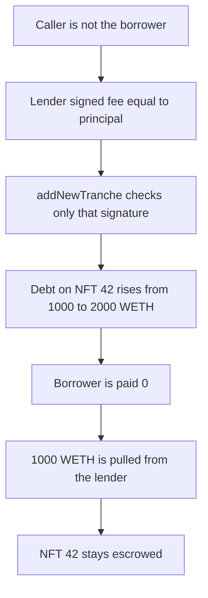

# Gondi — a lender tranche is added without the borrower

> **Vulnerability classes:** vuln/access-control/missing-auth · vuln/logic/missing-check

> **Reproduction:** cheatcode-free local synthetic. `addNewTranche` checks the lender signature and does not check the caller against the borrower. Full trace: [output.txt](output.txt). PoC: [test/35214-h-12-addnewtranche-no-authorization-from-borrower-code4rena_exp.sol](test/35214-h-12-addnewtranche-no-authorization-from-borrower-code4rena_exp.sol).

<!-- non-defihacklabs -->
<!-- source-auditvault: https://github.com/Auditware/AuditVault/blob/main/findings/35214-h-12-addnewtranche-no-authorization-from-borrower-code4rena.md -->
<!-- date: 2024-04 -->

**AuditVault taxonomy:** `lang/solidity` · `sector/lending` · `sector/token` · `platform/code4rena` · `has/github` · `severity/high` · `fix/use-reentrancy-guard` · genome: `missing-modifier` · `use-reentrancy-guard` · `role-bypass` · `integer-bounds` · `reentrancy-guard`

## Key info

| | |
|---|---|
| **Protocol** | Gondi MultiSourceLoan |
| **Finding** | Code4rena 2024-04 Gondi H-12, AuditVault 35214 |
| **Vulnerable code** | `MultiSourceLoan.addNewTranche` |
| **Harm** | 1,000 WETH is pulled from the lender. The borrower receives 0. Debt on escrowed NFT 42 rises from 1,000 WETH to 2,000 WETH at 10,000 bps |
| **Chain** | local synthetic |

## TL;DR

`addNewTranche` recovers the lender from the `RenegotiationOffer` signature and does not require `msg.sender` to be the borrower. The signed offer sets `fee` equal to `principalAmount` (1,000 WETH) and APR at 10,000 bps. The caller is not the borrower. The contract appends the tranche, pays the borrower `principal - fee` which is 0, and pulls the whole fee to the protocol because the fee fraction is 100%. Outstanding principal on NFT 42 goes from 1,000 WETH to 2,000 WETH. The token stays escrowed. A control that requires the borrower reverts this caller before any pull.

## The vulnerable code

Audited `addNewTranche`. The signature check is the only authorization. The recommended fix is `msg.sender == loan.borrower` before it.

```solidity
_baseLoanChecks(loanId, loan);
_baseRenegotiationChecks(offer);
// @> VULN: only the lender signature is checked. The borrower does not authorize the tranche.
this.checkSignature(offer.lender, hashOffer(offer), signature);
// FIX: require(msg.sender == loan.borrower).
```

The offer hash is the audited `RenegotiationOffer` typehash. The EIP-712 digest uses name `GONDI_MULTI_SOURCE_LOAN`, version `3`, chain id 1, and the loan contract. `ecrecover` must return the lender `0xf39F…2266`. The playground embeds that 65-byte signature. The forge test checks it equals `vm.sign` of the lender key.

The fee transfer is `fee * fraction / PRECISION`. Both the fraction and `PRECISION` are 10,000, and `fee` is 1,000 WETH, so the pull is 1,000 WETH. `principalAmount - fee` paid to the borrower is 0.

## Root cause

The function treats a lender signature as enough to change the borrower's loan. `refinanceFull` rejects a caller who is neither the lender nor the borrower. `addNewTranche` has no such check. The borrower cannot refuse the new principal, the 10,000 bps APR, or the fee that leaves them with no cash.

## Preconditions

A live loan id 1. Borrower `0xB0Bb`, NFT 42 escrowed, senior principal 1,000 WETH. The lender has signed renegotiation id 12 for another 1,000 WETH with fee 1,000 WETH and APR 10,000 bps, and has approved the loan for 1,000 WETH. The caller is not the borrower. The protocol fee fraction is the full fee.

## Attack walkthrough

1. The caller is not `0xB0Bb`. Loan id 1 is seeded with NFT 42 escrowed.
2. The lender is funded with 1,000 WETH and approves the loan.
3. `addNewTranche` is called with the lender signature. `ecrecover` returns the lender. The borrower is not checked.
4. A junior tranche is appended. Floor is 1,000 WETH. APR is 10,000 bps. `principalAmount` becomes 2,000 WETH. Token id is still 42.
5. The borrower transfer is 0. The fee transfer pulls 1,000 WETH from the lender to the protocol.
6. `paidToBorrower` is 0. `escrowedTokenId` is still 42. The lender balance is 0. The protocol balance is 1,000 WETH.

The guarded control requires `msg.sender == borrower` and reverts the same caller with `caller`. No WETH moves.

## Diagrams



## Impact

The borrower owes an extra 1,000 WETH at 10,000 bps on NFT 42 and receives no WETH. The NFT remains escrowed against 2,000 WETH instead of 1,000 WETH. The lender is debited 1,000 WETH for that junior claim. The protocol balance increases by 1,000 WETH.

## Remediation

Require `msg.sender == loan.borrower` before the signature check, which is the mitigation Gondi applied.

## How to reproduce

```bash
cd 35214-h-12-addnewtranche-no-authorization-from-borrower-code4rena_exp
forge test -vv
```

## Sources

- AuditVault finding: https://github.com/Auditware/AuditVault/blob/main/findings/35214-h-12-addnewtranche-no-authorization-from-borrower-code4rena.md
- Code4rena report: https://code4rena.com/reports/2024-04-gondi
- Audited function: https://github.com/code-423n4/2024-04-gondi/blob/b9863d73c08fcdd2337dc80a8b5e0917e18b036c/src/lib/loans/MultiSourceLoan.sol
