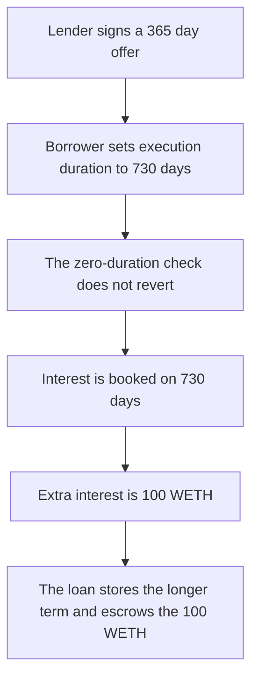

# Gondi — a signed 365-day offer is filled for 730 days

> **Vulnerability classes:** vuln/logic/missing-validation · vuln/logic/fee-calculation

> **Reproduction:** cheatcode-free local synthetic. `_validateOfferExecution` only rejects `offer.duration == 0`. The loan is stored at `executionData.duration`. Full trace: [output.txt](output.txt). PoC: [test/35215-h-13-processoffersfromexecutiondata-lack-of-check-execution_exp.sol](test/35215-h-13-processoffersfromexecutiondata-lack-of-check-execution_exp.sol).

<!-- non-defihacklabs -->
<!-- source-auditvault: https://github.com/Auditware/AuditVault/blob/main/findings/35215-h-13-processoffersfromexecutiondata-lack-of-check-execution.md -->
<!-- date: 2024-04 -->

**AuditVault taxonomy:** `lang/solidity` · `sector/lending` · `platform/code4rena` · `has/github` · `severity/high` · genome: `wrong-condition` · `direct-drain` · `liquidation-underwater` · `oracle-freshness`

## Key info

| | |
|---|---|
| **Protocol** | Gondi MultiSourceLoan |
| **Finding** | Code4rena 2024-04 Gondi H-13, AuditVault 35215 |
| **Vulnerable code** | `MultiSourceLoan._validateOfferExecution` / `_processOffersFromExecutionData` |
| **Harm** | A 365-day offer is stored for 730 days. Extra interest is 100 WETH on 1,000 WETH at 1,000 bps |
| **Chain** | local synthetic |

## TL;DR

The lender signs a loan offer whose `duration` is 365 days. That field is in the offer hash. `emitLoan` takes a separate execution duration and only checks that `offer.duration` is not zero. The borrower passes 730 days. Max interest is `principal + getInterest(apr, executionDuration)`: 200 WETH instead of 100 WETH. The extra 100 WETH is escrowed on the loan, and the stored duration is a year past the signature. Requiring `executionDuration <= offer.duration` reverts the same call.

## The vulnerable code

Audited `_validateOfferExecution` rejects only `offer.duration == 0`. `_processOffersFromExecutionData` then adds interest using `_duration` from the execution data, and stores that value on the loan.

```solidity
if (offer.duration == 0) {
    revert("zero duration");
}
// @> VULN: executionDuration is not required to be <= offer.duration
uint256 booked = amount + getInterest(amount, offer.aprBps, executionDuration);
// FIX: require(executionDuration <= offer.duration) before this interest is booked.
```

`getInterest` is the audited formula `amount * aprBps * duration / (10_000 * 365 days)`. At 1,000 WETH and 1,000 bps, 365 days is 100 WETH and 730 days is 200 WETH.

The offer hash is the audited `LoanOffer` typehash, including `duration` and an empty validators array. The digest uses name `GONDI_MULTI_SOURCE_LOAN`, version `3`, chain id 1, and the loan contract. The embedded signature recovers lender `0xf39F…2266`. The forge test checks it against `vm.sign`.

## Root cause

The signature binds `offer.duration`. The value copied onto the loan is `executionData.duration`, and no check relates the two. A nonzero signed duration does not cap the term the borrower can set.

## Preconditions

The lender has signed offer id 7: principal 1,000 WETH, fee 0, APR 1,000 bps, duration 365 days, and has approved the loan for 1,000 WETH. The borrower sets the execution duration to 730 days. Both happen in one block. Interest is a function of the stored duration, not of time passing.

## Attack walkthrough

1. The signed offer duration is 365 days. `ecrecover` returns the lender.
2. `offer.duration == 0` does not revert.
3. Interest is booked on 730 days: principal 1,000 WETH plus 200 WETH. The signed interest is 100 WETH. The gap is 100 WETH.
4. `storedDuration` is 730 days. `signedDuration` is 365 days. The loan ends one year later than the signature.
5. The lender's 1,000 WETH is transferred to the borrower. The loan then escrows the 100 WETH extra interest.

The control requires `executionDuration <= offer.duration` and reverts 730 days against a 365-day offer. No WETH moves.

## Diagrams



## Impact

The lender's 1,000 WETH is committed for 730 days instead of 365. Interest at 1,000 bps is 200 WETH instead of 100 WETH. The extra 100 WETH is escrowed on the loan. Default can be pursued a year later than the signed offer allowed.

## Remediation

Require `executionData.duration <= offer.duration` for every offer in the execution, which is the check Gondi added.

## How to reproduce

```bash
cd 35215-h-13-processoffersfromexecutiondata-lack-of-check-execution_exp
forge test -vv
```

## Sources

- AuditVault finding: https://github.com/Auditware/AuditVault/blob/main/findings/35215-h-13-processoffersfromexecutiondata-lack-of-check-execution.md
- Code4rena report: https://code4rena.com/reports/2024-04-gondi
- Finding issue: https://github.com/code-423n4/2024-04-gondi-findings/issues/28
- Validation: https://github.com/code-423n4/2024-04-gondi/blob/b9863d73c08fcdd2337dc80a8b5e0917e18b036c/src/lib/loans/MultiSourceLoan.sol
- Offer hash: https://github.com/code-423n4/2024-04-gondi/blob/b9863d73c08fcdd2337dc80a8b5e0917e18b036c/src/lib/utils/Hash.sol
