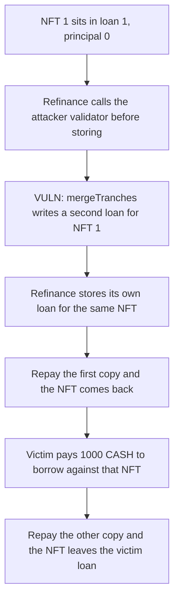

# Gondi — mergeTranches reenters and double-books one NFT

> **Vulnerability classes:** vuln/reentrancy/single-function

<!-- non-defihacklabs -->
<!-- source-auditvault: https://github.com/Auditware/AuditVault/blob/main/findings/35216-h-14-mergetranchesrefinancepartial-lack-of-nonreentrant-code.md -->
<!-- date: 2024-04 -->

## Key info

| | |
|---|---|
| **Protocol** | Gondi |
| **Finding** | Code4rena 2024-04 H-14, AuditVault 35216 |
| **Vulnerable code** | `MultiSourceLoan.mergeTranches` |
| **Harm** | 1,000 CASH taken from a lender; the NFT is pulled back out and the lender's loan stays unpaid |
| **Chain** | local synthetic |

## TL;DR

`refinanceFromLoanExecutionData` is `nonReentrant`, but it calls the offer validator before it stores the replacement loan. `mergeTranches` does not use that lock. The validator reenters `mergeTranches` and writes a second loan for the same NFT. The attacker repays one copy, receives the NFT, borrows 1,000 CASH from a real lender against it, then repays the other copy and takes the NFT back. The victim's loan is still recorded. The victim's balance is 0.

## The vulnerable code

```solidity
function mergeTranches(uint256 _loanId, Loan memory _loan, uint256 _minTranche, uint256 _maxTranche)
    external
    returns (uint256, Loan memory)
{
    _baseLoanChecks(_loanId, _loan);
    uint256 loanId = _getAndSetNewLoanId();
    Loan memory loanMergedTranches = _mergeTranches(loanId, _loan, _minTranche, _maxTranche);
    // @> VULN: no nonReentrant. A validator callback writes a second live loan for the same NFT.
    _loans[loanId] = loanMergedTranches.hash();
    delete _loans[_loanId];
    return (loanId, loanMergedTranches);
}
```

The report adds `nonReentrant` to `mergeTranches` and to `refinancePartial`. The control does that for `mergeTranches`. The callback then reverts with `Reentered`, the refinance rolls back, and the victim still holds 1,000 CASH.

## Root cause

The refinance path takes the reentrancy lock and then makes an external call into an offer validator the caller chose. `mergeTranches` checks that the old loan hash is still stored, allocates a new id, and writes that hash. It never looks at the lock. The callback therefore deletes the original loan and inserts a sibling loan while refinance still has the NFT id in memory. When refinance resumes it writes its own loan for the same token. One escrowed NFT now backs two loans, both with the attacker as lender and a zero principal, so either repay returns the token.

## Preconditions

The attacker already has a loan on NFT 1, with themselves as lender, so repaying a copy costs nothing. The victim has approved 1,000 CASH to the loan contract. The refinance execution data points its offer validator at the attacker's contract. No admin key is required. `mergeTranches` is external.

## Attack walkthrough

1. The victim holds 1,000 CASH, approved to the loan contract. NFT 1 is escrowed on loan 1. Principal is 0. Borrower and lender are the attacker.
2. The attacker calls `refinanceFromLoanExecutionData` and passes their own contract as the validator.
3. Refinance checks loan 1, reserves the next id, and calls `validateOffer` before storing anything.
4. The validator calls `mergeTranches` on loan 1. The lock does not stop it. A new loan is stored for NFT 1 and loan 1 is deleted.
5. Refinance stores the reserved id, also pointing at NFT 1. Two live loans now share the token.
6. The attacker repays the refinance copy. Principal is 0. The NFT is transferred back.
7. The attacker borrows 1,000 CASH from the victim against that NFT. The token is escrowed again. The victim's balance goes to 0.
8. The attacker repays the merged copy. `repayLoan` sends NFT 1 to the borrower again. The victim's loan hash is still stored, and nobody repaid the 1,000 CASH.

The control puts `nonReentrant` on `mergeTranches`. The same callback reverts. The victim's 1,000 CASH never moves, and NFT 1 stays in the original escrow.

## Diagrams



## Impact

The attacker holds 1,000 CASH that belonged to the victim, and holds NFT 1 as well. The victim's loan is still in storage, so the debt was not cleared and there is no collateral left to seize. The duplicate loan is what made the second withdrawal possible. Calling `mergeTranches` twice in separate transactions does not do this: the original id is deleted by the first call, and the second call cannot pass `_baseLoanChecks`.

## Remediation

Add `nonReentrant` to `mergeTranches` and `refinancePartial`, the same guard `refinanceFromLoanExecutionData` already uses. A callback during refinance must not be able to insert another loan for the escrowed NFT.

## How to reproduce

```bash
cd 35216-h-14-mergetranchesrefinancepartial-lack-of-nonreentrant-code_exp
forge test -vv
```

## Sources

- AuditVault finding: https://github.com/Auditware/AuditVault/blob/main/findings/35216-h-14-mergetranchesrefinancepartial-lack-of-nonreentrant-code.md
- Code4rena report: https://code4rena.com/reports/2024-04-gondi
- Code4rena issue: https://github.com/code-423n4/2024-04-gondi-findings/issues/27
- Vulnerable function: https://github.com/code-423n4/2024-04-gondi/blob/b9863d73c08fcdd2337dc80a8b5e0917e18b036c/src/lib/loans/MultiSourceLoan.sol
