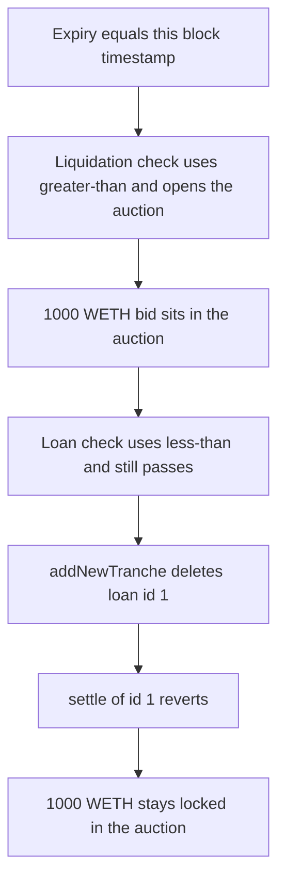

# Gondi — the exact expiry second is both liquidatable and still live

> **Vulnerability classes:** vuln/dos/frozen-funds · vuln/logic/liquidation-logic

> **Reproduction:** cheatcode-free local synthetic. `_baseLoanChecks` uses `<` and liquidation uses `>`. Full trace: [output.txt](output.txt). PoC: [test/35217-h-15-baseloanchecks-check-errors-for-expire-code4rena-gondi_exp.sol](test/35217-h-15-baseloanchecks-check-errors-for-expire-code4rena-gondi_exp.sol).

<!-- non-defihacklabs -->
<!-- source-auditvault: https://github.com/Auditware/AuditVault/blob/main/findings/35217-h-15-baseloanchecks-check-errors-for-expire-code4rena-gondi.md -->
<!-- date: 2024-04 -->

**AuditVault taxonomy:** `lang/solidity` · `sector/lending` · `sector/nft` · `platform/code4rena` · `has/github` · `severity/high` · `vuln/dos/frozen-funds` · `vuln/logic/liquidation-logic` · `impact/loss-of-funds/locked-funds` · `novelty/variant` · `misassumption/math-is-safe` · `fix/redesign-logic` · genome: `frozen-funds` · `liquidation-logic` · `locked-funds` · `variant` · `dos-resistance` · `liquidation-underwater` · `timestamp-dependence`

## Key info

| | |
|---|---|
| **Protocol** | Gondi MultiSourceLoan |
| **Finding** | Code4rena 2024-04 Gondi H-15, AuditVault 35217 |
| **Vulnerable code** | `MultiSourceLoan._baseLoanChecks` |
| **Harm** | 1,000 WETH stays in the auction. Settlement of loan id 1 reverts after that id is replaced at the exact expiry second |
| **Chain** | local synthetic |

## TL;DR

The loan expires when `startTime + duration` equals `block.timestamp`. `_baseLoanChecks` reverts only when that sum is strictly less than the timestamp, so the equal second is still treated as live. Liquidation reverts only when the expiry is strictly greater than the timestamp, so the same second is already due. Both calls succeed. Liquidation opens an auction and leaves the loan hash in place. `addNewTranche` then deletes loan id 1 and writes id 2. `settle(1)` reverts because the hash is gone. The 1,000 WETH bid remains in the auction and the lender is unpaid. The corrected `<=` check reverts `addNewTranche` on that second, and settlement then pays the lender the full 1,000 WETH.

## The vulnerable code

Audited comparisons. Liquidation is due when expiry is not strictly in the future. The loan check is expired only when expiry is strictly in the past. The equal second satisfies neither revert.

```solidity
uint256 expirationTime = loan.startTime + loan.duration;
if (expirationTime > block.timestamp) {
    revert("not due");
}

// @> VULN: strict < treats the exact expiry second as still live. Liquidation uses >.
if (loan.startTime + loan.duration < block.timestamp) {
    revert("expired");
}
// FIX: if (loan.startTime + loan.duration <= block.timestamp) revert("expired");
```

This run uses `startTime = 0`, `duration = 1`, and `block.timestamp = 1`. `1 > 1` is false and `1 < 1` is false.

## Root cause

The two checks are not complements. One uses `>` and the other uses `<`. Equality is accepted by both. The report's sequence is then possible: open the auction without clearing the hash, replace the loan through a path that still passes `_baseLoanChecks`, and leave settlement unable to find loan id 1.

## Preconditions

A loan whose `startTime + duration` equals the current timestamp. The hash is stored and is not deleted by liquidation. The attacker can call both `liquidate` and `addNewTranche` in that same block. A 1,000 WETH bid is posted into the auction. No timestamp warp is used. Forge and the playground both run this block at timestamp 1.

## Attack walkthrough

1. The loan is seeded at id 1. Expiry is exactly `block.timestamp`.
2. `liquidate` does not revert. 1,000 WETH is transferred into the auction. The hash for id 1 is still stored.
3. `addNewTranche` hits `_baseLoanChecks`. The `<` comparison does not revert. Id 1 is deleted and id 2 is written.
4. `settle(1)` reverts because the hash is empty. The revert is caught so the bid is not unwound.
5. The auction still holds 1,000 WETH. The lender's balance is 0.

The control uses `<=`. `addNewTranche` reverts with `expired`. The hash for id 1 remains. `settle` pays the lender 1,000 WETH and the auction balance is 0.

## Diagrams



## Impact

The lender is not paid the 1,000 WETH bid. That 1,000 WETH remains in the auction because settlement of the liquidated id reverts. The NFT loan id the auction was opened against no longer exists. The same second, with the corrected comparison, pays the lender and empties the auction.

## Remediation

Change the loan expiry check from `<` to `<=`, matching the mitigation Gondi applied, so the second liquidation treats as due is already expired for every other loan call.

## How to reproduce

```bash
cd 35217-h-15-baseloanchecks-check-errors-for-expire-code4rena-gondi_exp
forge test -vv
```

## Sources

- AuditVault finding: https://github.com/Auditware/AuditVault/blob/main/findings/35217-h-15-baseloanchecks-check-errors-for-expire-code4rena-gondi.md
- Code4rena report: https://code4rena.com/reports/2024-04-gondi
- Finding issue: https://github.com/code-423n4/2024-04-gondi-findings/issues/26
- Loan checks: https://github.com/code-423n4/2024-04-gondi/blob/b9863d73c08fcdd2337dc80a8b5e0917e18b036c/src/lib/loans/MultiSourceLoan.sol
