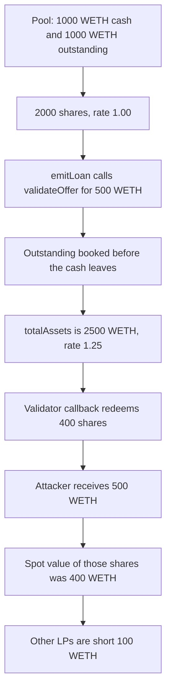

# Gondi — validateOffer reentry inflates the exchange rate

> **Vulnerability classes:** vuln/reentrancy/single-function · vuln/logic/incorrect-order-of-operations

> **Reproduction:** cheatcode-free local synthetic. `Pool.validateOffer` books the new loan before `MultiSourceLoan` pulls the principal, and the offer validator redeems in between. Full trace: [output.txt](output.txt). PoC: [test/35218-h-16-validateoffer-reentry-to-manipulate-exchangerate-code4r_exp.sol](test/35218-h-16-validateoffer-reentry-to-manipulate-exchangerate-code4r_exp.sol).

<!-- non-defihacklabs -->
<!-- source-auditvault: https://github.com/Auditware/AuditVault/blob/main/findings/35218-h-16-validateoffer-reentry-to-manipulate-exchangerate-code4r.md -->
<!-- date: 2024-04 -->

**AuditVault taxonomy:** `lang/solidity` · `sector/lending` · `sector/staking` · `platform/code4rena` · `has/github` · `severity/high` · genome: `single-function` · `known-pattern` · `direct-drain` · `reentrancy-guard`

## Key info

| | |
|---|---|
| **Protocol** | Gondi Pool / MultiSourceLoan |
| **Finding** | Code4rena 2024-04 Gondi H-16, AuditVault 35218 |
| **Vulnerable code** | `Pool.validateOffer` books `_outstandingValues` before the principal transfer |
| **Harm** | Validator redeems 400 shares for 500 WETH. Spot value of those shares is 400 WETH. Other LPs lose the extra 100 WETH |
| **Chain** | local synthetic |

## TL;DR

A pool offer is validated, then a callback runs, then the loan pulls the principal. `validateOffer` adds the new principal to outstanding value before that pull. `totalAssets` therefore includes both the cash and the loan. The share rate moves from 1.00 to 1.25. The attacker's validator redeems 400 shares in the callback and receives 500 WETH. At the spot rate those shares were worth 400 WETH. The other LPs are short 100 WETH.

## The vulnerable code

Audited `Pool.validateOffer` (`code-423n4/2024-04-gondi` @ `b9863d73`, `src/lib/pools/Pool.sol`). The loan calls this, then `_checkValidators`, then `safeTransferFrom` the principal. The assignment below is the audited line.

```solidity
/// @dev If the txn doesn't revert, we can assume the loan was executed.
_outstandingValues = _getNewLoanAccounting(principalAmount, _netApr(apr, _protocolFee));

// inside _getNewLoanAccounting, the update that call performs:
// @> VULN: principal is added to outstanding before the loan pulls the cash, so the exchange rate rises while the assets are still in the pool.
outstandingValues.principalAmount += uint128(_principalAmount);
// FIX: make validateOffer a view, or hold a lock until the principal transfer, and reject validators.
```

`totalAssets` is undeployed cash plus outstanding value. Supply does not change in `validateOffer`, so the exchange rate rises by the new principal until the cash actually leaves. The playground compiler inlines `_getNewLoanAccounting`, so the trace lands on the principal update.

## Root cause

Checks-effects-interactions is split across two contracts. The pool records the loan as an asset before the loan contract takes the cash. The validator callback sits in that gap and can call `redeem`. `validateOffer` and `redeem` do not share a lock. A `nonReentrant` modifier that ends when `validateOffer` returns does not cover the callback, because the callback runs after that return.

## Preconditions

The pool is an accepted lender, so `emitLoan` calls `validateOffer` instead of checking an EOA signature. The offer has a validator the attacker controls. The attacker already holds shares. In this run: 1,000 WETH cash, 1,000 WETH outstanding, 2,000 shares, attacker 400 shares, other LPs 1,600 shares. The new principal is 500 WETH, which fits in the idle cash, so the offer does not revert. Same block, so accrued interest on the cache is zero.

## Attack walkthrough

1. Spot rate is 1.00. Preview of 400 shares is 400 WETH. Other LPs' 1,600 shares are worth 1,600 WETH.
2. `emitLoan` calls `Pool.validateOffer` for 500 WETH. Outstanding principal becomes 1,500 WETH. Cash is still 1,000 WETH. `totalAssets` is 2,500 WETH. The rate is 1.25.
3. The validator callback reads that rate while the cash is still 1,000 WETH. It redeems 400 shares. `400 * 2,500 / 2,000 = 500` WETH.
4. The pool transfers 500 WETH to the validator. Spot value was 400 WETH. Extra is 100 WETH.
5. The loan then pulls the 500 WETH principal to the borrower. That is the real loan, not the profit. Pool cash is now 0. Outstanding stays 1,500 WETH. Remaining supply is the other LPs' 1,600 shares, which claim 1,500 WETH. Their shortfall is 100 WETH, the same 100 WETH the attacker received above spot.

The guarded control keeps a lock set from `validateOffer` until the principal transfer. The same redeem inside the callback fails. The loan still settles. A redeem after the lock drops pays 400 WETH, and the extra is 0.

## Diagrams



## Impact

The validator receives 500 WETH for shares whose spot value is 400 WETH. The extra 100 WETH is taken from the other LPs: after the loan settles, their 1,600 shares claim 1,500 WETH instead of 1,600 WETH. The borrower still receives the 500 WETH principal of the new loan. That principal is matched by the new outstanding entry and is not the attacker's profit.

## Remediation

Do not update outstanding value until the principal has left the pool, and do not run offer validators while the pool's accounting and cash disagree. Gondi's mitigation makes `validateOffer` a view so the callback cannot change pool state. A lock that is released when `validateOffer` returns is not enough. The control holds the lock until the transfer.

## How to reproduce

```bash
cd 35218-h-16-validateoffer-reentry-to-manipulate-exchangerate-code4r_exp
forge test -vv
```

## Sources

- AuditVault finding: https://github.com/Auditware/AuditVault/blob/main/findings/35218-h-16-validateoffer-reentry-to-manipulate-exchangerate-code4r.md
- Code4rena report: https://code4rena.com/reports/2024-04-gondi
- Finding issue: https://github.com/code-423n4/2024-04-gondi-findings/issues/24
- Audited pool: https://github.com/code-423n4/2024-04-gondi/blob/b9863d73c08fcdd2337dc80a8b5e0917e18b036c/src/lib/pools/Pool.sol
- Offer order: https://github.com/code-423n4/2024-04-gondi/blob/b9863d73c08fcdd2337dc80a8b5e0917e18b036c/src/lib/loans/MultiSourceLoan.sol
- Mitigation: https://github.com/code-423n4/2024-05-gondi-mitigation
