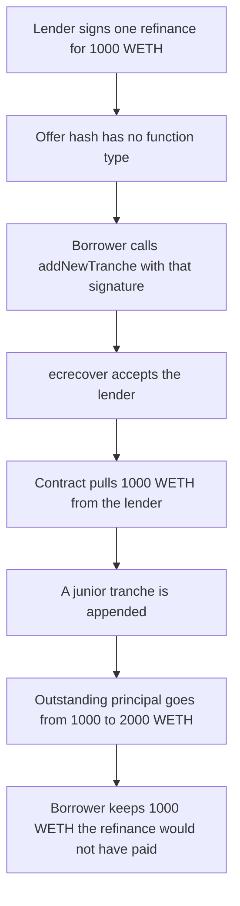

# Gondi — one lender signature opens a second tranche

> **Vulnerability classes:** vuln/auth/signature-replay · vuln/logic/missing-check · vuln/logic/missing-validation

> **Reproduction:** cheatcode-free local synthetic. `addNewTranche` checks the same `RenegotiationOffer` digest as `refinanceFull`. Full trace: [output.txt](output.txt). PoC: [test/35219-h-17-refinancefulladdnewtranche-reusing-a-lenders-signature_exp.sol](test/35219-h-17-refinancefulladdnewtranche-reusing-a-lenders-signature_exp.sol).

<!-- non-defihacklabs -->
<!-- source-auditvault: https://github.com/Auditware/AuditVault/blob/main/findings/35219-h-17-refinancefulladdnewtranche-reusing-a-lenders-signature.md -->
<!-- date: 2024-04 -->

**AuditVault taxonomy:** `lang/solidity` · `sector/lending` · `platform/code4rena` · `has/github` · `severity/high` · genome: `single-function` · `frontrun` · `frontrun-exposure`

## Key info

| | |
|---|---|
| **Protocol** | Gondi MultiSourceLoan |
| **Finding** | Code4rena 2024-04 Gondi H-17, AuditVault 35219 |
| **Vulnerable code** | `MultiSourceLoan.addNewTranche` / `refinanceFull` signature check |
| **Harm** | Borrower receives 1,000 WETH as a new junior tranche. Outstanding principal goes from 1,000 WETH to 2,000 WETH on the same NFT. The signed refinance would have paid the borrower 0 |
| **Chain** | local synthetic |

## TL;DR

A lender signs one `RenegotiationOffer` so the borrower can `refinanceFull`: replace the single 1,000 WETH tranche. The offer hash has no function type, and using the offer does not burn `renegotiationId`. The borrower passes that signature to `addNewTranche` instead. The contract pulls the full 1,000 WETH to the borrower and leaves the senior tranche in place. The NFT that backed 1,000 WETH now backs 2,000 WETH, and the lender's new money sits behind the original 1,000 WETH.

## The vulnerable code

Audited `MultiSourceLoan` (`code-423n4/2024-04-gondi` @ `b9863d73`). Both functions call `_checkSignature(lender, offer.hash(), sig)`. `Hash.hash(RenegotiationOffer)` is the typehash below and does not include a function tag. `isRenegotiationOfferCancelled` is only set by `cancelRenegotiationOffer`, not by execution.

```solidity
// refinanceFull, borrower path — same hash
this.checkSignature(offer.lender, hashOffer(offer), signature);

// addNewTranche
// @> VULN: refinanceFull verifies this same offer hash. No function type, and renegotiationId is not consumed.
this.checkSignature(offer.lender, hashOffer(offer), signature);
// FIX: bind a type tag into the hash and set isRenegotiationOfferCancelled[lender][renegotiationId] = true.
```

`hashOffer` is the audited encoding: `RenegotiationOffer(uint256 renegotiationId,uint256 loanId,address lender,uint256 fee,uint256[] trancheIndex,uint256 principalAmount,uint256 aprBps,uint256 expirationTime,uint256 duration)`. The EIP-712 digest is `keccak256(0x1901 ‖ domain ‖ hashOffer)`. Domain separator is name `GONDI_MULTI_SOURCE_LOAN`, version `3`, chain id, and the loan contract. `ecrecover` must return the lender. The playground embeds that 65-byte signature. The forge test checks it equals `vm.sign` of the lender key.

`_addNewTranche` then does `principalAmount += offer.principalAmount` and `transferFrom(lender, borrower, principalAmount - fee)`.

## Root cause

One struct hash authorizes two different settlements. `refinanceFull` replaces every tranche and, when the new principal equals the old one and interest is zero, sends the lender's WETH to the previous lender. `addNewTranche` appends a tranche and sends that same WETH to the borrower. The signature cannot tell them apart, and the id is not consumed, so the first function to land in a block wins.

## Preconditions

A live loan with one tranche. The lender has signed a same-size refinance (`principalAmount` equal to the outstanding principal, fee 0) and has approved the loan contract for that amount. The loan was opened in this block, so accrued interest is zero and the honest refinance pays the borrower nothing. `addNewTranche` does not require `msg.sender` to be the lender.

## Attack walkthrough

1. Loan id 1: borrower owes 1,000 WETH, NFT 42, senior lender `0xb0b5`, APR 1,000 bps.
2. The victim lender signs renegotiation id 17: principal 1,000 WETH, APR 500 bps, tranche index `[0]`, fee 0. `ecrecover` of the embedded signature is that lender.
3. `borrowerDelta` on those terms is 0. `refinanceFull` with the same bytes repays `0xb0b5` 1,000 WETH, pays the borrower 0, and leaves one tranche of 1,000 WETH. That path is the forge control contrast, not the playground run.
4. The borrower calls `addNewTranche` with the same signature. The cancelled-id flag is still false. The signature check passes.
5. A second tranche is appended. Floor is 1,000 WETH, so the new money is junior. Outstanding principal is 2,000 WETH. Collateral token id is still 42.
6. `transferFrom` pulls 1,000 WETH from the lender to the borrower. Lender balance is 0. Borrower balance is 1,000 WETH.
7. `isRenegotiationOfferCancelled[lender][17]` is still false. A second `addNewTranche` reverts because loan id 1 was deleted, not because the signature was consumed.

The guarded control puts `kind` in the digest and sets `consumed` on success. `addNewTranche` rejects the refinance signature. `refinanceFull` pays the borrower 0 and repays the senior lender 1,000 WETH. A second `refinanceFull` and a later `addNewTranche` both revert with `consumed`.

## Diagrams



## Impact

The borrower is paid 1,000 WETH that the signed refinance would not have paid. The position the lender thought was a 1,000 WETH replacement is a 1,000 WETH junior claim behind the original senior tranche. Total debt on NFT 42 is 2,000 WETH. The lender's wallet is debited the full signed principal for that worse claim.

## Remediation

Add a type field to `RenegotiationOffer` so `refinanceFull` and `addNewTranche` hash different digests, and mark `renegotiationId` consumed on execution. Gondi's later `trancheIndex` length check does not separate the two functions on a one-tranche loan, which the mitigation review left unmitigated.

## How to reproduce

```bash
cd 35219-h-17-refinancefulladdnewtranche-reusing-a-lenders-signature_exp
forge test -vv
```

## Sources

- AuditVault finding: https://github.com/Auditware/AuditVault/blob/main/findings/35219-h-17-refinancefulladdnewtranche-reusing-a-lenders-signature.md
- Code4rena report: https://code4rena.com/reports/2024-04-gondi
- Finding issue: https://github.com/code-423n4/2024-04-gondi-findings/issues/13
- Audited loan: https://github.com/code-423n4/2024-04-gondi/blob/b9863d73c08fcdd2337dc80a8b5e0917e18b036c/src/lib/loans/MultiSourceLoan.sol
- Offer hash: https://github.com/code-423n4/2024-04-gondi/blob/b9863d73c08fcdd2337dc80a8b5e0917e18b036c/src/lib/utils/Hash.sol
- Mitigation still open on one-tranche loans: https://github.com/code-423n4/2024-05-gondi-mitigation-findings/issues/65
