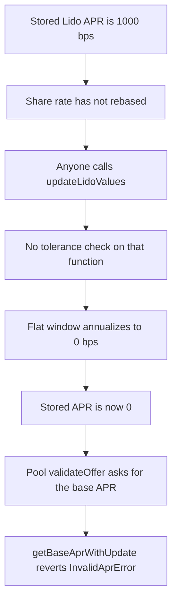

# Gondi — anyone can set the Lido APR to 0

> **Vulnerability classes:** vuln/logic/missing-check · vuln/oracle/missing-validation · vuln/dos/permanent

> **Reproduction:** cheatcode-free local synthetic. `updateLidoValues` samples a flat stETH share rate with no tolerance check and stores 0 bps. The next pool quote reverts. Full trace: [output.txt](output.txt). PoC: [test/35262-h-01-lidos-apr-can-be-maliciously-updated-to-0-value-due-to_exp.sol](test/35262-h-01-lidos-apr-can-be-maliciously-updated-to-0-value-due-to_exp.sol).

<!-- non-defihacklabs -->
<!-- source-auditvault: https://github.com/Auditware/AuditVault/blob/main/findings/35262-h-01-lidos-apr-can-be-maliciously-updated-to-0-value-due-to.md -->
<!-- date: 2024-06 -->

**AuditVault taxonomy:** `lang/solidity` · `sector/lending` · `sector/liquid-staking` · `sector/oracle` · `platform/code4rena` · `has/github` · `severity/high` · genome: `frozen-funds` · `specific-token-type` · `permanent` · `dos-resistance` · `timestamp-dependence`

## Key info

| | |
|---|---|
| **Protocol** | Gondi LidoEthBaseInterestAllocator |
| **Finding** | Code4rena 2024-06 Gondi H-01, AuditVault 35262 |
| **Vulnerable code** | `updateLidoValues` writes `aprBps` with no `getLidoUpdateTolerance` check |
| **Harm** | Stored Lido APR goes from 1000 bps to 0. `Pool.validateOffer` reverts `InvalidAprError` instead of quoting 1000 bps |
| **Chain** | local synthetic |

## TL;DR

`getBaseAprWithUpdate` only resamples stETH after `getLidoUpdateTolerance`. `updateLidoValues` is public and does not. stETH rebases about once a day, so a call a few seconds after a good sample sees a flat share rate. The APR formula divides that zero change by the elapsed seconds and stores 0. The pool's next offer check calls `getBaseAprWithUpdate`, which reverts `InvalidAprError`. Lending stops until a later rebase, and the same call can zero it again.

## The vulnerable code

Audited `LidoEthBaseInterestAllocator` (`code-423n4/2024-06-gondi` @ `ab141181`). `getBaseAprWithUpdate` gates `_updateLidoValues` on the tolerance. `updateLidoValues` does not.

```solidity
function updateLidoValues() external {
    _updateLidoValues(getLidoData);
}

function _updateLidoValues(LidoData memory _lidoData) private {
    uint256 shareRate = _currentShareRate();
    // @> VULN: no getLidoUpdateTolerance check, so a flat share rate over a short window writes aprBps 0.
    _lidoData.aprBps = uint16(
        (_BPS * _SECONDS_PER_YEAR * (shareRate - _lidoData.shareRate)) / _lidoData.shareRate
            / (block.timestamp - _lidoData.lastTs)
    );
    _lidoData.shareRate = uint144(shareRate);
    _lidoData.lastTs = uint96(block.timestamp);
    getLidoData = _lidoData;
}
```

`getBaseAprWithUpdate` then does `if (lidoData.aprBps == 0) revert InvalidAprError()`.

## Root cause

The APR is an annualized share-rate change. A window with no rebase has a zero numerator, so the result is 0 for any positive elapsed time. That 0 overwrites a real sample and is rejected by the quote used to open loans. The tolerance exists so a sample is only taken after enough time for a rebase. It is enforced on `getBaseAprWithUpdate` and missing on `updateLidoValues`.

## Preconditions

A stored sample with a non-zero APR (here 1000 bps) and a share rate equal to the current stETH share rate. `lastTs` is in the past but inside the tolerance (12 seconds when the clock allows it, otherwise the previous second). No rebase in between. Anyone can call `updateLidoValues`. Same block after that: the new `lastTs` is now, so the quote does not resample, sees 0, and reverts.

## Attack walkthrough

1. `getBaseAprWithUpdate` returns 1000. Elapsed time is under 1 day, so it does not recompute.
2. `updateLidoValues` reads the same share rate. The change is 0. The formula stores `aprBps = 0` and sets `lastTs` to this block.
3. `getLidoData` is now 0, not 1000.
4. `Pool.validateOffer` calls `getBaseAprWithUpdate`. The APR is 0 and the elapsed time is 0, so it does not resample. It reverts `InvalidAprError`. `quotedApr` stays 0. The offer is not opened.

The guarded control uses the same formula but skips the update while `block.timestamp - lastTs <= 1 days`. The APR stays 1000. `validateOffer` returns 1000. The change is 0.

## Diagrams



## Impact

The base-rate quote the pool needs to lend goes from 1000 bps to a revert. No new offer can be validated while the stored APR is 0. After the tolerance, a real rebase can restore a non-zero APR, and the same permissionless call can zero it again on the next flat window. That is a repeatable halt of pool lending, which is the harm the judge rated High.

## Remediation

Call `_updateLidoValues` only when `block.timestamp - lastTs > getLidoUpdateTolerance`, including from `updateLidoValues`. Do not replace a non-zero APR with a sample taken between rebases.

## How to reproduce

```bash
cd 35262-h-01-lidos-apr-can-be-maliciously-updated-to-0-value-due-to_exp
forge test -vv
```

## Sources

- AuditVault finding: https://github.com/Auditware/AuditVault/blob/main/findings/35262-h-01-lidos-apr-can-be-maliciously-updated-to-0-value-due-to.md
- Code4rena report: https://code4rena.com/reports/2024-06-gondi
- Finding issue: https://github.com/code-423n4/2024-06-gondi-findings/issues/9
- Allocator (same function in the April tree): https://github.com/code-423n4/2024-04-gondi/blob/b9863d73c08fcdd2337dc80a8b5e0917e18b036c/src/lib/pools/LidoEthBaseInterestAllocator.sol
- June path cited by the finding: https://github.com/code-423n4/2024-06-gondi/blob/ab1411814ca9323c5d427739f5771d3907dbea31/src/lib/pools/LidoEthBaseInterestAllocator.sol
