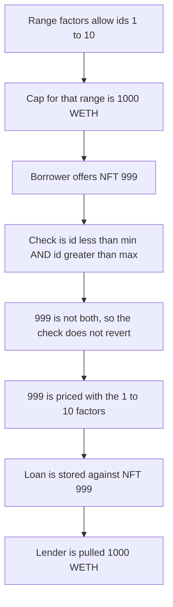

# Gondi — a collateral id outside the range still opens a loan

> **Vulnerability classes:** vuln/logic/wrong-condition · vuln/input-validation/missing

> **Reproduction:** cheatcode-free local synthetic. The range test is `id < min && id > max`, so token 999 is priced with the factors for ids 1-10. The lender is pulled 1,000 WETH. Full trace: [output.txt](output.txt). PoC: [test/35264-h-03-oraclepoolofferhandler-has-an-invalid-check-on-collater_exp.sol](test/35264-h-03-oraclepoolofferhandler-has-an-invalid-check-on-collater_exp.sol).

<!-- non-defihacklabs -->
<!-- source-auditvault: https://github.com/Auditware/AuditVault/blob/main/findings/35264-h-03-oraclepoolofferhandler-has-an-invalid-check-on-collater.md -->
<!-- date: 2024-06 -->

**AuditVault taxonomy:** `lang/solidity` · `sector/lending` · `sector/nft-lending` · `sector/oracle` · `platform/code4rena` · `has/github` · `severity/high` · genome: `wrong-condition` · `direct-drain` · `integer-bounds` · `circuit-input-range-check`

## Key info

| | |
|---|---|
| **Protocol** | Gondi OraclePoolOfferHandler |
| **Finding** | Code4rena 2024-06 Gondi H-03, AuditVault 35264 |
| **Vulnerable code** | `_getFactors` range test `collateralTokenId < min && collateralTokenId > max` |
| **Harm** | Loan opens against NFT 999. The lender is pulled 1,000 WETH that the factors reserved for token ids 1-10 |
| **Chain** | local synthetic |

## TL;DR

Collection offers can limit principal factors to a token-id range. The check that should reject an id outside that range uses `&&`. No integer is both below the minimum and above the maximum, so the revert is dead. Token 999 is priced with the 1-10 factors. Those factors cap principal at 1,000 WETH. The loan opens on NFT 999 and `transferFrom` takes that 1,000 WETH from the lender.

## The vulnerable code

Audited `OraclePoolOfferHandler._getFactors` (`code-423n4/2024-06-gondi` @ `ab141181`). For validation code 1 the handler decodes `(min, max)` and then:

```solidity
(uint256 min, uint256 max) = abi.decode(validationData.data, (uint256, uint256));
// @> VULN: id < min AND id > max is impossible, so an id outside [min, max] does not revert.
if (_collateralTokenId < min && _collateralTokenId > max) {
    revert InvalidInputError();
}
// FIX: if (_collateralTokenId < min || _collateralTokenId > max) revert InvalidInputError();
```

`validateOffer` then caps the offer with those factors:

```solidity
uint256 cap = floorValue * factorBps / PRECISION;
if (amount > cap) {
    revert InvalidPrincipalAmountError();
}
```

The key for the factors is the collection, the duration, and the encoded range. It does not include the token id. Once the range check fails open, every id uses that cap.

## Root cause

A bounds check written with `&&` instead of `||` is unreachable. The false branch is the only branch. Out-of-range collateral is indistinguishable from in-range collateral, and it inherits the principal the pool published for the lucrative ids.

## Preconditions

A range offer: ids 1 through 10, floor 10,000 WETH, factor 1,000 / 10,000, so the cap is 1,000 WETH. The lender has approved the loan contract for 1,000 WETH. The borrower passes token id 999 and amount 1,000 WETH. No merkle proof and no per-id factor is consulted.

## Attack walkthrough

1. The handler is configured for ids 1-10. `maxPrincipal` is 1,000 WETH.
2. `emitLoan(999, 1000 WETH)` calls `validateOffer`.
3. `999 < 1` is false. The `&&` short-circuits. `InvalidInputError` is not thrown.
4. The cap from the 1-10 factors is 1,000 WETH. The amount is not greater, so `InvalidPrincipalAmountError` is not thrown.
5. The loan stores collateral token id 999.
6. `transferFrom` pulls 1,000 WETH from the lender to the borrower. The lender balance is 0.

The guarded control uses `id < min || id > max`. Token 999 reverts before any pull. The lender still holds 1,000 WETH. Token id 1, which is inside the range, still draws the 1,000 WETH.

## Diagrams



## Impact

The lender's 1,000 WETH is lent against NFT 999. The published terms only authorized that principal for token ids 1 through 10. The borrower receives the full 1,000 WETH. The lender is left with a claim on a token the range was written to exclude.

## Remediation

Revert when `_collateralTokenId < min || _collateralTokenId > max`. Do not apply a range's principal factors to an id outside that range.

## How to reproduce

```bash
cd 35264-h-03-oraclepoolofferhandler-has-an-invalid-check-on-collater_exp
forge test -vv
```

## Sources

- AuditVault finding: https://github.com/Auditware/AuditVault/blob/main/findings/35264-h-03-oraclepoolofferhandler-has-an-invalid-check-on-collater.md
- Code4rena report: https://code4rena.com/reports/2024-06-gondi
- Finding issue: https://github.com/code-423n4/2024-06-gondi-findings/issues/6
- Handler path cited by the finding: https://github.com/code-423n4/2024-06-gondi/blob/ab1411814ca9323c5d427739f5771d3907dbea31/src/lib/pools/OraclePoolOfferHandler.sol
