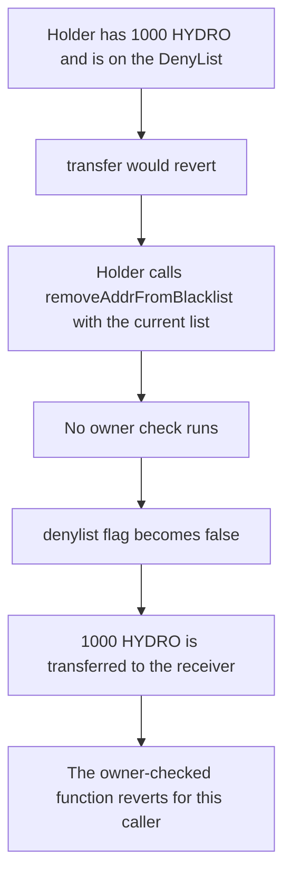

# Hydro — anyone can clear a DenyList entry and move the frozen balance

> **Vulnerability classes:** vuln/access-control/missing-owner-check · vuln/access-control/missing-modifier

> **Reproduction:** a self-contained Foundry PoC that compiles and runs offline
> with only `forge-std` — no fork and no RPC. Trace: [output.txt](output.txt).
> PoC: [test/35502-anyone-could-remove-anyone-from-the-blacklist-zokyo-none-hyd_exp.sol](test/35502-anyone-could-remove-anyone-from-the-blacklist-zokyo-none-hyd_exp.sol).

<!-- non-defihacklabs -->
<!-- source-auditvault: https://github.com/Auditware/AuditVault/blob/main/findings/35502-anyone-could-remove-anyone-from-the-blacklist-zokyo-none-hyd.md -->
<!-- date: 2024-04 -->

---

## Key info

| | |
|---|---|
| **Impact** | **HIGH** — a blacklisted balance of **1,000 HYDRO** is unlisted by its holder and transferred out |
| **Protocol** | Hydro `remove_addr_from_blacklist` |
| **Vulnerable code** | The entry takes the current DenyList and an address and deletes it, with no owner check |
| **Bug class** | Missing owner check on a blacklist removal |
| **Finding** | Zokyo — Hydro, April 2024 · id 35502 |
| **Report** | [Zokyo Hydro, 23 April 2024](https://github.com/solodit/solodit_content/blob/main/reports/Zokyo/2024-04-23-Hydro.md) |
| **Source** | [AuditVault finding](https://github.com/Auditware/AuditVault/blob/main/findings/35502-anyone-could-remove-anyone-from-the-blacklist-zokyo-none-hyd.md) |
| **Status** | The report marks the item Invalid; the missing check is reproduced here as described. The fixed function requires the owner. |
| **Compiler** | solc 0.8.27, cancun, via IR |

---

## TL;DR

`remove_addr_from_blacklist` takes the current DenyList and an address and removes that address. Other mutating functions in the same module check that the caller is the owner. This one does not.

A holder with **1,000 HYDRO** is blacklisted, so `transfer` reverts. They pass the one-address list and their own address. The flag clears. The **1,000 HYDRO** moves to the receiver.

The owner-checked function reverts for any other caller and the flag stays set.

`run()` does not warp. The Move entry is modeled as the Solidity function the report describes. The list argument is the DenyList the entry requires the caller to pass.

## The vulnerable code

```solidity
function removeAddrFromBlacklist(address[] calldata listed, address who) external {
    require(found, "listed");
    // @> VULN: the DenyList is updated with no owner == msg.sender check
    denylist[who] = false;
}
```

`transfer` then requires `!denylist[msg.sender]`. Once the flag is false, the frozen balance moves.

## Root cause

The deletion is authorized by possession of the list argument, not by the owner capability the other mutating functions take. Anyone who can pass the current list can drop any address that is on it, including themselves.

## Preconditions

- The holder is on the DenyList and has a balance of **1,000 HYDRO**.
- `transfer` reverts while the flag is set.
- No timestamp change happens inside `run()`.

## Attack walkthrough

1. Read `denylist[holder]`. It is true. The balance is **1,000 HYDRO**.
2. Call `removeAddrFromBlacklist([holder], holder)`. The caller is not the owner.
3. `denylist[holder]` is false.
4. `transfer` sends **1,000 HYDRO** to the receiver. The holder's balance is **0**.

Control: the same call from a non-owner on the fixed token reverts with `owner`. The address stays on the list.

## Diagrams



## Impact

**1,000 HYDRO** that the blacklist was holding in place moves to an arbitrary receiver. The owner is not involved.

## Remediation

Take the owner capability as an argument and require `owner == msg.sender`, matching the other mutating functions in the module.

## Sources

- [AuditVault finding 35502](https://github.com/Auditware/AuditVault/blob/main/findings/35502-anyone-could-remove-anyone-from-the-blacklist-zokyo-none-hyd.md)
- [Zokyo Hydro, 23 April 2024](https://github.com/solodit/solodit_content/blob/main/reports/Zokyo/2024-04-23-Hydro.md)

### Taxonomy

- `severity/high`
- `vuln/access-control/missing-owner-check`
- `vuln/access-control/missing-modifier`
