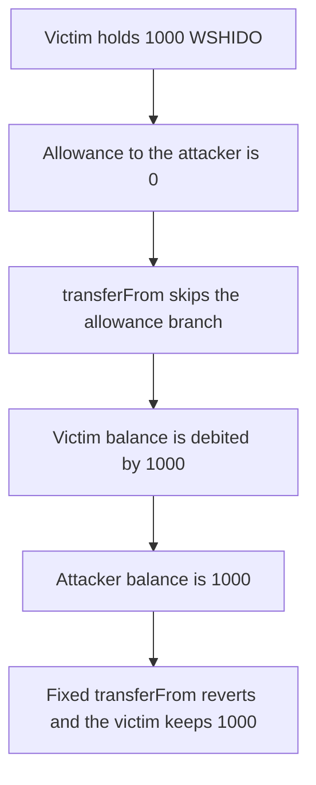

# Shido WSHIDO — transferFrom moves tokens when allowance is zero

> **Vulnerability classes:** vuln/logic/missing-check · vuln/access-control/broken-logic

> **Reproduction:** a self-contained Foundry PoC that compiles and runs offline
> with only `forge-std` — no fork and no RPC. Trace: [output.txt](output.txt).
> PoC: [test/35628-insufficient-src-validation-allows-malicious-users-to-steal_exp.sol](test/35628-insufficient-src-validation-allows-malicious-users-to-steal_exp.sol).

<!-- non-defihacklabs -->
<!-- source-auditvault: https://github.com/Auditware/AuditVault/blob/main/findings/35628-insufficient-src-validation-allows-malicious-users-to-steal.md -->
<!-- date: 2024-05 -->

---

## Key info

| | |
|---|---|
| **Impact** | **HIGH** — **1,000 WSHIDO** moves from a victim whose allowance is **0** |
| **Protocol** | Shido `WSHIDO.transferFrom` |
| **Vulnerable code** | The allowance deduction is skipped when the allowance is zero, and the balance update is unconditional |
| **Bug class** | Missing allowance check on transferFrom |
| **Finding** | Zokyo — Shido, May 2024 · id 35628 |
| **Report** | [Zokyo Shido report](https://github.com/solodit/solodit_content/blob/main/reports/Zokyo/2024-05-28-Shido.md) |
| **Source** | [AuditVault finding](https://github.com/Auditware/AuditVault/blob/main/findings/35628-insufficient-src-validation-allows-malicious-users-to-steal.md) |
| **Status** | Resolved in the audit. Reproduced here as a local synthetic of the described check. |
| **Compiler** | solc 0.8.27, cancun, via IR |

---

## TL;DR

WSHIDO is a WETH fork. `transferFrom` deducts allowance only when `src != msg.sender` and the allowance is not zero. After that `if`, it always debits `src` and credits `dst`.

A victim with **1,000 WSHIDO** and allowance **0** loses the full balance to `transferFrom`. The fixed function reverts on that call and the victim keeps **1,000**.

`run()` does not warp.

## The vulnerable code

```solidity
if (src != msg.sender && allowance[src][msg.sender] != 0) {
    allowance[src][msg.sender] -= wad;
}
// @> VULN: zero allowance skips the branch and src is still debited
balanceOf[src] -= wad;
balanceOf[dst] += wad;
```

WETH9 requires `allowance >= wad` whenever the allowance is not `uint.max`. This fork replaced that require with a non-zero test, so the zero allowance is the path that skips the check.

## Root cause

The allowance update is not a guard. It is an optional side effect. The balance move is outside the condition, and both `src` and `dst` are arguments.

## Preconditions

- The victim's WSHIDO balance is **1,000** (18 decimals).
- `allowance[victim][attacker]` is **0**.
- No timestamp change happens inside `run()`.

## Attack walkthrough

1. Read the victim balance: **1,000**. Read the allowance: **0**.
2. `transferFrom(victim, attacker, 1000 ether)`.
3. The allowance branch is skipped. `balanceOf[victim]` becomes **0**. `balanceOf[attacker]` becomes **1,000**.

Control: the same call on the fixed token reverts with `allowance`. The victim balance stays **1,000** and the attacker balance stays **0**.

## Diagrams



## Impact

Any holder who has not approved the attacker can be debited for their full balance. Here that is **1,000 WSHIDO**.

## Remediation

Require `allowance[src][msg.sender] >= wad` when `src != msg.sender`, and deduct inside that branch, matching WETH9. Do not move balances when the require fails.

## Sources

- [AuditVault finding 35628](https://github.com/Auditware/AuditVault/blob/main/findings/35628-insufficient-src-validation-allows-malicious-users-to-steal.md)
- [Zokyo Shido, 28 May 2024](https://github.com/solodit/solodit_content/blob/main/reports/Zokyo/2024-05-28-Shido.md)

### Taxonomy

- `severity/high`
- `vuln/logic/missing-check`
- `vuln/access-control/broken-logic`
