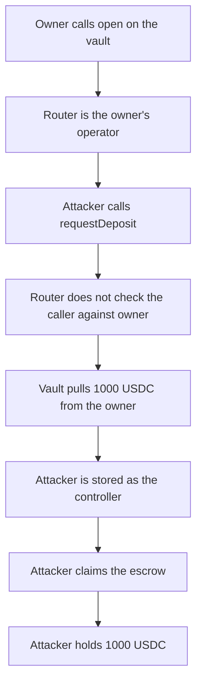

# Centrifuge — any caller can spend an opened vault through the router

> **Vulnerability classes:** vuln/access-control/missing-modifier · vuln/logic/missing-check

> **Reproduction:** cheatcode-free local synthetic. After the owner calls `open`, anyone can `requestDeposit` with that owner and their own controller. 1,000 USDC moves. Full trace: [output.txt](output.txt). PoC: [test/35789-centrifuge-router-can-perform-untrusted-actions-on-behalf-of_exp.sol](test/35789-centrifuge-router-can-perform-untrusted-actions-on-behalf-of_exp.sol).

<!-- non-defihacklabs -->
<!-- source-auditvault: https://github.com/Auditware/AuditVault/blob/main/findings/35789-centrifuge-router-can-perform-untrusted-actions-on-behalf-of.md -->
<!-- date: 2024-07 -->

**AuditVault taxonomy:** `lang/solidity` · `sector/rwa` · `sector/token` · `platform/spearbit` · `has/github` · `severity/high` · genome: `missing-modifier` · `variant` · `role-bypass` · `account-ownership`

## Key info

| | |
|---|---|
| **Protocol** | Centrifuge VaultRouter |
| **Finding** | Spearbit Centrifuge review, July 2024, AuditVault 35789 |
| **Vulnerable code** | `VaultRouter.requestDeposit` forwards `owner` with no initiator check |
| **Harm** | 1,000 USDC leaves an owner who had called `open`. The attacker is the controller and claims it |
| **Chain** | local synthetic |

## TL;DR

`open(vault)` sets the router as an endorsed operator for the caller, which is how permissionless claims are supposed to work. `requestDeposit` is also permissionless, and it does not require `owner == initiator`. Anyone can pass that owner's address and a controller they control. The vault sees `msg.sender` as the router, the operator check passes, and it pulls the owner's assets. The attacker then claims the escrow.

## The vulnerable code

Audited router shape from the Spearbit review. `open` endorses the router for `_initiator()`. `requestDeposit` does not look at `_initiator()` before it calls the vault.

```solidity
function open(address vault) public protected {
    IERC7540Vault(vault).setEndorsedOperator(_initiator(), true);
}

function requestDeposit(address vault, uint256 amount, address controller, address owner, uint256 topUpAmount)
    external
    payable
    protected
{
    if (owner == address(this)) {
        _approveMax(asset, vault);
    }
    _pay(topUpAmount);
    // @> VULN: any caller can pass another owner's address. The router is already that owner's operator.
    IERC7540Vault(vault).requestDeposit(amount, controller, owner);
    // FIX: require(owner == _initiator() || owner == address(this));
}
```

The vault accepts the call because `isOperator[owner][router]` is true, then `transferFrom`s the owner.

## Root cause

Endorsing the router is a delegation to a contract, not to every user of that contract. The router forwards `owner` and `controller` from calldata. `protected` only records who called. It does not compare that caller to `owner`. So the operator bit, which was meant to let the owner act through the router, lets every other caller act as the owner.

## Preconditions

The owner has called `open` on the vault and still has it open. The owner holds 1,000 USDC and has approved the vault. The attacker is any address. No router admin key is required.

## Attack walkthrough

1. The owner holds 1,000 USDC approved to the vault and calls `open`. `isOperator[owner][router]` becomes true.
2. The attacker calls `requestDeposit(vault, 1000, attacker, owner, 0)`.
3. The router does not revert. It calls `vault.requestDeposit(1000, attacker, owner)`.
4. The vault's operator check passes. `transferFrom` moves 1,000 USDC from the owner into the vault. `claimable[attacker]` is 1,000 USDC.
5. The attacker calls `claim`. The vault pays the attacker 1,000 USDC. The owner's balance is 0.

The guarded control adds `owner == caller || owner == router` before the vault call. The same request reverts. The owner still holds 1,000 USDC. Nothing is escrowed.

## Diagrams



## Impact

The owner loses 1,000 USDC. The attacker receives it by naming themselves controller of a request the owner did not sign. The same pattern applies to `requestRedeem` in the review: tranche tokens can be redeemed to an arbitrary controller. This run shows the deposit path, which moves the asset.

## Remediation

Before calling the vault, require `owner == _initiator() || owner == address(this)`. Centrifuge fixed this in commit `3b21650d`.

## How to reproduce

```bash
cd 35789-centrifuge-router-can-perform-untrusted-actions-on-behalf-of_exp
forge test -vv
```

## Sources

- AuditVault finding: https://github.com/Auditware/AuditVault/blob/main/findings/35789-centrifuge-router-can-perform-untrusted-actions-on-behalf-of.md
- Spearbit review: https://github.com/spearbit/portfolio/blob/master/pdfs/Centrifuge-Spearbit-Security-Review-July-2024.pdf
- Fixed router shape: https://github.com/centrifuge/protocol/blob/v3.1.0/src/vaults/VaultRouter.sol
- Fix commit cited by the review: `3b21650d`
