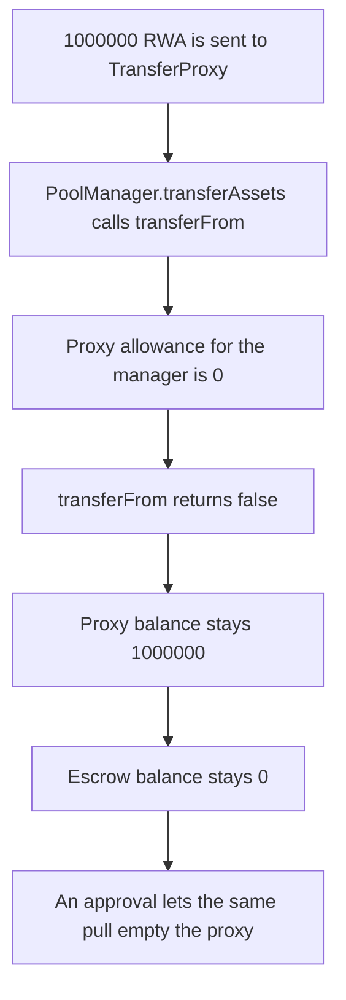

# Centrifuge — transferAssets cannot pull the TransferProxy balance

> **Vulnerability classes:** vuln/logic/missing-allowance · vuln/dos/frozen-funds

> **Reproduction:** a self-contained Foundry PoC that compiles and runs offline
> with only `forge-std` — no fork and no RPC. Trace: [output.txt](output.txt).
> PoC: [test/35790-assets-can-get-stuck-in-transferproxy-spearbit-none-centrifu_exp.sol](test/35790-assets-can-get-stuck-in-transferproxy-spearbit-none-centrifu_exp.sol).

<!-- non-defihacklabs -->
<!-- source-auditvault: https://github.com/Auditware/AuditVault/blob/main/findings/35790-assets-can-get-stuck-in-transferproxy-spearbit-none-centrifu.md -->
<!-- date: 2024-07 -->

---

## Key info

| | |
|---|---|
| **Impact** | **HIGH** — **1,000,000 RWA** sent into TransferProxy stays there; the escrow receives **0** |
| **Protocol** | Centrifuge `PoolManager.transferAssets` / `TransferProxy` |
| **Vulnerable code** | `transferFrom` the proxy with no allowance set for the pool manager |
| **Bug class** | Missing allowance, so bridged assets are frozen in the proxy |
| **Finding** | Spearbit — Centrifuge, July 2024 · id 35790 |
| **Report** | [Centrifuge Spearbit review, July 2024](https://github.com/spearbit/portfolio/blob/master/pdfs/Centrifuge-Spearbit-Security-Review-July-2024.pdf) |
| **Source** | [AuditVault finding](https://github.com/Auditware/AuditVault/blob/main/findings/35790-assets-can-get-stuck-in-transferproxy-spearbit-none-centrifu.md) |
| **Status** | Fixed by setting the poolManager allowance on the proxy. Reproduced here as a local synthetic. |
| **Compiler** | solc 0.8.27, cancun, via IR |

---

## TL;DR

`transferAssets` moves tokens from the TransferProxy to the escrow with `transferFrom`. The proxy never approves the pool manager. The pull returns false.

**1,000,000 RWA** transferred into the proxy remains there. The escrow balance stays **0**. The same pull on a proxy that approved the manager delivers **1,000,000** to the escrow and leaves the proxy at **0**.

`run()` does not warp.

## The vulnerable code

```solidity
function transferAssets(address asset, uint256 amount) external returns (bool pulled) {
    // @> VULN: the proxy has no allowance for PoolManager, so the pull cannot succeed
    pulled = Asset(asset).transferFrom(address(proxy), address(escrow), amount);
}
```

The audited note is `TransferProxyFactory.sol` L18: `transferAssets` reads the proxy balance through `transferFrom`, and no allowance is set for `poolManager`.

## Root cause

`transferFrom` spends the proxy's allowance for the caller. Deployment of the proxy does not call `approve(poolManager)`. Every later pull fails, and the tokens have no other exit in this path.

## Preconditions

- Assets have been transferred into the TransferProxy. Here that amount is **1,000,000 RWA** (18 decimals).
- `allowance[proxy][poolManager]` is **0**.
- No timestamp change happens inside `run()`.

## Attack walkthrough

1. Transfer **1,000,000 RWA** to the proxy. Its balance is **1,000,000**.
2. `PoolManager.transferAssets` calls `transferFrom(proxy, escrow, 1_000_000 ether)`.
3. The token returns false because the allowance is **0**.
4. The proxy balance is still **1,000,000**. The escrow balance is **0**.

Control: the proxy approves the manager for `type(uint256).max` before the pull. The escrow receives **1,000,000** and the proxy balance is **0**.

## Diagrams



## Impact

**1,000,000 RWA** is frozen in the TransferProxy. Users who sent assets into that proxy cannot have them forwarded, and the escrow that should custody them holds **0**.

## Remediation

In the proxy's deployment, `approve(poolManager, type(uint256).max)` for each asset `transferAssets` pulls, which is the fix the report asked for.

## Sources

- [AuditVault finding 35790](https://github.com/Auditware/AuditVault/blob/main/findings/35790-assets-can-get-stuck-in-transferproxy-spearbit-none-centrifu.md)
- [Spearbit Centrifuge review, July 2024](https://github.com/spearbit/portfolio/blob/master/pdfs/Centrifuge-Spearbit-Security-Review-July-2024.pdf)

### Taxonomy

- `severity/high`
- `vuln/logic/missing-allowance`
- `vuln/dos/frozen-funds`
