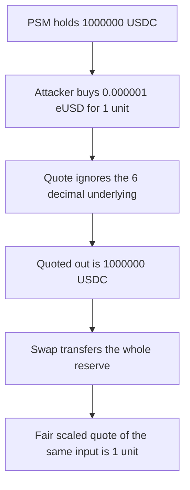

# Euler PSM — a 6-decimal underlying is quoted as if it had 18

> **Vulnerability classes:** vuln/arithmetic/decimal-mismatch · vuln/logic/price-calculation

> **Reproduction:** a self-contained Foundry PoC that compiles and runs offline
> with only `forge-std` — no fork and no RPC. Trace: [output.txt](output.txt).
> PoC: [test/35943-pegstabilitymodule-assumes-underlying-has-18-decimals-spearb_exp.sol](test/35943-pegstabilitymodule-assumes-underlying-has-18-decimals-spearb_exp.sol).

<!-- non-defihacklabs -->
<!-- source-auditvault: https://github.com/Auditware/AuditVault/blob/main/findings/35943-pegstabilitymodule-assumes-underlying-has-18-decimals-spearb.md -->
<!-- date: 2024-04 -->

---

## Key info

| | |
|---|---|
| **Impact** | **HIGH** — **0.000001 eUSD**, bought for **1** unit of USDC, redeems the PSM's **1,000,000 USDC** |
| **Protocol** | Euler EVK `PegStabilityModule.quoteToUnderlyingGivenIn` |
| **Vulnerable code** | The quote divides by the 18-decimal `PRICE_SCALE` and never reads `underlying.decimals()` |
| **Bug class** | Decimal mismatch between an 18-decimal synth and a 6-decimal underlying |
| **Finding** | Spearbit — Euler EVK, April 2024 · id 35943 |
| **Report** | [Euler Spearbit review, April 2024](https://github.com/spearbit/portfolio/blob/master/pdfs/Euler-Spearbit-Security-Review-EVK-April-2024.pdf) |
| **Source** | [AuditVault finding](https://github.com/Auditware/AuditVault/blob/main/findings/35943-pegstabilitymodule-assumes-underlying-has-18-decimals-spearb.md) |
| **Status** | Fixed by documenting `conversionPrice = 10**underlyingDecimals` for a 1:1 peg. Reproduced here as a local synthetic of the unscaled quote. |
| **Compiler** | solc 0.8.27, cancun, via IR |

---

## TL;DR

The synth is 18 decimals. USDC is 6. The quote treats one synth wei as one underlying wei.

The PSM holds **1,000,000 USDC** (`1_000_000e6` units). The attacker buys `1_000_000e6` synth wei, which is **0.000001 eUSD**, for **1** USDC unit at a fair desk. `swapToUnderlyingGivenIn` pays **1,000,000 USDC** and empties the module.

The scaled quote of the same input is **1** unit. The module would have kept **999,999.999999 USDC**.

`run()` does not warp. The fee is 0 so the decimal gap is the whole difference.

## The vulnerable code

```solidity
function quoteToUnderlyingGivenIn(uint256 amountIn) public view returns (uint256) {
    // @> VULN: 18-decimal PRICE_SCALE, underlying.decimals() is never read
    return amountIn * (BPS_SCALE - TO_UNDERLYING_FEE) / BPS_SCALE * PRICE_SCALE / PRICE_SCALE;
}
```

`PRICE_SCALE` is `1e18`. The multiplication cancels. A 12-decimal gap between the tokens is never applied. The fixed quote divides by `10 ** (18 - underlying.decimals())`, which is `1e12` for USDC.

## Root cause

Swap amounts are quoted in the synth's decimals. The module was written as if every underlying also had 18. USDC does not. One human unit of synth is `1e18` wei and one human unit of USDC is `1e6` units, so an unscaled 1:1 quote overpays the underlying by `1e12`.

## Preconditions

- The PSM holds **1,000,000 USDC**.
- The attacker can buy eUSD at the human peg. Here **1** USDC unit buys `1_000_000e6` synth wei.
- `TO_UNDERLYING_FEE` is 0.
- No timestamp change happens inside `run()`.

## Attack walkthrough

1. Pay **1** USDC unit to the fair desk. Receive `1_000_000e6` eUSD wei (**0.000001 eUSD**).
2. `quoteToUnderlyingGivenIn` returns `1_000_000e6`. The fair scaled quote is **1**.
3. `swapToUnderlyingGivenIn` burns the synth and transfers **1,000,000 USDC** to the attacker.
4. The PSM balance is **0**.

Control: the same swap on the scaled module returns **1** unit and leaves `1_000_000e6 - 1` in the PSM.

## Diagrams



## Impact

The attacker spends **1** unit of USDC and receives **1,000,000 USDC**. The PSM reserve is drained. Every 6-decimal underlying quoted this way is overpaid by `10^12` against the synth.

## Remediation

Scale the quote by `10 ** (18 - underlying.decimals())`, or set `conversionPrice` to `10**underlyingDecimals` for a 1:1 peg and divide by that price instead of treating raw amounts as equal.

## Sources

- [AuditVault finding 35943](https://github.com/Auditware/AuditVault/blob/main/findings/35943-pegstabilitymodule-assumes-underlying-has-18-decimals-spearb.md)
- [Spearbit Euler EVK review, April 2024](https://github.com/spearbit/portfolio/blob/master/pdfs/Euler-Spearbit-Security-Review-EVK-April-2024.pdf)
- Fixed module: [euler-xyz PegStabilityModule.sol](https://github.com/euler-xyz/euler-vault-kit/blob/master/src/Synths/PegStabilityModule.sol)

### Taxonomy

- `severity/high`
- `vuln/arithmetic/decimal-mismatch`
- `vuln/logic/price-calculation`
