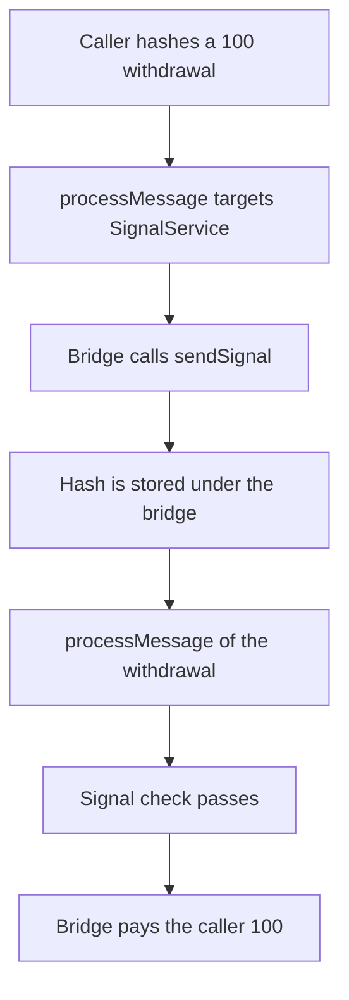

# Taiko: any caller can signal a 100 withdrawal from the bridge

> **Vulnerability classes:** vuln/bridge/message-spoofing · vuln/access-control/missing-auth

<!-- non-defihacklabs -->
<!-- source-auditvault: https://github.com/Auditware/AuditVault/blob/main/findings/35996-fraudulent-messages-may-be-sent-through-the-bridge-sigmaprim.md -->
<!-- date: 2024-02 -->

## Key info

| | |
|---|---|
| **Protocol** | Taiko |
| **Finding** | Sigma Prime Taiko, AuditVault 35996 |
| **Vulnerable code** | `Bridge.processMessage` |
| **Harm** | Any caller stores a signal as the bridge and withdraws 100. The control rejects SignalService as `message.to` and credits 0 |
| **Chain** | local synthetic |

## TL;DR

`sendMessage` and `processMessage` have no relayer role. `processMessage` calls `message.to` with `message.data`. The caller points that at `SignalService.sendSignal` and passes the hash of a message that pays 100 to themselves. `sendSignal` records the hash under `msg.sender`, which is the bridge. The next `processMessage` of that withdrawal sees the signal and transfers 100. The control refuses `message.to == signalService`, so the hash is never stored and nothing is credited.

## The vulnerable code

```solidity
function processMessage(Message calldata m) external {
    if (m.to == address(signal)) {
        // @> VULN: any caller can make the bridge call SignalService
        invoked = m.to;
        (bool ok,) = m.to.call(m.data);
        require(ok, "call");
        return;
    }
    bytes32 h = keccak256(abi.encode(m.owner, m.to, m.value));
    require(signal.signaled(address(this), h), "signal");
    require(token.transfer(m.owner, m.value), "pay");
    released = m.value;
}
```

`sendSignal` is `signaled[msg.sender][signal] = true`. After the bridge calls it, `signaled[bridge][hash]` is true.

## Root cause

The bridge will call any address. A call into the signal service is indistinguishable from the bridge signaling a message itself, because the signal is keyed by `msg.sender`.

## Preconditions

The bridge holds 100. The caller is any account. There is no relayer allow-list on `sendMessage` or `processMessage`. Both steps are in one transaction. No second chain and no timestamp change are required: the signal service and the bridge are the two contracts the message passes through.

## Attack walkthrough

1. Mint 100 to the bridge. See [output.txt](output.txt).
2. Hash a message whose owner is the caller and whose value is 100.
3. `processMessage` a message whose `to` is the signal service and whose data is `sendSignal(hash)`.
4. The signal is stored under the bridge.
5. `processMessage` the withdrawal. The bridge transfers 100 to the caller.
6. The control's `processStrict` reverts when `to` is the signal service. The hash is not stored. The caller's balance stays 0.

## Diagrams



## Impact

The bridge's 100 is transferred to the caller. No trusted relayer is involved. Blocking `message.to` from being the signal service stops the signal from being stored, and the withdrawal does not pay.

## Remediation

Reject `message.to` values that are not the vault's message handler, and do not allow the bridge to call `SignalService.sendSignal`.

## How to reproduce

```bash
cd 35996-fraudulent-messages-may-be-sent-through-the-bridge-sigmaprim_exp
forge test -vv
```

## Sources

- AuditVault finding: https://github.com/Auditware/AuditVault/blob/main/findings/35996-fraudulent-messages-may-be-sent-through-the-bridge-sigmaprim.md
- Report: https://github.com/sigp/public-audits/blob/master/reports/taiko/review.pdf
- Fix: Taiko PR 15577, additional checks on `message.to`
- Synthetic: [test/35996-fraudulent-messages-may-be-sent-through-the-bridge-sigmaprim.sol](test/35996-fraudulent-messages-may-be-sent-through-the-bridge-sigmaprim.sol)
