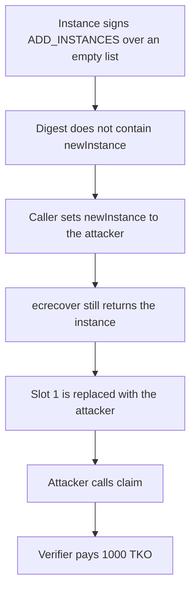

# Taiko — SGX addInstances signature does not bind newInstance

> **Vulnerability classes:** vuln/auth/signature-validation · vuln/logic/missing-check

> **Reproduction:** cheatcode-free local synthetic. The instance key signs an empty extra list. `newInstance` is not in the hash, so that signature installs the attacker, who then claims 1,000 TKO. Full trace: [output.txt](output.txt). PoC: [test/35997-insufficient-signature-hashing-for-sgx-addinstances-sigmapri_exp.sol](test/35997-insufficient-signature-hashing-for-sgx-addinstances-sigmapri_exp.sol).

<!-- non-defihacklabs -->
<!-- source-auditvault: https://github.com/Auditware/AuditVault/blob/main/findings/35997-insufficient-signature-hashing-for-sgx-addinstances-sigmapri.md -->
<!-- date: 2024-02 -->

**AuditVault taxonomy:** `lang/solidity` · `platform/sigmaprime` · `has/github` · `severity/high` · `sector/zk` · genome: `missing-modifier` · `insider` · `role-bypass` · `permit-fork-replay`

## Key info

| | |
|---|---|
| **Protocol** | Taiko SGX verifier |
| **Finding** | Sigma Prime Taiko review, February 2024, AuditVault 35997 |
| **Vulnerable code** | `addInstances` hashes `extraInstances` and not `newInstance` |
| **Harm** | An address the signer did not include becomes instance 1 and is paid 1,000 TKO |
| **Chain** | local synthetic |

## TL;DR

Each SGX instance signs `ADD_INSTANCES` when it rotates its key. The digest is `keccak256(abi.encode("ADD_INSTANCES", extraInstances))`. The replacement address, `newInstance`, is a separate argument and is not in the digest. Anyone who holds one such signature can pass any `newInstance`. This run uses the known instance key over an empty extra list, sets `newInstance` to the attacker, and then claims the 1,000 TKO registration payout that only a live instance can take.

## The vulnerable code

The audited function. `ECDSA.recover` is inlined here as `ecrecover` of the same raw digest.

```solidity
bytes32 hash = keccak256(abi.encode("ADD_INSTANCES", extraInstances));
address oldInstance = _recover(hash, signature);
if (!_isInstanceValid(id, oldInstance)) revert SGX_INVALID_INSTANCE();
// @> VULN: newInstance is not in the signed hash, so this address was not approved by the instance.
this.writeInstance(id, newInstance);
// FIX: keccak256(abi.encode("ADD_INSTANCES", newInstance, extraInstances))
```

The embedded signature is 65 bytes from instance `0xf39Fd6e51aad88F6F4ce6aB8827279cffFb92266` over that digest with `extraInstances` empty. `ecrecover` of the raw digest returns that instance. There is no Ethereum signed-message prefix.

## Root cause

The signature attests a list of extra instances and a type tag. The address that replaces the current instance is chosen by the caller after the signature exists. Validity only checks that the recovered signer is the instance being replaced. It does not check that the signer named the replacement.

## Preconditions

Instance 1 is the signer. The signer has produced one `ADD_INSTANCES` signature over an empty extra list. The attacker does not need a second SGX key for the swap itself. The verifier holds 1,000 TKO, paid to whoever `claim` sees in the instance slot.

## Attack walkthrough

1. Slot 1 is the signer. The digest of `ADD_INSTANCES` plus an empty list does not contain the attacker.
2. `addInstances(1, attacker, [], signature)` recovers the signer. The instance check passes.
3. Slot 1 is overwritten with the attacker. `extraInstances.length` is still 0, so the signer did not include that address.
4. `claim(1)` sees `msg.sender` as instance 1 and transfers 1,000 TKO. The attacker's balance is 1,000 TKO.

The guarded control hashes `newInstance` as well. A signature over one replacement address installs that address. A second `addInstances` with the same signature and a different `newInstance` reverts `SGX_INVALID_INSTANCE`. The attacker is not installed and is paid 0.

## Diagrams



## Impact

A signature that named no extra instance registers an address the signer did not include. That address is then paid 1,000 TKO. The same key can also sign `verifyProof` once it sits in the instance set, which is the forged-proof impact in the review. This run stops at the registration payout, which is the on-chain effect of the missing field.

## Remediation

Include `newInstance` in the digest, and bind the contract and chain so the signature cannot be replayed. Taiko's PR 15514 hashes `newInstance`.

## How to reproduce

```bash
cd 35997-insufficient-signature-hashing-for-sgx-addinstances-sigmapri_exp
forge test -vv
```

## Sources

- AuditVault finding: https://github.com/Auditware/AuditVault/blob/main/findings/35997-insufficient-signature-hashing-for-sgx-addinstances-sigmapri.md
- Sigma Prime report: https://github.com/sigp/public-audits/blob/master/reports/taiko/review.pdf
- Sigma Prime case study, February 2024: https://sigmaprime.io/case-studies/taiko/
