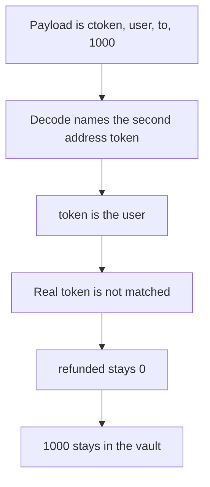

# Taiko: a recalled message leaves 1000 in the vault

> **Vulnerability classes:** vuln/bridge/missing-validation · vuln/data/wrong-encoding

<!-- non-defihacklabs -->
<!-- source-auditvault: https://github.com/Auditware/AuditVault/blob/main/findings/35998-incorrect-value-assigned-to-token-when-recalling-messages-si.md -->
<!-- date: 2024-02 -->

## Key info

| | |
|---|---|
| **Protocol** | Taiko |
| **Finding** | Sigma Prime Taiko, AuditVault 35998 |
| **Vulnerable code** | `ERC20Vault.onMessageRecalled` |
| **Harm** | The recall binds `token` to the user. 1000 of the real token is not refunded and stays in the vault. The control pays 1000 |
| **Chain** | local synthetic |

## TL;DR

`receiveToken` is encoded as `(ctoken, user, to, amount)`. `onMessageRecalled` decodes that payload as `(CanonicalERC20, address, address, uint256)` and names the second address `token`. The second address is the user. The vault therefore does not transfer the real token. 1000 stays in the vault and the user's balance stays 0. The control decodes `CanonicalERC20.addr` and transfers 1000 to the user.

## The vulnerable code

```solidity
(, token,, amount) = abi.decode(messageData[4:], (CanonicalERC20, address, address, uint256));
// @> VULN: token is the user, so the real token amount is not refunded
decoded = token;
```

`CanonicalERC20` is `(address addr, uint256 chainId)`. After the struct, the next address is `user`. `amount` is still 1000. The refund runs only when `token == address(real)`, which is false, so `refunded` stays 0 and `lost` is 1000.

The fixed decode is:

```solidity
(ctoken,,, amount) = abi.decode(messageData[4:], (CanonicalERC20, address, address, uint256));
address token = ctoken.addr;
```

That `token` is the real token, and the transfer pays 1000.

## Root cause

The encode order is `(ctoken, user, to, amount)`. The recall names the second decoded address `token`. Those are not the same word.

## Preconditions

The vault holds 1000 of the real token. The recalled payload is a `receiveToken` call with the user as the second argument and 1000 as the amount. No second chain and no timestamp change.

## Attack walkthrough

1. Mint 1000 into the vault. See [output.txt](output.txt).
2. Call `onMessageRecalled` with `receiveToken(ctoken, user, user, 1000)`.
3. `decoded` is the user address.
4. `refunded` is 0 and `lost` is 1000.
5. The vault balance is 1000 and the user balance is 0.
6. The control calls `onMessageRecalledFixed`. The user receives 1000 and the vault balance is 0.

## Diagrams



## Impact

The user loses the 1000 refund. The tokens remain in the vault. Assigning `token` from `CanonicalERC20.addr` pays the 1000.

## Remediation

Decode `CanonicalERC20` and refund `ctoken.addr`, which is the fix in Taiko PR 15582.

## How to reproduce

```bash
cd 35998-incorrect-value-assigned-to-token-when-recalling-messages-si_exp
forge test -vv
```

## Sources

- AuditVault finding: https://github.com/Auditware/AuditVault/blob/main/findings/35998-incorrect-value-assigned-to-token-when-recalling-messages-si.md
- Report: https://github.com/sigp/public-audits/blob/master/reports/taiko/review.pdf
- Fix: Taiko PR 15582, recall uses `CanonicalERC20` and ignores the user word
- Synthetic: [test/35998-incorrect-value-assigned-to-token-when-recalling-messages-si.sol](test/35998-incorrect-value-assigned-to-token-when-recalling-messages-si.sol)
