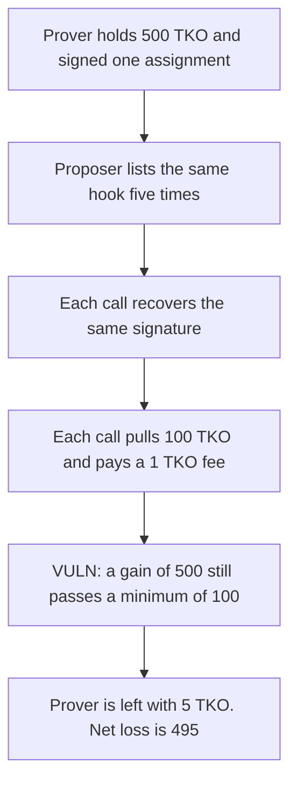

# Taiko — a repeated assignment hook drains the prover's TKO

> **Vulnerability classes:** vuln/logic/missing-check · vuln/auth/signature-replay

<!-- non-defihacklabs -->
<!-- source-auditvault: https://github.com/Auditware/AuditVault/blob/main/findings/35999-assignmenthooks-may-drain-prover-tko-when-calling-proposeblo.md -->
<!-- date: 2024-02 -->

## Key info

| | |
|---|---|
| **Protocol** | Taiko |
| **Finding** | Sigma Prime AssignmentHooks, AuditVault 35999 |
| **Vulnerable code** | `TaikoL1.proposeBlock` |
| **Harm** | Prover loses 495 TKO net. TaikoL1 receives 500 TKO. The liveness bond was 100. The proposer paid 5 TKO of fees. |
| **Chain** | local synthetic |

## TL;DR

`proposeBlock` calls every hook the proposer puts in the list, then checks only that the contract's TKO balance grew by **at least** one liveness bond. The assignment signature is recovered on every call and never marked used. The same hook, listed five times, pulls 100 TKO five times. The check sees a gain of 500 and lets the proposal through. The prover is left with the 5 TKO of fees. The proposer spent 5 TKO to take 500 from the prover.

## The vulnerable code

```solidity
uint256 tkoBalance = tko.balanceOf(address(this));
for (uint256 i; i < params.length; ++i) {
    IHook(params[i].hook).onBlockProposed(msg.sender, v, r, s);
}
// @> VULN: any pull of at least one bond is accepted, so repeated hooks over-charge the prover
if (tko.balanceOf(address(this)) < tkoBalance + livenessBond) {
    revert L1_LIVENESS_BOND_NOT_RECEIVED();
}
```

Inside the hook, `ecrecover` accepts the prover and nothing records that the signature was used:

```solidity
address signer = ecrecover(digest, v, r, s);
require(signer == prover, "sig");
tko.transferFrom(prover, msg.sender, bond);
tko.transferFrom(proposer, prover, fee);
```

The report's fix rejects a repeated hook address and requires the TKO balance to rise by **exactly** `livenessBond`. The control does both. Five copies of the hook revert. One copy pulls 100 TKO and pays the 1 TKO fee, so the prover is left with 401.

## Root cause

Two checks are missing, and either one would have stopped the drain. The loop never compares hook addresses, so the proposer can name the assignment hook on every iteration. The hook validates the prover's signature and does not bump a nonce, so the same signature authorizes every pull. The balance check then uses `<` rather than `==`, which was meant to confirm that the bond arrived and instead accepts any larger amount.

## Preconditions

The prover has approved the assignment hook for 500 TKO and signed one assignment digest. The liveness bond is 100 TKO. The proposer fee is 1 TKO, smaller than the bond. The proposer can choose the hook list. No admin key is involved.

## Attack walkthrough

1. The prover holds 500 TKO. The hook is approved for that amount. The proposer holds 5 TKO, enough for five fees.
2. `proposeBlock` is called with the same hook address five times and the same signature.
3. Each call recovers the prover. The signature is not consumed.
4. Each call transfers 100 TKO from the prover to TaikoL1 and 1 TKO from the proposer to the prover.
5. TaikoL1's balance rose by 500. The check requires only 100. The call succeeds.
6. The prover's balance is 5 TKO. Net loss is 495. The proposer's fee balance is 0.

The control reverts when the same hook appears twice, before a second bond can move. A single hook then pulls exactly 100 TKO.

## Diagrams



## Impact

The assigned prover loses 495 TKO. TaikoL1 holds 500 TKO that the prover approved, four bonds more than the proposal required. The proposer spent 5 TKO. The report calls this griefing because the attacker does not receive the TKO, but the prover's loss is larger than the attacker's cost. A larger approval is drained the same way: the loop can keep calling the hook until the approval is gone.

## Remediation

Reject a hook address that already ran in this `proposeBlock`. Require the TKO balance to increase by exactly `livenessBond`, not by at least that amount. Invalidate the prover signature with a nonce inside the assignment hook so the same signature cannot authorize a second pull.

## How to reproduce

```bash
cd 35999-assignmenthooks-may-drain-prover-tko-when-calling-proposeblo_exp
forge test -vv
```

## Sources

- AuditVault finding: https://github.com/Auditware/AuditVault/blob/main/findings/35999-assignmenthooks-may-drain-prover-tko-when-calling-proposeblo.md
- Sigma Prime report: https://github.com/sigp/public-audits/blob/master/reports/taiko/review.pdf
- Report PDF created 2024-02-09
