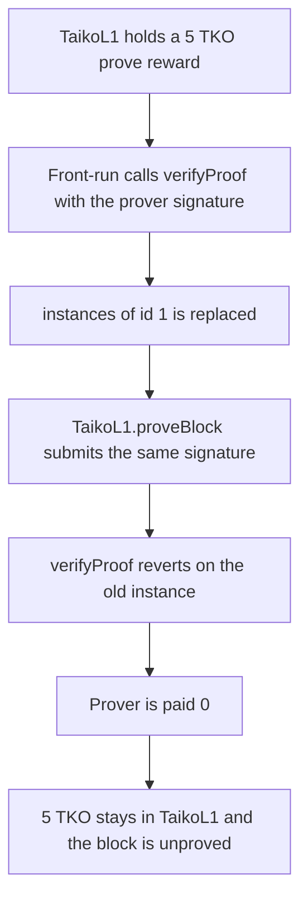

# Taiko — verifyProof can be front-run so the assigned prover is not paid

> **Vulnerability classes:** vuln/access-control/missing-modifier · vuln/dos/griefing

> **Reproduction:** a self-contained Foundry PoC that compiles and runs offline
> with only `forge-std` — no fork and no RPC. Trace: [output.txt](output.txt).
> PoC: [test/36000-sgx-verifyproof-allows-front-running-to-prevent-proving-l2-b_exp.sol](test/36000-sgx-verifyproof-allows-front-running-to-prevent-proving-l2-b_exp.sol).

<!-- non-defihacklabs -->
<!-- source-auditvault: https://github.com/Auditware/AuditVault/blob/main/findings/36000-sgx-verifyproof-allows-front-running-to-prevent-proving-l2-b.md -->
<!-- date: 2024-03 -->

---

## Key info

| | |
|---|---|
| **Impact** | **HIGH** — the assigned prover is paid **0** of a **5 TKO** block reward, and the block stays unproved |
| **Protocol** | Taiko `SgxVerifier.verifyProof` |
| **Vulnerable code** | `verifyProof` rotates `instances[id]` for any caller |
| **Bug class** | Missing caller check lets a copied proof front-run `TaikoL1.proveBlock` |
| **Finding** | Sigma Prime — Taiko · id 36000 |
| **Report** | [Sigma Prime Taiko review](https://github.com/sigp/public-audits/blob/master/reports/taiko/review.pdf) |
| **Source** | [AuditVault finding](https://github.com/Auditware/AuditVault/blob/main/findings/36000-sgx-verifyproof-allows-front-running-to-prevent-proving-l2-b.md) |
| **Status** | Restricted to TaikoL1 and higher-tier proofs in PR 15514. Reproduced here as a local synthetic. |
| **Compiler** | solc 0.8.27, cancun, via IR |

---

## TL;DR

`verifyProof` recovers the signer of `(id, currentInstance, newInstance)` and, if that signer is the current instance, stores the new instance. It does not require the caller to be `TaikoL1`.

The proof is public once the prover broadcasts it. A front-run submits it first. The instance moves. `TaikoL1.proveBlock` then calls `verifyProof` with the same signature, the recovered signer is no longer the current instance, and the call reverts.

The **5 TKO** reward stays in `TaikoL1`. The prover's balance stays **0**. The block is not proved. The same proof, with no front-run, pays the prover **5 TKO**.

`run()` does not warp. The signature was produced offline from the instance key and hardcoded. No cheatcode signs it.

## The vulnerable code

```solidity
address signer = ecrecover(digest, v, r, s);
require(signer == current && signer != address(0), "instance");
// @> VULN: any address can rotate the instance; TaikoL1 is not required
instances[id] = newInstance;
```

The audited function is stateful: `_replaceInstance(id, oldInstance, newInstance)`. After that replacement, `TaikoL1`'s later call sees an invalid instance and `proveBlock` reverts.

## Root cause

The proof authorizes an instance rotation, not a caller. The first transaction to present a valid signature consumes the rotation. The contract that was supposed to present it, `TaikoL1`, is not enforced.

## Preconditions

- `instances[1]` is the instance that signed `(1, instance, newInstance)`.
- `TaikoL1` holds a **5 TKO** reward for a successful prove.
- The same signature is what `proveBlock` will submit. Here it is the hardcoded signature of the known instance key.
- No timestamp change happens inside `run()`.

## Attack walkthrough

1. Transfer **5 TKO** into `TaikoL1`. That is the reward `proveBlock` would pay.
2. Call `verifyProof` with the prover's signature. `instances[1]` becomes the new instance.
3. Call `TaikoL1.proveBlock` with the same signature. `verifyProof` reverts because the recovered signer is the old instance.
4. `proved[1]` stays false. The prover's TKO balance is **0**. `TaikoL1` still holds **5 TKO**.

Control: `proveBlock` is the first caller. The instance check passes, `proved[1]` is true, the prover receives **5 TKO**, and `TaikoL1`'s balance is **0**.

## Diagrams



## Impact

The assigned prover receives **0** instead of **5 TKO**, and the block is not marked proved. Repeating the front-run delays proving for as long as the copied proofs keep landing first. The finding's resolution was to allow `verifyProof` only from `TaikoL1` and higher-tier proofs.

## Remediation

Require `msg.sender` to be `TaikoL1` or the next verifier in the tiered hierarchy before `_replaceInstance`.

## Sources

- [AuditVault finding 36000](https://github.com/Auditware/AuditVault/blob/main/findings/36000-sgx-verifyproof-allows-front-running-to-prevent-proving-l2-b.md)
- [Sigma Prime Taiko review](https://github.com/sigp/public-audits/blob/master/reports/taiko/review.pdf)

### Taxonomy

- `severity/high`
- `vuln/access-control/missing-modifier`
- `vuln/dos/griefing`
