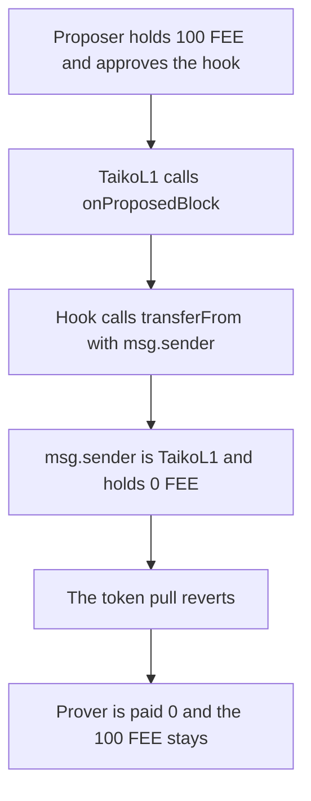

# Taiko — ERC20 prover payment always reverts

> **Vulnerability classes:** vuln/dos/frozen-funds · vuln/logic/wrong-condition

> **Reproduction:** a self-contained Foundry PoC that compiles and runs offline
> with only `forge-std` — no fork and no RPC. Trace: [output.txt](output.txt).
> PoC: [test/36001-prover-payment-in-erc20-tokens-always-reverts-sigmaprime-non_exp.sol](test/36001-prover-payment-in-erc20-tokens-always-reverts-sigmaprime-non_exp.sol).

<!-- non-defihacklabs -->
<!-- source-auditvault: https://github.com/Auditware/AuditVault/blob/main/findings/36001-prover-payment-in-erc20-tokens-always-reverts-sigmaprime-non.md -->
<!-- date: 2024-02 -->

---

## Key info

| | |
|---|---|
| **Impact** | **HIGH** — an ERC20 prover fee of **100 FEE** reverts inside `proposeBlock`. The prover is paid **0**. The **100 FEE** stays with the proposer |
| **Protocol** | Taiko `AssignmentHooks.onProposedBlock` |
| **Vulnerable code** | `transferFrom(msg.sender, blk.assignedProver, proverFee)` |
| **Bug class** | The ERC20 pull uses TaikoL1 as the token sender |
| **Finding** | Sigma Prime — Taiko review, February 2024 · id 36001 |
| **Report** | [Sigma Prime Taiko review](https://github.com/sigp/public-audits/blob/master/reports/taiko/review.pdf) |
| **Source** | [AuditVault finding](https://github.com/Auditware/AuditVault/blob/main/findings/36001-prover-payment-in-erc20-tokens-always-reverts-sigmaprime-non.md) |
| **Status** | Fixed by pulling the fee from the proposer (PR 15486). Reproduced here as a local synthetic. |
| **Compiler** | solc 0.8.27, cancun, via IR |

---

## TL;DR

`AssignmentHooks.onProposedBlock` pays the assigned prover. For ETH it sends `msg.value`. For an ERC20 it calls `transferFrom` with `msg.sender` as the source.

The hook is invoked by `TaikoL1`, so `msg.sender` is `TaikoL1`. The proposer holds the **100 FEE** and has approved the hook. `TaikoL1` holds **0**. The pull reverts, `proposeBlock` reverts, and the prover receives **0**.

`run()` does not warp. Nothing in the path reads `block.timestamp`.

## The vulnerable code

```solidity
unchecked {
    refund = msg.value - input.tip;
}
// Paying ERC20 tokens
IERC20(assignment.feeToken).transferFrom(msg.sender, blk.assignedProver, proverFee); // @> VULN
```

`msg.sender` is `TaikoL1` because of the `onlyFromNamed("taiko")` caller. The intended source is the proposer, who holds the balance and the approval.

The fixed call passes `proposer` instead of `msg.sender`. The control hook does that and the prover receives **100 FEE**.

## Root cause

The ETH branch can pay out of `msg.value`, which really did come from the transaction sender. The ERC20 branch copied that shape and named `msg.sender` as the token source. The hook's caller is the protocol contract, not the proposer, so the token source and the funded account are different addresses.

## Preconditions

- The assignment's `feeToken` is an ERC20, not `address(0)`.
- `TaikoL1` calls `onProposedBlock`. The proposer is a separate account.
- The proposer holds **100 FEE** and has approved the hook. `TaikoL1` holds none of the token.
- The tip is 0, so the ETH check does not revert before the token pull.
- No timestamp change happens inside `run()`.

## Attack walkthrough

1. Mint **100 FEE** to the proposer and approve the hook for that amount.
2. `TaikoL1.proposeBlock` calls `onProposedBlock`. `msg.sender` inside the hook is `TaikoL1`.
3. The ERC20 branch calls `transferFrom(TaikoL1, prover, 100 FEE)`.
4. The token rejects the pull because `TaikoL1`'s balance is 0. The propose call reverts.
5. The prover's balance is **0**. The proposer still holds **100 FEE**.

Control: the same mint and approval, with `transferFrom(proposer, prover, 100 FEE)`. The prover receives **100 FEE** and the proposer is left at **0**.

## Diagrams



## Impact

A proposer who chose an ERC20 prover fee cannot propose. The assigned prover is paid **0** instead of **100 FEE**, and the **100 FEE** remains on the proposer. The parent `proposeBlock` reverts with the hook.

## Remediation

Pass the proposer as the `transferFrom` source. The proposer is the account that holds the fee and the approval.

## Sources

- [AuditVault finding 36001](https://github.com/Auditware/AuditVault/blob/main/findings/36001-prover-payment-in-erc20-tokens-always-reverts-sigmaprime-non.md)
- [Sigma Prime Taiko review, February 2024](https://github.com/sigp/public-audits/blob/master/reports/taiko/review.pdf)
- Fix described by the finding: taiko-mono PR 15486, which pulls the ERC20 fee from the block proposer

### Taxonomy

- `severity/high`
- `vuln/dos/frozen-funds`
- `vuln/logic/wrong-condition`
