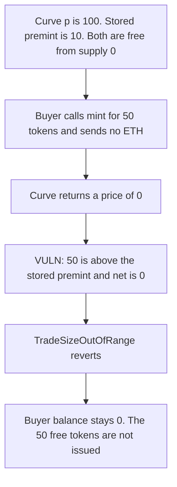

# Catalyst — mint locks the free premint above the stored value

> **Vulnerability classes:** vuln/logic/missing-check · vuln/logic/incorrect-state-transition

<!-- non-defihacklabs -->
<!-- source-auditvault: https://github.com/Auditware/AuditVault/blob/main/findings/36311-h-01-broken-mint-if-market-pre-mint-less-than-p-pashov-audit.md -->
<!-- date: 2024-04 -->

## Key info

| | |
|---|---|
| **Protocol** | Catalyst (Molecule IPSeed) |
| **Finding** | Pashov Audit Group April review H-01, AuditVault 36311 |
| **Vulnerable code** | `IPSeed.mint` |
| **Harm** | A buy of 50 tokens that the curve prices at 0 reverts. The buyer receives 0. The curve's free prefix `p` is 100. The stored premint is 10. |
| **Chain** | local synthetic |

## TL;DR

`checkParameters` lets a market store a premint smaller than the curve's free prefix `p`, as long as `getBuyPrice(0, premint)` is 0. `mint` then compares `totalSupply + amount` to that stored premint. A buyer who asks for 50 tokens, still inside `p = 100`, gets a price of 0 and is rejected with `TradeSizeOutOfRange`. Those 50 tokens are not issued. Checking `p` instead mints them for 0 ETH.

## The vulnerable code

```solidity
// revert trades that require too low volume but still allow premints that require 0 value
if (
    // @> VULN: stored premint can be below the curve's free p, so a still-free mint reverts
    totalSupply[tokenId] + amount > _marketParams.premint && (amount < MINIMUM_TRADE_SIZE || net == 0)
) {
    revert TradeSizeOutOfRange();
}
```

`checkParameters` is what makes the bad pair legal:

```solidity
if (params.priceCurve.getBuyPrice(0, params.premint, params.curveParameters) != 0) {
    revert ParameterMismatch();
}
```

The report's fix reads `p` from the curve parameters and compares to that:

```diff
- totalSupply(tokenId) + amount > _marketParams.premint
+ totalSupply(tokenId) + amount > p
```

The control does that. `mint(1, 50 ether)` returns gross 0 and net 0, and the buyer holds 50 tokens.

## Root cause

The curve's free prefix and the market's stored premint are two different numbers. Spawn only checks that the stored premint itself is free. It does not require the stored premint to equal `p`. Mint then uses the stored number as the end of the free region. Any buy that is still free under `p`, but larger than the stored premint, has `net == 0` and fails the trade-size guard.

## Preconditions

The curve's `p` is 100 tokens. The market is spawned with premint 10. `getBuyPrice(0, 10)` and `getBuyPrice(0, 50)` are both 0. `MINIMUM_TRADE_SIZE` is 1 token, so the revert is not caused by a dust amount. It is caused by the zero price. Supply starts at 0. Anyone can call mint.

## Attack walkthrough

1. `getBuyPrice(0, 10)` is 0, so spawn is allowed to store premint 10 while `p` is 100.
2. `getBuyPrice(0, 50)` is also 0. Fifty tokens are inside the free prefix.
3. The market is spawned with premint 10 and curve parameter `p = 100`.
4. The buyer calls `mint(1, 50)` with no ETH.
5. Mint reads a net of 0, then evaluates `0 + 50 > 10 && net == 0`.
6. `TradeSizeOutOfRange` reverts. The buyer's balance stays 0. Supply stays 0.

The fixed mint compares 50 to `p`. 50 is not greater than 100, so the guard does not fire. The buyer receives 50 tokens and pays 0 ETH.

## Diagrams



## Impact

The buyer cannot mint 50 tokens that the curve prices at 0. The free region between the stored premint of 10 and `p` of 100 is locked. A later buyer who tries the same amount reverts the same way. The tokens are not under-paid out. The mint does not happen at all.

## Remediation

Compare `totalSupply + amount` to `p` decoded from the curve parameters, not to `_marketParams.premint`. Spawn should also reject a stored premint that is not equal to `p`, so the two values cannot drift.

## How to reproduce

```bash
cd 36311-h-01-broken-mint-if-market-pre-mint-less-than-p-pashov-audit_exp
forge test -vv
```

## Sources

- AuditVault finding: https://github.com/Auditware/AuditVault/blob/main/findings/36311-h-01-broken-mint-if-market-pre-mint-less-than-p-pashov-audit.md
- Pashov report: https://github.com/pashov/audits/blob/master/team/md/Catalyst-security-review-april.md
- Report added 2024-04-19
