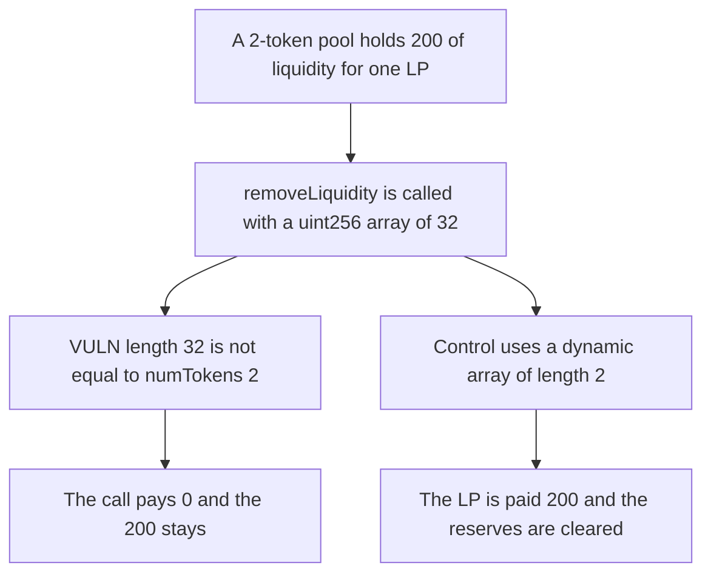

# Lucidly removeLiquidity never pays a pool whose token count is below 32

> **Vulnerability classes:** vuln/input-validation/fixed-array-length · vuln/dos/frozen-funds

<!-- non-defihacklabs -->
<!-- source-auditvault: https://github.com/Auditware/AuditVault/blob/main/findings/36346-h-06-impossible-to-addremove-liquidity-if-numtokens-max-num.md -->
<!-- date: 1970-01 -->

## Key info

| Field | Value |
|---|---|
| **Loss** | 200 of LP stays in a 2-token pool. The remove call pays 0 |
| **Vulnerable contract** | `Pool.removeLiquidity` |
| **Attacker EOA** | `0x1111111111111111111111111111111111111111` |
| **Attack contract** | `Exploit` at `0x15452ec016c4dc8c549e7fe6ff4b26324ea8b7a4` |
| **Attack tx** | `Exploit.run()` |
| **Chain / block / date** | Ethereum model · block 0 · 1970-01 |
| **Compiler** | solc 0.8.27, cancun, via IR |
| **Bug class** | `amounts` is `uint256[32]`, so `amounts.length` is always 32 |



## TL;DR

`removeLiquidity` takes `uint256[32]`. In Solidity that value's `.length` is the compile-time size, 32. The pool requires `amounts.length == numTokens`. A pool with 2 tokens can never pass.

The model seeds 200 of LP. The fixed-array call stores a payout of 0. The LP balance and the reserves both stay 200. The same amounts in a `uint256[]` of length 2 pay the 200 and clear both.

The finding has no month, so the date marker is 1970-01.

## The vulnerable code

```solidity
function removeLiquidity(uint256[MAX_NUM_TOKENS] calldata amounts, address receiver) external returns (uint256 out) {
    uint256 given = amounts.length;
    if (given != numTokens) {
        lastOut = 0; // @> VULN: a uint256[32] always reports length 32, so a 2-token pool never pays
        return 0;
    }
}
```

The published function reverts on the length check. This model records 0 so the check is in the trace. Either way the LP is unpaid.

## Impact

Liquidity in any pool with fewer than 32 tokens cannot be removed through the quoted function. The 200 seeded here remains on the LP balance and in `liquidity`.

## How to reproduce

```bash
cd 36346-h-06-impossible-to-addremove-liquidity-if-numtokens-max-num_exp
forge test -vv
```

`test_exploit_fixed_array_pays_nothing` asserts the payout is 0 and both balances stay 200. `test_control_dynamic_array_pays_200` asserts the dynamic array pays 200.

## Sources

- AuditVault finding: https://github.com/Auditware/AuditVault/blob/main/findings/36346-h-06-impossible-to-addremove-liquidity-if-numtokens-max-num.md
