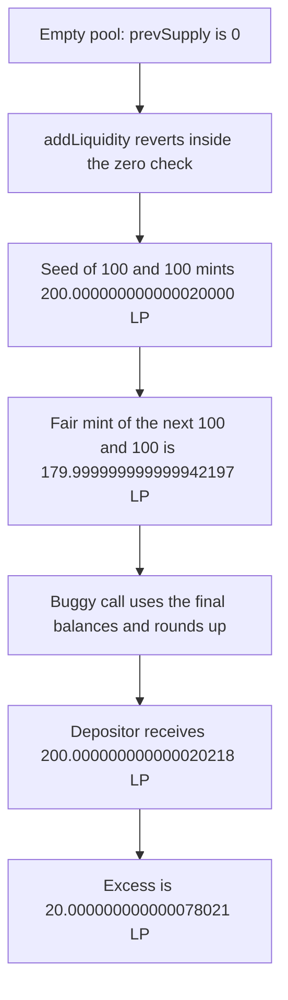

# Lucidly — addLiquidity solves supply with the wrong balances

> **Vulnerability classes:** vuln/logic/wrong-condition · vuln/logic/state-update

> **Reproduction:** a self-contained Foundry PoC that compiles and runs offline
> with only `forge-std` — no fork and no RPC. Trace: [output.txt](output.txt).
> PoC: [test/36348-h-08-wrong-usage-of-variables-for-calculatesupply-pashov-au_exp.sol](test/36348-h-08-wrong-usage-of-variables-for-calculatesupply-pashov-au_exp.sol).

<!-- non-defihacklabs -->
<!-- source-auditvault: https://github.com/Auditware/AuditVault/blob/main/findings/36348-h-08-wrong-usage-of-variables-for-calculatesupply-pashov-au.md -->
<!-- date: 2024-07 -->

---

## Key info

| | |
|---|---|
| **Impact** | **HIGH** — the first add on an empty pool reverts, and a later add of 100 and 100 mints **200.000000000000020218 LP** instead of **179.999999999999942197 LP** |
| **Protocol** | Lucidly `Pool.addLiquidity` |
| **Vulnerable code** | The first `_calculateSupply` call passes `_prevSupply`, the final virtual balances, and `true` |
| **Bug class** | Wrong arguments to the supply update |
| **Finding** | Pashov Audit Group — Lucidly, H-08 · id 36348 |
| **Report** | [Lucidly security review](https://github.com/pashov/audits/blob/master/team/md/Lucidly-security-review.md) |
| **Source** | [AuditVault finding](https://github.com/Auditware/AuditVault/blob/main/findings/36348-h-08-wrong-usage-of-variables-for-calculatesupply-pashov-au.md) |
| **Status** | The second call in the function is the correct one. Reproduced here as a local synthetic. |
| **Compiler** | solc 0.8.27, cancun, via IR |

---

## TL;DR

`addLiquidity` calls `_calculateSupply` with `_prevSupply`, `_virtualBalanceProdFinal`, `_virtualBalanceSumFinal`, and `true`. The supply argument should be the running supply, the balances should be the fee-adjusted ones, and the round-up flag should be `_prevSupply == 0`.

On an empty pool `_prevSupply` is 0. `_calculateSupply` reverts on that zero, so the first add mints **0** LP.

After a seed of 100 and 100, supply is **200.000000000000020000 LP**. Adding another 100 and 100 should mint **179.999999999999942197 LP** once the 10 percent fee is removed from the credited balances. The buggy call mints **200.000000000000020218 LP**. The excess is **20.000000000000078021 LP**. A full withdrawal of that LP quotes **100.000000000000000054** of token0. The fair withdrawal quotes **94.736842105263136896**.

`run()` does not warp. Weights are equal and rates are 1, so the product of a balanced pool is 1. Amplification is `100e18`.

## The vulnerable code

```solidity
// @> VULN: _prevSupply, the final balances, and true — not the fee-adjusted supply
(nextSupply, prodFinal) = _calculateSupply(2, prevSupply, AMPLIFICATION, prodFinal, sumFinal, true);
```

`_calculateSupply` starts with `require(supply_ != 0)`, which is the zero check the report points at. The fixed call passes `prevSupply == 0 ? sum : prevSupply` and `prevSupply == 0` as the round-up flag, and it uses the balances after the fee.

## Root cause

The first call was written with the arguments of the later fee mint: previous supply, final balances, and round up. Those are the wrong inputs for the LP minted to the depositor. The zero previous supply also makes the first deposit revert.

## Preconditions

- Two assets, equal weights, rate 1, amplification `100e18`, fee 10 percent.
- The empty-pool add is attempted before any seed.
- The mis-mint is measured after a seed of **100** and **100**.
- No timestamp change happens inside `run()`.

## Attack walkthrough

1. `addLiquidity(100, 100)` on the empty pool. `_prevSupply` is 0. The call reverts. Minted LP is **0**.
2. Seed **100** and **100**. Supply becomes **200.000000000000020000 LP**, minted to the genesis LP.
3. `previewFair(100, 100)` returns **179.999999999999942197 LP**.
4. The buggy `addLiquidity(100, 100)` mints **200.000000000000020218 LP** to the depositor.
5. `quoteWithdraw` of that LP returns **100.000000000000000054** of token0, against a fair quote of **94.736842105263136896**.

Control: the fixed pool's first `addLiquidity(100, 100)` mints a non-zero supply. A second add mints strictly less than **200 LP**, because the 10 percent fee is not given to the depositor.

## Diagrams



## Impact

The pool cannot take its first deposit through `addLiquidity`. After it has supply, a depositor of **100** and **100** is minted **20.000000000000078021 LP** more than the fee-adjusted mint, and a withdrawal of that LP returns the deposit without leaving the **10 percent** fee in the pool.

## Remediation

Pass the running supply, the fee-adjusted product and sum, and `_prevSupply == 0` into the first `_calculateSupply`. That is the call the report says is already correct on the second use.

## Sources

- [AuditVault finding 36348](https://github.com/Auditware/AuditVault/blob/main/findings/36348-h-08-wrong-usage-of-variables-for-calculatesupply-pashov-au.md)
- [Pashov Lucidly security review, H-08](https://github.com/pashov/audits/blob/master/team/md/Lucidly-security-review.md)
- Audited tree: [lucidlyfi/lucidly-core-v1 Pool.sol](https://github.com/lucidlyfi/lucidly-core-v1/blob/f00c45bbadc836b9eaa94717a0b3aa017e792588/src/Pool.sol#L520)

### Taxonomy

- `severity/high`
- `vuln/logic/wrong-condition`
- `vuln/logic/state-update`
