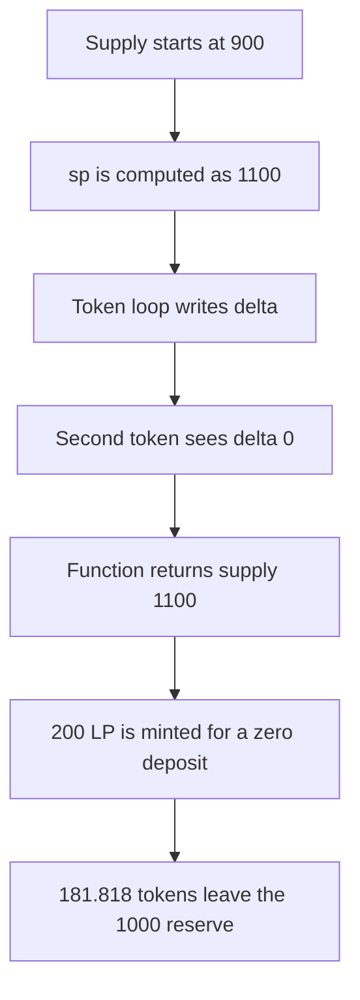

# Lucidly — supply iteration returns inside the token loop

> **Vulnerability classes:** vuln/logic/incorrect-order-of-operations · vuln/logic/price-calculation

> **Reproduction:** a self-contained Foundry PoC that compiles and runs offline
> with only `forge-std` — no fork and no RPC. Trace: [output.txt](output.txt).
> PoC: [test/36349-h-09-wrong-loop-area-pashov-audit-group-none-lucidly-markdow_exp.sol](test/36349-h-09-wrong-loop-area-pashov-audit-group-none-lucidly-markdow_exp.sol).

<!-- non-defihacklabs -->
<!-- source-auditvault: https://github.com/Auditware/AuditVault/blob/main/findings/36349-h-09-wrong-loop-area-pashov-audit-group-none-lucidly-markdow.md -->
<!-- date: 2024-05 -->

---

## Key info

| | |
|---|---|
| **Impact** | **HIGH** — a caller who deposits nothing is minted **200 LP** and withdraws **181.818181818181818181** of a **1000** reserve |
| **Protocol** | Lucidly `Pool._calculateSupply` |
| **Vulnerable code** | delta is computed inside the per-token loop |
| **Bug class** | The Newton step returns before every token has updated `r` |
| **Finding** | Pashov Audit Group — Lucidly H-09 · id 36349 |
| **Report** | [Lucidly security review](https://github.com/pashov/audits/blob/master/team/md/Lucidly-security-review.md) |
| **Source** | [AuditVault finding](https://github.com/Auditware/AuditVault/blob/main/findings/36349-h-09-wrong-loop-area-pashov-audit-group-none-lucidly-markdow.md) |
| **Status** | The review says the loop must end before `delta = 0`, matching yETH. Reproduced as a local synthetic. |
| **Compiler** | solc 0.8.27, cancun, via IR |

---

## TL;DR

`_calculateSupply` is the Newton update yETH writes as two loops: for each iteration, set `r = r * sp / s` once per token, then compute `delta` once. Lucidly's loop does not end before `delta = 0`. With two tokens, supply **900** and product **1**, the first token moves `s` to **1100**. The second token then sees `delta == 0` and returns supply **1100**.

The pool mints **200 LP** and pays `1000 * 200 / 1100` = **181.818181818181818181** tokens. Closing the token loop before `delta`, which is the review's diff, does not return that supply: the next iteration underflows. `run()` does not read `block.timestamp`.

## The vulnerable code

```solidity
_r = FixedPointMathLib.rawDiv(FixedPointMathLib.rawMul(_s, _sp), _s);
// @> VULN: delta is inside the token loop; yETH ends that loop before delta = 0
lastDelta = _delta;
if (FixedPointMathLib.rawDiv(FixedPointMathLib.rawMul(_delta, PRECISION), _s) <= MAX_POW_REL_ERR) {
    return (_sp, _r);
}
_s = _sp;
```

The review's diff closes the `for` immediately after the `_r` assignment, so `uint256 _delta = 0` sits outside that loop.

## Root cause

The per-token update and the convergence test share one loop. After the first token, `s` is already `sp`. The second token's relative error is zero, so the function returns one Newton step early.

## Preconditions

- Two tokens, amplification **2e18**, virtual-balance sum **1000e18**, product **1e18**, supply **900e18**.
- The reserve holds **1000** tokens against **900** existing LP.
- The caller adds no tokens.

## Attack walkthrough

1. Seed supply **900** and reserve **1000**.
2. `_calculateSupply` computes `sp = 1100e18`.
3. Token 0 sets `r` from the quoted `rawDiv(rawMul(_s, _sp), _s)` line and stores a non-zero delta.
4. Token 1 sees `s == sp`, stores delta **0**, and returns **1100e18**.
5. The pool mints **200 LP** and transfers **181.818181818181818181** tokens.

## Diagrams



## Impact

Existing LPs lose **181.818181818181818181** of the **1000** reserve to a caller who deposited nothing. The control with the brace moved before `delta` reverts instead of paying that amount.

## Remediation

End the token loop before `uint256 _delta = 0`, as in the review diff and in yETH `_calc_supply`.

## How to reproduce

```bash
cd evm-hack-registry/36349-h-09-wrong-loop-area-pashov-audit-group-none-lucidly-markdow_exp
forge test -vv
```

Expect both tests to pass. The exploit asserts the paid amount. The control expects a revert.

## Sources

- AuditVault finding 36349
- Pashov Audit Group, Lucidly security review, H-09
- yETH `Pool.vy` `_calc_supply` at the commit cited by the review
- lucidly-core-v1 `src/Pool.sol` around the lines cited by the review, commit `f00c45bb`
