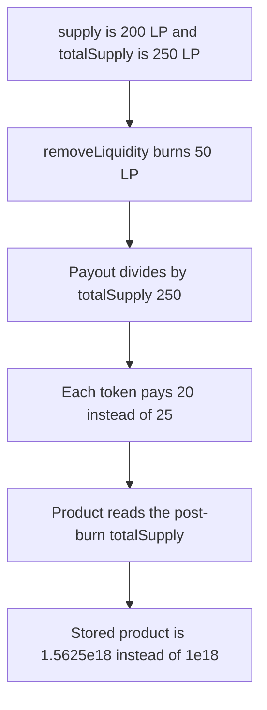

# Lucidly — removeLiquidity prices the burn with totalSupply

> **Vulnerability classes:** vuln/logic/price-calculation · vuln/logic/state-update

> **Reproduction:** a self-contained Foundry PoC that compiles and runs offline
> with only `forge-std` — no fork and no RPC. Trace: [output.txt](output.txt).
> PoC: [test/36352-h-12-incorrect-supply-usage-pashov-audit-group-none-lucidly_exp.sol](test/36352-h-12-incorrect-supply-usage-pashov-audit-group-none-lucidly_exp.sol).

<!-- non-defihacklabs -->
<!-- source-auditvault: https://github.com/Auditware/AuditVault/blob/main/findings/36352-h-12-incorrect-supply-usage-pashov-audit-group-none-lucidly.md -->
<!-- date: 2024-07 -->

---

## Key info

| | |
|---|---|
| **Impact** | **HIGH** — burning **50 LP** pays **20** of each token instead of **25**. The stored product is **1.5625e18** instead of **1e18**, high by **0.5625e18** |
| **Protocol** | Lucidly `Pool.removeLiquidity` |
| **Vulnerable code** | product update reads `totalSupply()` after `_burn` |
| **Bug class** | Circulating LP is used where the invariant `supply` belongs |
| **Finding** | Pashov Audit Group — Lucidly, July 2024 · id 36352, H-12 |
| **Report** | [Lucidly security review](https://github.com/pashov/audits/blob/master/team/md/Lucidly-security-review.md) |
| **Source** | [AuditVault finding](https://github.com/Auditware/AuditVault/blob/main/findings/36352-h-12-incorrect-supply-usage-pashov-audit-group-none-lucidly.md) |
| **Status** | Fixed by using `supply`, matching yETH. Reproduced here as a local synthetic. |
| **Compiler** | solc 0.8.27, cancun, via IR |

---

## TL;DR

Lucidly keeps two supplies. `supply` is the pool invariant. `totalSupply` is the LP token in circulation. The report says they match only after `_calculateSupply` and `_updateSupply`, and that `removeLiquidity` reads `totalSupply` anyway.

On a two-asset pool the invariant supply is **200 LP** and **250 LP** are outstanding. Each virtual balance is **100**. Burning **50 LP** snapshots `totalSupply` (**250**) as the payout base, then reads `totalSupply` again (**200**) inside the product. The withdrawer receives **20** of each token. The fair burn, using `supply` the way yETH does, pays **25** of each and stores a product of **1e18**. The stored product here is **1.5625e18**.

`run()` does not warp. Nothing in the path reads `block.timestamp`.

## The vulnerable code

```solidity
uint256 _prevSupply = lp.totalSupply();
lp.burn(msg.sender, lpAmount);
// @> VULN: totalSupply() after the burn, not the invariant supply
uint256 _ts = lp.totalSupply();
uint256 _base = FixedPointMathLib.rawDiv(FixedPointMathLib.rawMul(_ts, __weight), vb);
```

The audited expression is the same read, inlined:

```solidity
_virtualBalanceProd = FixedPointMathLib.rawDiv(
    FixedPointMathLib.rawMul(
        _virtualBalanceProd,
        _powDown(
            FixedPointMathLib.rawDiv(FixedPointMathLib.rawMul(totalSupply(), __weight), vb),
            FixedPointMathLib.rawMul(__weight, _numTokens)
        )
    ),
    PRECISION
);
```

yETH `remove_liquidity` sets `supply = prev_supply - lp_amount` and uses that `supply` in the product. The payout divides by `prev_supply`, the invariant, not by `token.totalSupply()`.

## Root cause

`_burn` changes `totalSupply` immediately and does not change `supply`. The product is documented against the invariant. Reading the circulating supply after the burn feeds a different number into `supply * weight / balance`, so the stored product and the token amounts diverge from the yETH formula.

## Preconditions

- Two assets, virtual balances **100** and **100**, equal weights. `weight * n = 1`, so the power is the identity. Rates are 1.
- Invariant `supply` is **200 LP**. LP `totalSupply` is **250**. That gap is the unsynced state the report describes.
- The withdrawer burns **50 LP**.
- No timestamp change happens inside `run()`.

## Attack walkthrough

1. Seed the pool. `supply` is **200**. The withdrawer is minted **250 LP**.
2. `removeLiquidity(50)` sets `_prevSupply` to `totalSupply()`, which is **250**, then burns.
3. Each token pays `100 * 50 / 250 = 20`. The fair payout is `100 * 50 / 200 = 25`.
4. The product reads the post-burn `totalSupply` of **200** against a remaining balance of **80**. The base is **1.25e18**. After both tokens the stored product is **1.5625e18**.
5. The fair path reduces `supply` from **200** to **150**, pays **25**, and stores a product of **1e18**.

The withdrawer is short **5** of each token. The product is high by **0.5625e18**. The invariant `supply` is left at **200** instead of **150**.

Control: the same seed and the same **50 LP** burn, with `_prevSupply = supply` and the product reading the updated `supply`. The withdrawer receives **25** of each token, `supply` is **150**, and the product is **1e18**.

## Diagrams



## Impact

The withdrawer loses **5** of token0 and **5** of token1 on a **50 LP** burn: **20** received against a fair **25**. The stored product is **1.5625e18** rather than **1e18**, so the next swap that reads it is priced **0.5625e18** high. `supply` remains **200** while the corrected update would store **150**.

## Remediation

Snapshot and update the invariant `supply` before the product, and use that value in the product. Do not read `totalSupply()` unless the two supplies have just been synced. This matches yETH `remove_liquidity`.

## Sources

- [AuditVault finding 36352](https://github.com/Auditware/AuditVault/blob/main/findings/36352-h-12-incorrect-supply-usage-pashov-audit-group-none-lucidly.md)
- [Pashov Lucidly security review, H-12](https://github.com/pashov/audits/blob/master/team/md/Lucidly-security-review.md)
- Audited tree: [lucidlyfi/lucidly-core-v1@f00c45bbadc836b9eaa94717a0b3aa017e792588](https://github.com/lucidlyfi/lucidly-core-v1/tree/f00c45bbadc836b9eaa94717a0b3aa017e792588) `src/Pool.sol`
- Correct supply input: [yearn/yETH Pool.vy@8d831fd](https://github.com/yearn/yETH/blob/8d831fd6b4de9f004d419f035cd2806dc8d5cf7e/contracts/Pool.vy#L561)

### Taxonomy

- `severity/high`
- `vuln/logic/price-calculation`
- `vuln/logic/state-update`
