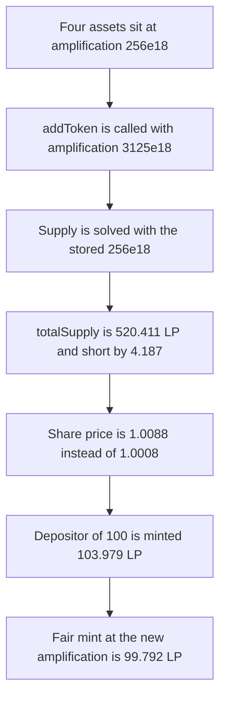

# Lucidly — addToken updates supply with the old amplification

> **Vulnerability classes:** vuln/logic/state-update · vuln/logic/price-calculation

> **Reproduction:** a self-contained Foundry PoC that compiles and runs offline
> with only `forge-std` — no fork and no RPC. Trace: [output.txt](output.txt).
> PoC: [test/36353-h-13-incorrect-supply-update-when-adding-token-pashov-audit_exp.sol](test/36353-h-13-incorrect-supply-update-when-adding-token-pashov-audit_exp.sol).

<!-- non-defihacklabs -->
<!-- source-auditvault: https://github.com/Auditware/AuditVault/blob/main/findings/36353-h-13-incorrect-supply-update-when-adding-token-pashov-audit.md -->
<!-- date: 2024-07 -->

---

## Key info

| | |
|---|---|
| **Impact** | **HIGH** — after the token is added, `totalSupply` is short by **4.187399816552179222 LP**, the share price is high by **0.008052482328780901**, and a depositor of 100 is minted **103.979436279176422035 LP** instead of **99.792036462624242813 LP** |
| **Protocol** | Lucidly `Pool.addToken` |
| **Vulnerable code** | `_calculateSupply` is called with stored `amplification`, not `amplification_` |
| **Bug class** | Supply and the LP mint use the pre-update amplification |
| **Finding** | Pashov Audit Group — Lucidly, July 2024 · id 36353, H-13 |
| **Report** | [Lucidly security review](https://github.com/pashov/audits/blob/master/team/md/Lucidly-security-review.md) |
| **Source** | [AuditVault finding](https://github.com/Auditware/AuditVault/blob/main/findings/36353-h-13-incorrect-supply-update-when-adding-token-pashov-audit.md) |
| **Status** | Fixed by passing `amplification_` into `_calculateSupply`. Reproduced here as a local synthetic. |
| **Compiler** | solc 0.8.27, cancun, via IR |

---

## TL;DR

`addToken` takes the new amplification and is supposed to recompute the pool invariant with it, the same way yETH `add_asset` passes `_amplification` into `_calc_supply`. The Lucidly call passes the stored `amplification` instead.

On a four-asset pool at amplification `256e18`, adding a fifth asset with amplification `3125e18` should move supply from **498.807286459472473015** to **524.598714666764808847**. The bug stops at **520.411314850212629625**. Supply is short by **4.187399816552179222 LP**. Assets per LP are **1.008817420026903351** instead of **1.000764937698122450**.

A later deposit of 100 is minted `newInvariant - storedSupply`. The depositor receives **103.979436279176422035 LP**. The same deposit against the corrected supply mints **99.792036462624242813 LP**. The extra **4.187399816552179222 LP** is exactly the amount the adder was under-minted.

`run()` does not warp. Nothing in the path reads `block.timestamp`.

## The vulnerable code

```solidity
(__supply, _virtualBalanceProd) = _calculateSupply(
    _numTokens,
    _virtualBalanceSum,
    amplification, // @> VULN: old amplification, not amplification_
    _virtualBalanceProd,
    _virtualBalanceSum,
    true
);
```

The iteration is the yETH step `D' = (A * sigma - D * pi) / (A - 1)`. `A` is the third argument. The stored value is still `256e18`. `amplification_` is `3125e18`, and it is written to storage only after this call returns.

The fixed call passes `amplification_`. The control pool does that and the depositor receives the smaller, fair mint.

## Root cause

The new amplification is an input of `addToken` because adding an asset changes `A f^n` even when the economic amplification is meant to stay put. The supply update ignores that input and solves the invariant at the previous `A f^n`. The LP minted to the adder, the stored supply, and every later mint that subtracts that supply are then off by the same gap.

## Preconditions

- The pool already has supply. Here that is four virtual balances, 100, 50, 150 and 200, at amplification `256e18`.
- The added asset's virtual balance is 25, and the new amplification is `3125e18`.
- Weights are equal and `weight * n = 1`, so the product power is the identity. Rates are 1, so a token amount is its virtual balance. Neither simplification removes the amplification input.
- No timestamp change happens inside `run()`.

## Attack walkthrough

1. Seed the four-asset pool. Supply is **498.807286459472473015 LP**, minted to the genesis LP.
2. `addToken(25 ether, 3125 ether, adder)` pushes the new balance and calls `_calculateSupply` with the stored amplification `256e18`.
3. Stored supply becomes **520.411314850212629625**. The adder receives **21.604028390740156610 LP** instead of **25.791428207292335832 LP**.
4. Storage amplification is then overwritten with `3125e18`. A quote at that amplification on the same balances is **524.598714666764808847**. The share price is high by **0.008052482328780901**.
5. The depositor adds 100 of the first asset. The mint is the new invariant minus the short supply, so the depositor receives **103.979436279176422035 LP** instead of **99.792036462624242813 LP**.

Control: the same seed and the same `addToken` arguments, with `amplification_` passed into `_calculateSupply`. Supply is **524.598714666764808847**. The depositor receives **99.792036462624242813 LP**, and the adder receives **25.791428207292335832 LP**.

## Diagrams



## Impact

The adder is under-minted by **4.187399816552179222 LP**. The next depositor is over-minted by that same amount: **103.979436279176422035 LP** instead of **99.792036462624242813 LP**. Until the next deposit, `totalSupply` is short by **4.187399816552179222** and each LP claims **0.008052482328780901** too much of the virtual balances.

## Remediation

Pass `amplification_` into `_calculateSupply` before writing it to storage, matching yETH `add_asset`.

## Sources

- [AuditVault finding 36353](https://github.com/Auditware/AuditVault/blob/main/findings/36353-h-13-incorrect-supply-update-when-adding-token-pashov-audit.md)
- [Pashov Lucidly security review, H-13](https://github.com/pashov/audits/blob/master/team/md/Lucidly-security-review.md)
- Audited tree cited by the report: [lucidlyfi/lucidly-core-v1@f00c45bbadc836b9eaa94717a0b3aa017e792588](https://github.com/lucidlyfi/lucidly-core-v1/tree/f00c45bbadc836b9eaa94717a0b3aa017e792588) `src/Pool.sol`
- Correct argument: [yearn/yETH Pool.vy@8d831fd](https://github.com/yearn/yETH/blob/8d831fd6b4de9f004d419f035cd2806dc8d5cf7e/contracts/Pool.vy#L868) passes `_amplification` into `_calc_supply`

### Taxonomy

- `severity/high`
- `vuln/logic/state-update`
- `vuln/logic/price-calculation`
