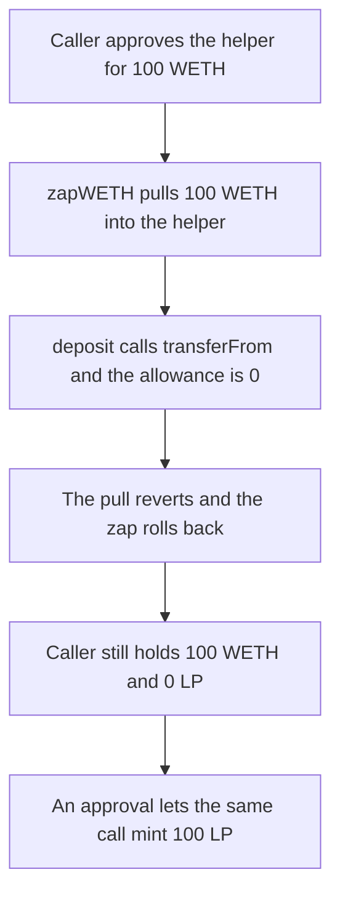

# Radiant — zapWETH never approves TokenizedLp

> **Vulnerability classes:** vuln/logic/missing-allowance

> **Reproduction:** a self-contained Foundry PoC that compiles and runs offline
> with only `forge-std` — no fork and no RPC. Trace: [output.txt](output.txt).
> PoC: [test/36368-c-01-no-approvals-from-helper-to-tokenizedlp-pashov-audit-gr_exp.sol](test/36368-c-01-no-approvals-from-helper-to-tokenizedlp-pashov-audit-gr_exp.sol).

<!-- non-defihacklabs -->
<!-- source-auditvault: https://github.com/Auditware/AuditVault/blob/main/findings/36368-c-01-no-approvals-from-helper-to-tokenizedlp-pashov-audit-gr.md -->
<!-- date: 2024-06 -->

---

## Key info

| | |
|---|---|
| **Impact** | **HIGH** — `zapWETH` of **100 WETH** reverts. The caller still holds **100 WETH** and receives **0 LP**. With the approval, the caller receives **100 LP** and holds **0 WETH** |
| **Protocol** | Radiant `UniV3PoolHelper.zapWETH` |
| **Vulnerable code** | `tokenizedLpToken.deposit` is called with no WETH allowance from the helper |
| **Bug class** | Missing approval from the helper to TokenizedLp |
| **Finding** | Pashov Audit Group — Radiant June review · id 36368, C-01 |
| **Report** | [Radiant security review, June](https://github.com/pashov/audits/blob/master/team/md/Radiant-security-review-June.md) |
| **Source** | [AuditVault finding](https://github.com/Auditware/AuditVault/blob/main/findings/36368-c-01-no-approvals-from-helper-to-tokenizedlp-pashov-audit-gr.md) |
| **Status** | Fixed by approving TokenizedLp from the helper before `deposit`. Reproduced here as a local synthetic. |
| **Compiler** | solc 0.8.27, cancun, via IR |

---

## TL;DR

`zapWETH` pulls the caller's WETH into `UniV3PoolHelper`, then calls `UniV3TokenizedLp.deposit`. `deposit` takes the tokens with `transferFrom` on the helper. The helper never approves TokenizedLp, so that pull reverts with `"allowance"`. The zap rolls back.

The caller of a **100 WETH** zap still holds **100 WETH**. TokenizedLp minted **0 LP**. The helper's WETH balance is **0**, because the pull into the helper is undone with the revert. The helper's allowance to TokenizedLp is **0**.

The control runs the same zap after `weth.approve(tokenizedLp, amount)`. The caller receives **100 LP**. TokenizedLp holds the **100 WETH**. The caller's WETH balance is **0**.

`run()` does not warp. The reverted deposit is caught so the outer call can record the balances. Nothing reads `block.timestamp`.

## The vulnerable code

```solidity
function zapWETH(uint256 amount) public onlyLockZap returns (uint256 liquidity) {
    IERC20(weth9Addr).safeTransferFrom(msg.sender, address(this), amount);
    uint256 token0Amt = token0 == weth9Addr ? amount : 0;
    uint256 token1Amt = token1 == weth9Addr ? amount : 0;
    liquidity = tokenizedLpToken.deposit(token0Amt, token1Amt, msg.sender); // @> VULN: no approval
}
```

`deposit` then executes `weth.transferFrom(msg.sender, address(this), amount)` with `msg.sender` equal to the helper. The allowance is 0, so the require reverts.

The fix is `weth.approve(address(tokenizedLpToken), amount)` after the pull and before `deposit`.

## Root cause

TokenizedLp pulls the deposit from whoever calls it. The helper is that caller, and it is a fresh holder of the WETH. No line in `zapWETH` or the helper constructor sets an allowance for TokenizedLp, so every zap reverts.

## Preconditions

- The caller has approved the helper, which is the normal zap setup. Here that allowance is 100 WETH.
- `token0` is WETH, so the whole amount is `token0Amt` and `token1Amt` is 0.
- The helper's allowance to TokenizedLp is 0. Nothing in `run()` changes that.
- No timestamp change happens inside `run()`.

## Attack walkthrough

1. Mint 100 WETH to the caller and approve the helper for 100.
2. `zapWETH` pulls the 100 WETH into the helper.
3. `deposit` calls `transferFrom` on the helper. The allowance check reverts.
4. The zap rolls back. The caller holds **100 WETH**. The helper holds **0**. LP minted to the caller is **0**.

Control: the helper approves TokenizedLp for 100 before `deposit`. `deposit` returns **100**. The caller holds **100 LP** and **0 WETH**. TokenizedLp holds the **100 WETH**.

## Diagrams



## Impact

A 100 WETH zap cannot complete. The caller keeps **100 WETH** and receives **0 LP**. The same call with the missing approval mints **100 LP** and moves the **100 WETH** into TokenizedLp.

## Remediation

Approve TokenizedLp for the WETH amount, or for the max, after the helper has taken the tokens and before `deposit`.

## Sources

- [AuditVault finding 36368](https://github.com/Auditware/AuditVault/blob/main/findings/36368-c-01-no-approvals-from-helper-to-tokenizedlp-pashov-audit-gr.md)
- [Pashov Radiant security review, June, C-01](https://github.com/pashov/audits/blob/master/team/md/Radiant-security-review-June.md)
- Audited tree cited by the report: [radiant-capital/v2-core@2f6eaadd32dd2d650499ee21e2b75824dd429ebf](https://github.com/radiant-capital/v2-core/tree/2f6eaadd32dd2d650499ee21e2b75824dd429ebf) `UniV3PoolHelper` / `UniV3TokenizedLp`

### Taxonomy

- `severity/high`
- `vuln/logic/missing-allowance`
