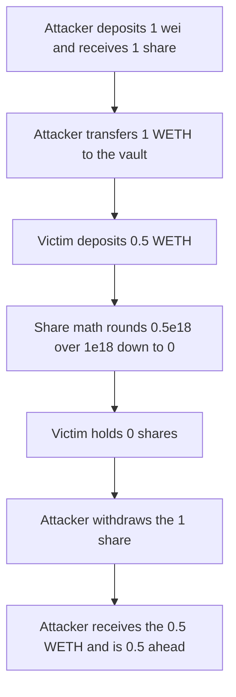

# Radiant — UniV3TokenizedLp initial donation

> **Vulnerability classes:** vuln/arithmetic/precision-loss · vuln/logic/price-calculation

> **Reproduction:** a self-contained Foundry PoC that compiles and runs offline
> with only `forge-std` — no fork and no RPC. Trace: [output.txt](output.txt).
> PoC: [test/36369-h-01-univ3tokenizedlp-can-be-attacked-by-an-initial-donation_exp.sol](test/36369-h-01-univ3tokenizedlp-can-be-attacked-by-an-initial-donation_exp.sol).

<!-- non-defihacklabs -->
<!-- source-auditvault: https://github.com/Auditware/AuditVault/blob/main/findings/36369-h-01-univ3tokenizedlp-can-be-attacked-by-an-initial-donation.md -->
<!-- date: 2024-06 -->

---

## Key info

| | |
|---|---|
| **Impact** | **HIGH** — the second depositor of **0.5 WETH** receives **0 shares**. The attacker withdraws that **0.5 WETH** and finishes **0.5 WETH** ahead |
| **Protocol** | Radiant `UniV3TokenizedLp.deposit` |
| **Vulnerable code** | `shares = (shares * totalSupply()) / (pool0PricedInToken1 + pool1)` |
| **Bug class** | Share price has no virtual offset, so a donation inflates it |
| **Finding** | Pashov Audit Group — Radiant June review · id 36369, H-01 |
| **Report** | [Radiant security review, June](https://github.com/pashov/audits/blob/master/team/md/Radiant-security-review-June.md) |
| **Source** | [AuditVault finding](https://github.com/Auditware/AuditVault/blob/main/findings/36369-h-01-univ3tokenizedlp-can-be-attacked-by-an-initial-donation.md) |
| **Status** | The report recommends virtual shares and virtual assets, or a deposit to `address(0)` in the deploy block. Reproduced here as a local synthetic. |
| **Compiler** | solc 0.8.27, cancun, via IR |

---

## TL;DR

`deposit` mints shares one-for-one while `totalSupply` is 0. After that it prices shares as `deposit * totalSupply / assets`.

The attacker deposits **1 wei**, receives **1 share**, and transfers **1 WETH** directly to the vault. Assets are about **1 WETH** and supply is **1**. The next depositor sends **0.5 WETH**. Integer division rounds the mint to **0 shares**, but the tokens are still pulled. The attacker withdraws the **1 share** and receives **1.5 WETH** plus the original wei. Net profit is **0.5 WETH**, which is the victim's deposit.

`run()` does not warp. Nothing in the path reads `block.timestamp`.

## The vulnerable code

```solidity
if (totalSupply != 0) {
    uint256 pool0PricedInToken1 = (pool0 * oraclePrice) / PRECISION;
    // @> VULN: share price has no virtual offset, so the donation rounds the next mint to 0
    shares = (shares * totalSupply) / (pool0PricedInToken1 + pool1);
}
```

This is the line the report quotes. `pool1` is the WETH already in the vault, including a raw transfer that did not mint shares. `totalSupply` is still the **1 wei** from the first deposit.

The fixed deposit uses a virtual offset:

```solidity
shares = amount1 * (totalSupply + OFFSET) / (pool1 + 1);
```

With `OFFSET = 1000`, the same sequence mints the victim **999 shares**. The attacker withdraws only their own shares and finishes with less WETH than they started.

## Root cause

The share price is assets divided by a supply that can be 1 wei. A direct token transfer raises assets without raising supply. The next depositor's mint rounds down to zero, and the 1 wei share owns the donation plus that deposit.

## Preconditions

- The vault has no shares. The first depositor can still reach that state.
- The attacker can transfer WETH to the vault without calling `deposit`. The token has no callback into the vault.
- The victim deposits **0.5 WETH** after the **1 WETH** donation, which is less than the inflated assets per share.
- The other token's balance is 0 and the oracle price is 1e18, so `pool0PricedInToken1` is 0. The quoted division still rounds to 0.
- No timestamp change happens inside `run()`.

## Attack walkthrough

1. Deposit **1 wei**. `totalSupply` is 0, so the vault mints **1 share** to the attacker.
2. Transfer **1 WETH** to the vault. Supply stays **1**.
3. The victim deposits **0.5 WETH**. Shares are `0.5e18 * 1 / (1e18 + 1) = 0`.
4. The victim's WETH is pulled. Their share balance is **0**.
5. The attacker withdraws **1 share**. The vault holds **1.5 WETH** plus **1 wei**, and that share is the whole supply, so all of it is sent back.
6. The attacker spent **1 WETH** plus **1 wei** and received **1.5 WETH** plus **1 wei**. Profit is **0.5 WETH**.

Control: the same amounts with `shares = amount * (totalSupply + 1000) / (assets + 1)`. The first **1 wei** mints **1000 shares**. After the donation the victim's **0.5 WETH** mints **999 shares**. Withdrawing the attacker's shares returns less than the **1 WETH** they donated.

## Diagrams



## Impact

The second depositor loses **0.5 WETH** and receives **0 shares**. The attacker, who put in **1 WETH** plus **1 wei**, withdraws **1.5 WETH** plus **1 wei** and keeps a profit of **0.5 WETH**.

## Remediation

Mint shares against virtual shares and virtual assets, as in the ERC-4626 inflation defense. The report also notes that deploying the vault and depositing to `address(0)` in the same block blocks the empty-supply state.

## Sources

- [AuditVault finding 36369](https://github.com/Auditware/AuditVault/blob/main/findings/36369-h-01-univ3tokenizedlp-can-be-attacked-by-an-initial-donation.md)
- [Pashov Radiant security review, June, H-01](https://github.com/pashov/audits/blob/master/team/md/Radiant-security-review-June.md)
- Virtual shares and assets: [OpenZeppelin, a novel defense against ERC-4626 inflation attacks](https://blog.openzeppelin.com/a-novel-defense-against-erc4626-inflation-attacks)

### Taxonomy

- `severity/high`
- `vuln/arithmetic/precision-loss`
- `vuln/logic/price-calculation`
