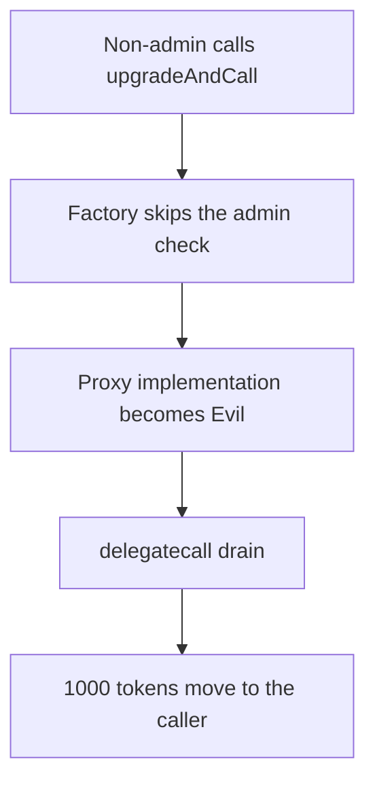

# Curra — anyone can upgrade a proxy and drain it

> **Vulnerability classes:** vuln/access-control/missing-modifier · vuln/dependency/upgradeable-contract

> **Reproduction:** a self-contained Foundry PoC that compiles and runs offline
> with only `forge-std` — no fork and no RPC. Trace: [output.txt](output.txt).
> PoC: [test/37160-anyone-can-upgrade-an-implementation-zokyo-none-curra-markdo_exp.sol](test/37160-anyone-can-upgrade-an-implementation-zokyo-none-curra-markdo_exp.sol).

<!-- non-defihacklabs -->
<!-- source-auditvault: https://github.com/Auditware/AuditVault/blob/main/findings/37160-anyone-can-upgrade-an-implementation-zokyo-none-curra-markdo.md -->
<!-- date: 2024-01 -->

---

## Key info

| | |
|---|---|
| **Impact** | **HIGH** — a non-admin replaces the implementation and takes **1000** tokens from the proxy |
| **Protocol** | Curra `ERC1967Factory.upgradeAndCall` |
| **Vulnerable code** | `upgradeTo` is called with no admin check |
| **Bug class** | Public upgrade after the admin check was removed |
| **Finding** | Zokyo — Curra · id 37160 |
| **Report** | [Zokyo Curra, 4 Jan 2024](https://github.com/solodit/solodit_content/blob/main/reports/Zokyo/2024-01-04-Curra.md) |
| **Source** | [AuditVault finding](https://github.com/Auditware/AuditVault/blob/main/findings/37160-anyone-can-upgrade-an-implementation-zokyo-none-curra-markdo.md) |
| **Status** | The report says the issue was resolved by making the upgrade paths internal. Reproduced as a local synthetic. |
| **Compiler** | solc 0.8.27, cancun, via IR |

---

## TL;DR

`ERC1967Factory` stores an admin for the proxy, but `upgrade` and `upgradeAndCall` no longer read it. Any caller can point the proxy at a contract they deployed and then `delegatecall` it. The proxy holds **1000** tokens. `drain` transfers all of them to the caller. The recorded admin is `0xbeef` and is never the caller.

A factory that requires `msg.sender == admin` reverts, and the **1000** tokens stay in the proxy. `run()` does not warp.

## The vulnerable code

```solidity
function upgradeAndCall(address proxy, address implementation, bytes memory data) public payable {
    // @> VULN: the proxy admin is not checked; anyone may replace the implementation
    VaultProxy(payable(proxy)).upgradeTo(implementation);
    if (data.length > 0) {
        (bool ok,) = proxy.call(data);
        require(ok, "call");
    }
}
```

## Root cause

The report says the admin check was removed and both upgrade functions were left public. The factory is still the only address the proxy accepts as the upgrade caller, so going through the factory is enough.

## Preconditions

- The proxy holds **1000** tokens.
- The factory's stored admin is not the attacker.
- The attacker can deploy a contract with a `drain` function.

## Attack walkthrough

1. Call `upgradeAndCall(proxy, evil, drain(attacker))`.
2. `upgradeTo` writes the new implementation. No admin comparison runs.
3. The factory calls the proxy. The proxy `delegatecall`s `drain`.
4. **1000** tokens move to the attacker. The proxy balance is **0**.

## Diagrams



## Impact

Every token held by the proxy can be taken by the first caller who supplies an implementation. Here that amount is **1000**.

## Remediation

Require the caller to be the stored admin. Keep `upgradeAndCall` internal, as the report recommends.

## How to reproduce

```bash
cd evm-hack-registry/37160-anyone-can-upgrade-an-implementation-zokyo-none-curra-markdo_exp
forge test -vv
```

## Sources

- AuditVault finding 37160
- Zokyo, Curra, 4 January 2024, `src/ERC1967Factory.sol`
