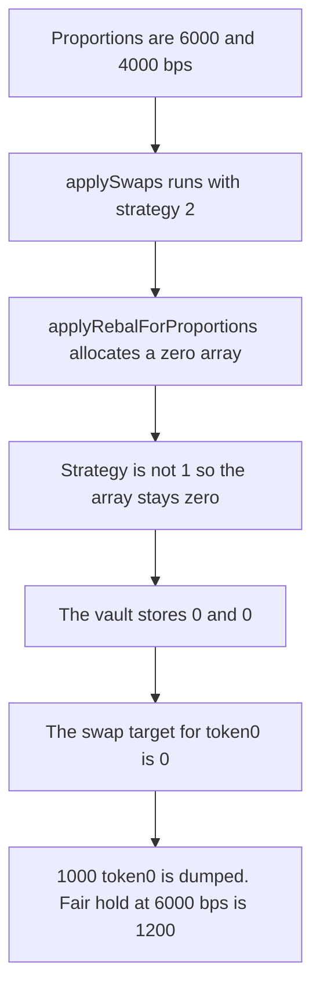

# Aarna — passive rebalance zeroes token proportions

> **Vulnerability classes:** vuln/logic/state-update · vuln/data/uninitialized

> **Reproduction:** a self-contained Foundry PoC that compiles and runs offline
> with only `forge-std` — no fork and no RPC. Trace: [output.txt](output.txt).
> PoC: [test/37166-unintended-tokens-proportion-reset-in-applyswapsandpassivere_exp.sol](test/37166-unintended-tokens-proportion-reset-in-applyswapsandpassivere_exp.sol).

<!-- non-defihacklabs -->
<!-- source-auditvault: https://github.com/Auditware/AuditVault/blob/main/findings/37166-unintended-tokens-proportion-reset-in-applyswapsandpassivere.md -->
<!-- date: 2024-01 -->

---

## Key info

| | |
|---|---|
| **Impact** | **HIGH** — strategy 2 replaces **6000 / 4000** with **0 / 0**. The next swap dumps **1000 token0**. Keeping 6000 bps would hold **1200**. The position is off by **1200 token0** |
| **Protocol** | Aarna `AFiBase.applySwapsAndPassiveRebal` |
| **Vulnerable code** | `uTokenProportions = rebalContract.applyRebalForProportions(...)` for every `strategy >= 1` |
| **Bug class** | A zero array is stored when the strategy is not 1 |
| **Finding** | Zokyo — Aarna, 4 January 2024 · id 37166 |
| **Report** | [Zokyo Aarna report](https://github.com/solodit/solodit_content/blob/main/reports/Zokyo/2024-01-04-aarna.md) |
| **Source** | [AuditVault finding](https://github.com/Auditware/AuditVault/blob/main/findings/37166-unintended-tokens-proportion-reset-in-applyswapsandpassivere.md) |
| **Status** | Fixed by updating proportions only when the strategy is 1. Reproduced here as a local synthetic. |
| **Compiler** | solc 0.8.27, cancun, via IR |

---

## TL;DR

`applySwapsAndPassiveRebal` calls `applyRebalForProportions` whenever `strategy >= 1`. Inside that function a new array is allocated at zero, and it is filled only when `_strategyNumber == 1`.

Strategy **2** therefore returns `[0, 0]`. The vault stores it over the previous **6000 / 4000**. The vault holds **1000** of each token. The swap targets `2000 * 0 / 10000 = 0` of token0 and transfers all **1000 token0** out. Leaving the old **6000** bps in place would target **1200** and hold **1200**. The balance is off by **1200 token0**.

`rebalPeriod` is 0, so the time check is true at the current block timestamp. `run()` does not warp.

## The vulnerable code

```solidity
if (
    typeOfProduct == 2 && isPassiveRebalEnabled
        && (block.timestamp - lastRebalTime >= rebalPeriod) && strategy >= 1
) {
    // @> VULN: strategy other than 1 returns a zero array and replaces the stored proportions
    uTokenProportions = rebalContract.applyRebalForProportions(strategy);
}
```

```solidity
uTokenProportions = new uint256[](2);
if (_strategyNumber == 1) {
    uTokenProportions = manager.updateUTokenProportion();
}
return uTokenProportions;
```

The fixed gate uses `strategy == 1`. Strategy 2 then leaves **6000 / 4000** in storage, and the swap buys until the vault holds **1200 token0**.

## Root cause

The outer check treats every strategy number of 1 or more as a reason to replace the stored proportions. The inner function only knows how to fill the array for strategy 1. Every other strategy returns the zero-initialized array, and the caller stores it.

## Preconditions

- `typeOfProduct` is 2, passive rebalance is enabled, and `rebalPeriod` is 0.
- `strategy` is 2.
- Stored proportions are **6000** and **4000**.
- The vault holds **1000** of each token, valued one-for-one.
- No timestamp change happens inside `run()`.

## Attack walkthrough

1. `applySwapsAndPassiveRebal` sees `strategy >= 1` and calls `applyRebalForProportions(2)`.
2. The rebalance contract allocates `[0, 0]`. Strategy is not 1, so the manager is not called. The zero array is returned and stored.
3. `swapToward` computes `want0 = 2000 * 0 / 10000 = 0`.
4. The vault transfers **1000 token0** to the counterparty and pulls **1000 token1**.
5. The vault's token0 balance is **0**. At the old **6000** bps the same balances would be moved to **1200 token0**. The difference is **1200**.

Control: the same balances and strategy 2, but the assignment runs only when `strategy == 1`. Proportions stay **6000 / 4000**. The swap buys **200 token0**. The vault ends holding **1200 token0**.

## Diagrams



## Impact

The counterparty receives **1000 token0** that the vault was holding as a 60 percent position. The vault is left with **0 token0** instead of the **1200** it would hold if the **6000** bps target survived. The position is off by **1200 token0**.

## Remediation

Replace the stored proportions only when `strategy == 1`. For every other strategy, leave the existing array in place.

## Sources

- [AuditVault finding 37166](https://github.com/Auditware/AuditVault/blob/main/findings/37166-unintended-tokens-proportion-reset-in-applyswapsandpassivere.md)
- [Zokyo Aarna report, 4 January 2024](https://github.com/solodit/solodit_content/blob/main/reports/Zokyo/2024-01-04-aarna.md)

### Taxonomy

- `severity/high`
- `vuln/logic/state-update`
- `vuln/data/uninitialized`
