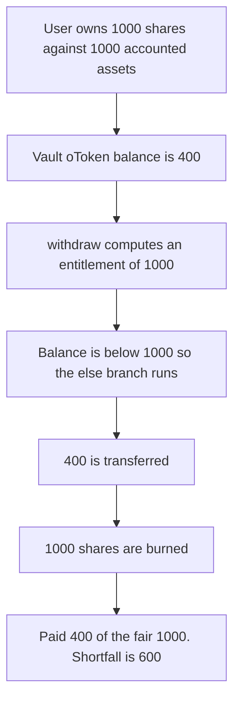

# Aarna — withdraw pays 400 of a 1000 entitlement

> **Vulnerability classes:** vuln/logic/missing-check · vuln/logic/wrong-condition

> **Reproduction:** a self-contained Foundry PoC that compiles and runs offline
> with only `forge-std` — no fork and no RPC. Trace: [output.txt](output.txt).
> PoC: [test/37167-potential-asset-under-disbursement-in-withdraw-function-of-a_exp.sol](test/37167-potential-asset-under-disbursement-in-withdraw-function-of-a_exp.sol).

<!-- non-defihacklabs -->
<!-- source-auditvault: https://github.com/Auditware/AuditVault/blob/main/findings/37167-potential-asset-under-disbursement-in-withdraw-function-of-a.md -->
<!-- date: 2024-01 -->

---

## Key info

| | |
|---|---|
| **Impact** | **HIGH** — the user is entitled to **1000 oToken** and is paid **400**. The **600** shortfall is not sent, and the **1000** shares are still burned |
| **Protocol** | Aarna `AFiBase.withdraw` |
| **Vulnerable code** | else branch transfers `balanceOf(address(this))` instead of reverting |
| **Bug class** | A short balance is paid out and treated as a full redemption |
| **Finding** | Zokyo — Aarna, 4 January 2024 · id 37167 |
| **Report** | [Zokyo Aarna report](https://github.com/solodit/solodit_content/blob/main/reports/Zokyo/2024-01-04-aarna.md) |
| **Source** | [AuditVault finding](https://github.com/Auditware/AuditVault/blob/main/findings/37167-potential-asset-under-disbursement-in-withdraw-function-of-a.md) |
| **Status** | Fixed by reverting when the balance cannot cover the entitlement. Reproduced here as a local synthetic. |
| **Compiler** | solc 0.8.27, cancun, via IR |

---

## TL;DR

`withdraw` computes `redFromContract` from the user's shares and the accounted assets. It then pays the full amount only when the contract's oToken balance is at least that large. Otherwise it transfers whatever balance it has.

The user owns **1000** shares against **1000** of accounted assets, so the fair payout is **1000**. The contract holds **400**. The else branch transfers **400** and the function still burns the **1000** shares. Paid **400**, fair **1000**, short **600**.

`run()` does not warp.

## The vulnerable code

```solidity
uint256 redFromContract = accountedAssets * shares / totalShares;
if (oToken.balanceOf(address(this)) >= redFromContract) {
    oToken.transfer(msg.sender, redFromContract);
} else {
    // @> VULN: balance is below the entitlement, and the shortfall is not reverted or recorded
    paid = oToken.balanceOf(address(this));
    oToken.transfer(msg.sender, paid);
}
sharesOf[msg.sender] -= shares;
```

The fixed function `require`s the balance to cover `redFromContract` before transferring. A vault holding **400** reverts and keeps the shares. After another **600** is minted to the vault, the same withdraw pays **1000**.

## Root cause

The entitlement and the token balance are different numbers. The code treats a smaller balance as a successful full redemption instead of leaving the position open or recording what is still owed.

## Preconditions

- Accounted assets are **1000** and the user holds all **1000** shares.
- The contract's oToken balance is **400**.
- No timestamp change happens inside `run()`.

## Attack walkthrough

1. The user withdraws **1000** shares.
2. `redFromContract` is **1000**. The balance check fails.
3. The else branch sets `paid` to **400** and transfers it.
4. The **1000** shares are burned and accounted assets fall by the full **1000**.
5. The user holds **400**. The gap versus the fair amount is **600**.

Control: the same short vault reverts with `"short"`, the shares stay at **1000**, and the user is paid **0**. After the vault is funded with the missing **600**, `withdraw` pays **1000**.

## Diagrams



## Impact

The withdrawing user receives **400 oToken** and loses a claim on **1000**. **600** of the entitlement is not paid, and the shares that represented it are gone.

## Remediation

Revert when `balanceOf(address(this))` is below `redFromContract`. Pay the full entitlement only when the tokens are present.

## Sources

- [AuditVault finding 37167](https://github.com/Auditware/AuditVault/blob/main/findings/37167-potential-asset-under-disbursement-in-withdraw-function-of-a.md)
- [Zokyo Aarna report, 4 January 2024](https://github.com/solodit/solodit_content/blob/main/reports/Zokyo/2024-01-04-aarna.md)

### Taxonomy

- `severity/high`
- `vuln/logic/missing-check`
- `vuln/logic/wrong-condition`
