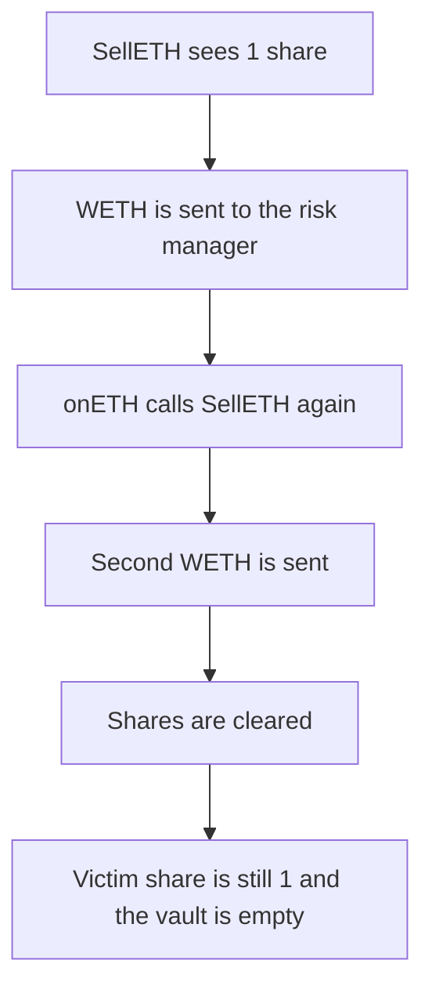

# TRZN — SellETH pays the risk manager before shares move

> **Vulnerability classes:** vuln/reentrancy/single-function · vuln/access-control/missing-modifier

> **Reproduction:** a self-contained Foundry PoC that compiles and runs offline
> with only `forge-std` — no fork and no RPC. Trace: [output.txt](output.txt).
> PoC: [test/37229-reentrancy-attack-is-possible-on-selleth-function-zokyo-none_exp.sol](test/37229-reentrancy-attack-is-possible-on-selleth-function-zokyo-none_exp.sol).

<!-- non-defihacklabs -->
<!-- source-auditvault: https://github.com/Auditware/AuditVault/blob/main/findings/37229-reentrancy-attack-is-possible-on-selleth-function-zokyo-none.md -->
<!-- date: 2024-01 -->

---

## Key info

| | |
|---|---|
| **Impact** | **HIGH** — a seller with **1** share receives **2 WETH**. The victim's **1 WETH** is gone and their share is still **1** |
| **Protocol** | TRZN `VaultETH.SellETH` |
| **Vulnerable code** | WETH transfer to the risk manager before `shares` is cleared |
| **Bug class** | Single-function reentrancy. The inherited guard is not applied |
| **Finding** | Zokyo — TRZN Finance · id 37229 |
| **Report** | [Zokyo TRZN Finance, 12 Jan 2024](https://github.com/solodit/solodit_content/blob/main/reports/Zokyo/2024-01-12-TRZN%20Finance.md) |
| **Source** | [AuditVault finding](https://github.com/Auditware/AuditVault/blob/main/findings/37229-reentrancy-attack-is-possible-on-selleth-function-zokyo-none.md) |
| **Status** | The report says the issue was resolved with `nonReentrant` and by moving the Ether transfer last. Reproduced as a local synthetic. |
| **Compiler** | solc 0.8.27, cancun, via IR |

---

## TL;DR

`SellETH` checks that the caller has a share, sends that much WETH to the risk manager, and only then writes the share balance to zero. The risk manager is a contract. Its `onETH` hook calls `SellETH` again while the share is still **1**. The vault held **2 WETH** (the caller's **1** and the victim's **1**). Both sends succeed. The victim's share is unchanged and the vault balance is **0**.

Clearing the share before the transfer makes the reentered call revert. Only **1 WETH** leaves, and the victim's **1 WETH** stays. `run()` does not warp.

## The vulnerable code

```solidity
function SellETH(uint256 amount) external {
    require(shares[msg.sender] >= amount, "shares");
    // @> VULN: Ether is sent to the risk manager before shares are cleared, and SellETH is not nonReentrant
    weth.transfer(riskManager, amount);
    shares[msg.sender] = 0;
}
```

## Root cause

The report says `SellETH` sends Ether to risk managers and that the contract's reentrancy guard is not applied to this function. The external call happens before the share write.

## Preconditions

- The vault holds **2 WETH**.
- The caller and the victim each have **1** share.
- The risk manager is the caller's contract.

## Attack walkthrough

1. `SellETH(1 ether)` sees one share.
2. WETH is transferred. `onETH` calls `SellETH` again.
3. The second call also sees one share and transfers another **1 WETH**.
4. Both calls then write the share to **0**.
5. The caller holds **2 WETH**. The victim still has **1** share against an empty vault.

## Diagrams



## Impact

The caller extracts the victim's **1 WETH** on top of their own **1 WETH**.

## Remediation

Write the share balance before the transfer, and mark `SellETH` `nonReentrant`, as the report recommends.

## How to reproduce

```bash
cd evm-hack-registry/37229-reentrancy-attack-is-possible-on-selleth-function-zokyo-none_exp
forge test -vv
```

## Sources

- AuditVault finding 37229
- Zokyo, TRZN Finance, 12 January 2024
