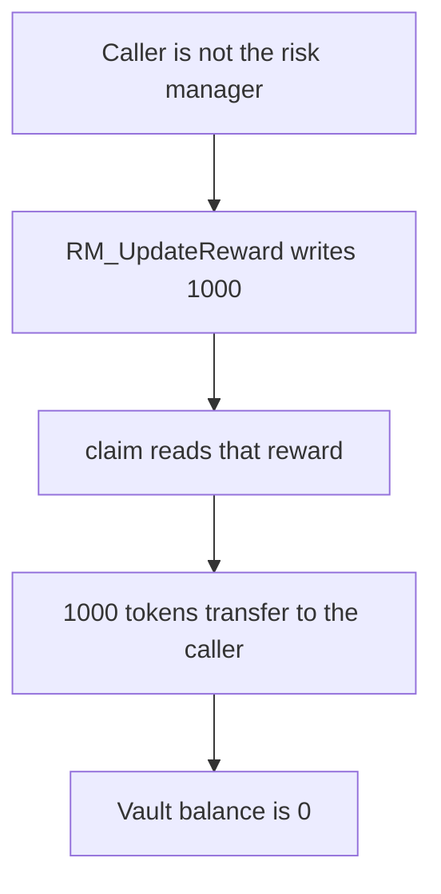

# TRZN — RM_UpdateReward has no access control

> **Vulnerability classes:** vuln/access-control/missing-modifier · vuln/access-control/missing-auth

> **Reproduction:** a self-contained Foundry PoC that compiles and runs offline
> with only `forge-std` — no fork and no RPC. Trace: [output.txt](output.txt).
> PoC: [test/37230-function-rm-updatereward-in-vaulteth-v2-has-no-access-contro_exp.sol](test/37230-function-rm-updatereward-in-vaulteth-v2-has-no-access-contro_exp.sol).

<!-- non-defihacklabs -->
<!-- source-auditvault: https://github.com/Auditware/AuditVault/blob/main/findings/37230-function-rm-updatereward-in-vaulteth-v2-has-no-access-contro.md -->
<!-- date: 2024-01 -->

---

## Key info

| | |
|---|---|
| **Impact** | **HIGH** — any caller sets the claimable reward to **1000** and takes the vault's reward tokens |
| **Protocol** | TRZN `VaultETH_V2.RM_UpdateReward` |
| **Vulnerable code** | `reward = newReward` with no caller check |
| **Bug class** | Missing risk-manager authorization |
| **Finding** | Zokyo — TRZN Finance · id 37230 |
| **Report** | [Zokyo TRZN Finance, 12 Jan 2024](https://github.com/solodit/solodit_content/blob/main/reports/Zokyo/2024-01-12-TRZN%20Finance.md) |
| **Source** | [AuditVault finding](https://github.com/Auditware/AuditVault/blob/main/findings/37230-function-rm-updatereward-in-vaulteth-v2-has-no-access-contro.md) |
| **Status** | The report says the issue was resolved. Reproduced as a local synthetic. |
| **Compiler** | solc 0.8.27, cancun, via IR |

---

## TL;DR

`RM_UpdateReward` is named for the risk manager. The stored risk manager is `0xbeef`. The function does not read `msg.sender`. A caller sets `reward` to **1000**, the vault's entire balance, and `claim` transfers it. The same call on a function that requires the risk manager reverts, and the **1000** tokens stay. `run()` does not warp.

## The vulnerable code

```solidity
function RM_UpdateReward(uint256 newReward) external {
    // @> VULN: RM_UpdateReward has no risk-manager check
    reward = newReward;
}
```

## Root cause

The report says any user can call a function that is supposed to be limited to risk managers. The reward value is what `claim` pays out of the vault.

## Preconditions

- The vault holds **1000** reward tokens funded for stakers.
- The caller is not the risk manager.

## Attack walkthrough

1. `RM_UpdateReward(1000 ether)` writes `reward`.
2. `claim` copies `reward`, zeroes it, and transfers **1000** tokens to the caller.
3. The vault balance is **0**.

## Diagrams



## Impact

Stakers lose the **1000** reward tokens. The caller did not stake and is not the risk manager.

## Remediation

Require `msg.sender` to be the risk manager before writing `reward`.

## How to reproduce

```bash
cd evm-hack-registry/37230-function-rm-updatereward-in-vaulteth-v2-has-no-access-contro_exp
forge test -vv
```

## Sources

- AuditVault finding 37230
- Zokyo, TRZN Finance, 12 January 2024, `VaultETH_V2.RM_UpdateReward`
